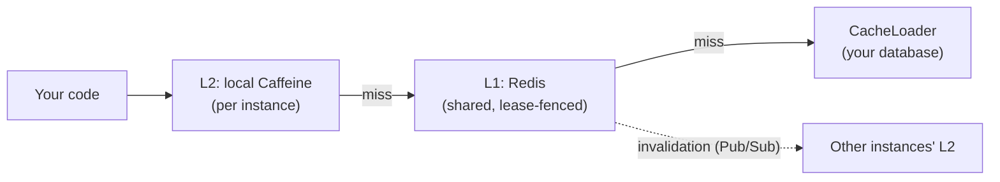

# CoCache

Level 2 Distributed Coherence Cache Framework

[](https://www.apache.org/licenses/LICENSE-2.0.html)
[](https://github.com/Ahoo-Wang/CoCache/releases)
[](https://central.sonatype.com/artifact/me.ahoo.cocache/cocache-core)
[](https://www.codacy.com/gh/Ahoo-Wang/CoCache/dashboard?utm_source=github.com&amp;utm_medium=referral&amp;utm_content=Ahoo-Wang/CoCache&amp;utm_campaign=Badge_Grade)
[](https://codecov.io/gh/Ahoo-Wang/CoCache)
[](https://github.com/Ahoo-Wang/CoCache/actions/workflows/ci.yml)
[](https://deepwiki.com/Ahoo-Wang/CoCache)

> **Documentation:** [English](https://cocache.ahoo.me/) | [中文](https://cocache.ahoo.me/zh/)

CoCache gives Spring Boot services local-memory read latency without serving stale data indefinitely. Each instance keeps an in-process copy (L2, Caffeine) in front of a shared copy (L1, Redis) in front of your data source. Redis serializes every write per key, so a slow load can never overwrite a newer invalidation, and every `put` or `invalidate` tells the other instances to drop their local copy in the same round trip.



## Quick start

```kotlin
implementation("me.ahoo.cocache:cocache-spring-boot-starter:6.0.0")
implementation("org.springframework.boot:spring-boot-starter-data-redis")
```

```kotlin
@CoCache(ttl = 120)                               // seconds; defaults: ttl 3600, ttlJitter 60, absentTtl 60, localMaxAge 300
interface UserCache : Cache<String, User>         // CoCache generates the implementation

@EnableCoCache(caches = [UserCache::class])
@SpringBootApplication
class AppServer

@Configuration
class UserCacheConfiguration {
    @Bean // matched to UserCache by its generic type; returning null caches "not found" for absentTtl
    fun userLoader(repo: UserRepository) = CacheLoader<String, User> { id -> repo.findById(id) }
}

// usage
val user = userCache[id]              // L2 → L1 → CacheLoader
userRepository.save(changed)          // write: commit the source of truth first,
userCache.invalidate(changed.id)      // then invalidate — every instance drops its copy
```

Prefer no annotations? Declare a spec bean instead and inject `Cache<String, User>`:

```kotlin
@Bean
fun userSpec(repo: UserRepository): CacheSpec<String, User> = cacheSpec("user") {
    codec = jacksonCodec<User>(JsonMapper.builder().findAndAddModules().build())
    loader = CacheLoader { id -> repo.findById(id) }
    policy { ttl = Duration.ofMinutes(2) }
}
```

The [Quick Start](https://cocache.ahoo.me/guide/quick-start) walks through each step. Coming from 5.x? Read the [5.x → 6.0 migration guide](https://cocache.ahoo.me/guide/migration-6).

## Features

- **Two levels, one API.** `get`, `getAll`, `lookup`, `put`, `invalidate`, `invalidateAll` on `Cache<K, V>`, declared as an `@CoCache` interface or a `CacheSpec` bean.
- **Lease-fenced L1.** A miss takes a lease in Redis, and only the lease holder may fill. Concurrent misses across the cluster load once when the loader finishes within `lease-wait`.
- **Atomic invalidation.** Delete and broadcast happen in one Lua script. Failed invalidations are retried in the background.
- **Negative caching.** A loader that returns `null` stores "not found" for `absentTtl`.
- **Refresh ahead.** With `refreshWindow`, one node per key reloads a hot value before it expires.
- **Batch reads.** `getAll` reads L1 in about one round trip and calls `CacheLoader.loadAll` once.
- **`SetCache`.** Atomic element add and remove for sets whose only copy is Redis.
- **`JoinCache`.** A read-only view that joins two caches (for example an order and its user) with two batch reads, declared with `@JoinCacheable`.
- **Spring Cache and transactions.** `@Cacheable` through `CoCacheSpringCacheManager`, and `TransactionalInvalidator` to invalidate after commit.
- **Observability.** Micrometer metrics, a `cocache` health indicator, and the `cocache` actuator endpoint, which can inspect or invalidate a single key.
- **Local development without Redis.** `cocache.backend: memory` runs caches in process for tests and local runs.
- **Redis topologies.** Standalone, Sentinel, and Cluster through Lettuce, with classic or sharded Pub/Sub (`cocache.redis.channel-mode`).

## Guarantees

- **Bounded staleness.** Races inside the protocol leave no stale value in Redis. Writes that bypass CoCache heal within `ttl`. A lost invalidation message leaves a peer's local copy stale for at most `localMaxAge` (5 minutes by default), and every channel reconnect clears L2.
- **No lost invalidations.** A load that started before an invalidation can write neither Redis nor the local copy after it.
- **Not linearizable.** Peers see a change once the invalidation message arrives.

[Consistency](https://cocache.ahoo.me/architecture/consistency) states the full model. The normative design and its invariants are in [`docs/architecture.md`](docs/architecture.md).

## Documentation map

| You want to… | Read |
|--------------|------|
| Use CoCache | [Guide](https://cocache.ahoo.me/guide/): why CoCache, quick start, how it works, declaring caches, keeping data fresh, JoinCache, Spring Cache, testing, configuration reference |
| Upgrade from 5.x | [Upgrading from 5.x](https://cocache.ahoo.me/guide/migration-6) and the [changelog](https://cocache.ahoo.me/guide/changelog) |
| Run it in production | [Operations](https://cocache.ahoo.me/operations/): deployment, observability, troubleshooting |
| Understand or extend it | [Architecture](https://cocache.ahoo.me/architecture/): design, consistency, SPI and TCK |
| Change CoCache itself | [`CONTRIBUTING.md`](CONTRIBUTING.md), then [`docs/architecture.md`](docs/architecture.md) |
| Work on it as an AI agent | [`AGENTS.md`](AGENTS.md) and the [`skills/cocache`](skills/cocache/SKILL.md) skill |

## Contributing

See [CONTRIBUTING.md](CONTRIBUTING.md). Report security issues privately per [SECURITY.md](SECURITY.md).

## License

[Apache License 2.0](LICENSE)
