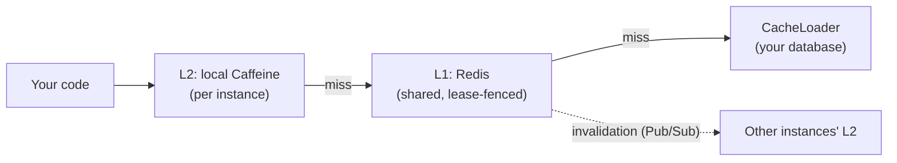

# CoCache

Level 2 Distributed Coherence Cache Framework

[](https://www.apache.org/licenses/LICENSE-2.0.html)
[](https://github.com/Ahoo-Wang/CoCache/releases)
[](https://central.sonatype.com/artifact/me.ahoo.cocache/cocache-core)
[](https://www.codacy.com/gh/Ahoo-Wang/CoCache/dashboard?utm_source=github.com&amp;utm_medium=referral&amp;utm_content=Ahoo-Wang/CoCache&amp;utm_campaign=Badge_Grade)
[](https://codecov.io/gh/Ahoo-Wang/CoCache)
[](https://github.com/Ahoo-Wang/CoCache/actions/workflows/ci.yml)
[](https://deepwiki.com/Ahoo-Wang/CoCache)

> **Documentation:** [English](https://cocache.ahoo.me/) | [中文](https://cocache.ahoo.me/zh/)

CoCache gives Spring Boot services local-memory read latency without serving stale data indefinitely. Each instance keeps an in-process copy (L2, Caffeine) in front of a shared copy (L1, Redis) in front of your data source. Redis serializes every write per key, so a slow load can never overwrite a newer invalidation, and every `put` or `invalidate` tells the other instances to drop their local copy in the same round trip (with the default atomic broadcast; sharded or non-atomic mode takes two round trips).



**Requirements:** JDK 21+, Spring Boot 4, and Redis 7.0+ (or Valkey 7.2+): standalone, Sentinel or Cluster. Tests and local runs need no Redis (`cocache.backend: memory`). Plain Kotlin or Java works too, through `CacheRuntime` and `CoCacheFactory`.

## Pick a type

Ask one question about each piece of data: **if Redis loses this key, can this process rebuild it?**

| Answer | Type | For |
|--------|------|-----|
| Yes | `Cache<K, V>` | Rows a `CacheLoader` can fetch again; or, declared `externallySourced()` (`@CoCache(source = EXTERNAL)`), values that callers supply, such as Spring Cache methods |
| Yes | `VersionedCache<K, V>` | A read model a versioned loader rebuilds, written by version (`putIfNewer`) so replays can't regress it |
| No | `Store<K, V>` | Data whose only copy is Redis: sessions, revocation lists, one-time codes; compare-and-set with `putIfMatch` / `deleteIfMatch` |
| No | `VersionedStore<K, V>` | Only-copy data whose writers must survive late or replayed writes |
| No | `SetStore<K, E>` | A set whose only copy is Redis, with atomic `add` / `remove` |

Each type has only the operations that are safe for its role (a `Store` has no `invalidate`, a `VersionedCache` no `put`), and all of them read the same way, with async and suspending views. [Choosing and Declaring Caches](https://cocache.ahoo.me/guide/caches#types) walks through the choice.

## Quick start

```kotlin
implementation("me.ahoo.cocache:cocache-spring-boot-starter:8.0.0-alpha.5")
implementation("org.springframework.boot:spring-boot-starter-data-redis")
```

```kotlin
@CoCache(ttl = 120)                               // seconds; defaults: ttl 3600, ttlJitter 60, absentTtl 60, localMaxAge 300
interface UserCache : Cache<String, User>         // CoCache generates the implementation

@EnableCoCache(caches = [UserCache::class])
@SpringBootApplication
class AppServer

@Configuration
class UserCacheConfiguration {
    @Bean // matched to UserCache by its generic type; returning null caches "not found" for absentTtl
    fun userLoader(repo: UserRepository) = CacheLoader<String, User> { id -> repo.findById(id) }
}

// usage
val user = userCache[id]              // L2 → L1 → CacheLoader
userRepository.save(changed)          // write: commit the source of truth first,
userCache.invalidate(changed.id)      // then invalidate — every instance drops its copy
```

Prefer no annotations? Declare a spec bean instead and inject `Cache<String, User>`:

```kotlin
@Bean
fun userSpec(mapper: ObjectMapper, repo: UserRepository): CacheSpec<String, User> = cacheSpec("user") {
    codec = jacksonCodec<User>(mapper)   // the application's Jackson 3 ObjectMapper; a spec always names its codec
    loader = CacheLoader { id -> repo.findById(id) }
    policy { ttl = Duration.ofMinutes(2) }
}
```

Configuration comes in three layers, merged field by field. Every duration needs a unit:

```yaml
cocache:
  key-prefix: "${spring.application.name}:"   # separates applications that share a Redis
  defaults:
    cache:
      local-max-age: 2m      # below the declarations: fills only fields they leave unset
  overrides:
    cache:
      ttl: 30m               # only tightens: no Cache keeps a value longer
  caches:
    "[UserCache]":
      load-max-concurrent: 32   # one cache, set last
```

The [Quick Start](https://cocache.ahoo.me/guide/quick-start) walks through each step, and the [Configuration Reference](https://cocache.ahoo.me/guide/configuration) lists every key.

## Features

- **Lease-fenced L1.** A miss takes a lease in Redis, and only the lease holder may fill. Concurrent misses across the cluster load once when the loader finishes within `lease-wait`.
- **Atomic invalidation.** Delete and broadcast happen in one Lua script. Failed invalidations, and puts whose outcome is unknown, are retried in the background as invalidations.
- **Negative caching.** A loader that returns `null` stores "not found" for `absentTtl`.
- **Refresh ahead.** With `refreshWindow`, one node per key reloads a hot value before it expires.
- **Batch reads.** `getAll` reads L1 in about one round trip and calls `CacheLoader.loadAll` once.
- **Honest failures.** A read without a source (`Store`, `VersionedStore`, `SetStore`, an externally sourced `Cache`) that can't reach Redis returns `Lookup.Unknown` instead of pretending the key is absent; writes to an only copy throw instead of retrying later.
- **Three-layer configuration.** `cocache.defaults` below the declarations, `cocache.overrides` that only tighten, `cocache.caches.[name]` for one cache. The actuator endpoint reports each field's effective value and where it came from.
- **`CoCacheFactory` for libraries.** A library creates its caches through the `CoCacheFactory` bean and locks the fields its correctness depends on, so application configuration can't weaken them.
- **Join views.** `@JoinCacheable` joins two caches (for example an order and its user) with two batch reads: a `JoinView` is read only, over any two types; a `JoinCache`, over two `Cache`s, can also invalidate.
- **Async API and coroutines.** `cache.async()` returns `CompletableFuture`s on the same cache without parking a thread, and `cache.suspending()` gives every type a suspending view, with `SuspendingCacheLoader` for loaders. A `@CoCache` interface can also extend a view, for example `interface UserCache : SuspendingCache<String, User>`.
- **Spring Cache and transactions.** `@Cacheable(sync = true)` through `CoCacheSpringCacheManager`; `@CacheEvict` and `TransactionalInvalidator` invalidate after the commit and after a rollback, and loads inside a rolled-back write transaction are invalidated.
- **Observability.** Micrometer metrics, a `cocache` health indicator, and the `cocache` actuator endpoint, which can inspect, invalidate or broadcast a single key, and reports each cache's keyspace and effective policy.
- **Redis topologies.** Standalone, Sentinel, and Cluster through Lettuce, with classic or sharded Pub/Sub (`cocache.redis.channel-mode`).

## Guarantees

- **Bounded staleness.** Races inside the protocol leave no stale value in Redis. Writes that bypass CoCache heal within `ttl`. A lost invalidation message leaves a peer's local copy stale for at most `localMaxAge` (5 minutes by default), and every channel reconnect clears L2.
- **No lost invalidations.** A load that started before an invalidation can write neither Redis nor the local copy after it.
- **Not linearizable.** Peers see a change once the invalidation message arrives.

[Consistency](https://cocache.ahoo.me/architecture/consistency) states the full model. The normative design and its invariants are in [`docs/architecture.md`](docs/architecture.md).

## Documentation map

| You want to… | Read |
|--------------|------|
| Start | [Guide](https://cocache.ahoo.me/guide/): why CoCache, [quick start](https://cocache.ahoo.me/guide/quick-start), [how it works](https://cocache.ahoo.me/guide/concepts) |
| Choose and declare caches | [Choosing and Declaring Caches](https://cocache.ahoo.me/guide/caches), then one guide per type: [`Cache`](https://cocache.ahoo.me/guide/cache), [`VersionedCache`](https://cocache.ahoo.me/guide/versioned-cache), [`Store`](https://cocache.ahoo.me/guide/store), [`VersionedStore`](https://cocache.ahoo.me/guide/versioned-store), [`SetStore`](https://cocache.ahoo.me/guide/set-store) |
| Use CoCache | [Keeping data fresh](https://cocache.ahoo.me/guide/freshness), [JoinCache](https://cocache.ahoo.me/guide/join-cache), [Spring Cache](https://cocache.ahoo.me/guide/spring-cache), [async](https://cocache.ahoo.me/guide/async), [coroutines](https://cocache.ahoo.me/guide/coroutines), [testing](https://cocache.ahoo.me/guide/testing), [native images](https://cocache.ahoo.me/guide/native), [configuration reference](https://cocache.ahoo.me/guide/configuration) |
| Upgrade | [Upgrading from 6.x](https://cocache.ahoo.me/guide/upgrade) and the [changelog](https://cocache.ahoo.me/guide/changelog) |
| Run it in production | [Operations](https://cocache.ahoo.me/operations/): deployment, [observability](https://cocache.ahoo.me/operations/observability), [troubleshooting](https://cocache.ahoo.me/operations/troubleshooting) |
| Understand or extend it | [Architecture](https://cocache.ahoo.me/architecture/): design, [consistency](https://cocache.ahoo.me/architecture/consistency), [SPI and TCK](https://cocache.ahoo.me/architecture/extending) |
| Change CoCache itself | [`CONTRIBUTING.md`](CONTRIBUTING.md), then [`docs/architecture.md`](docs/architecture.md) |
| Work on it as an AI agent | [`AGENTS.md`](AGENTS.md) to change CoCache itself; the [agent skills](skills/README.md) (`cocache-develop`, `cocache-extend`) for applications that use it |

## Contributing

See [CONTRIBUTING.md](CONTRIBUTING.md). Report security issues privately per [SECURITY.md](SECURITY.md).

## License

[Apache License 2.0](LICENSE)
