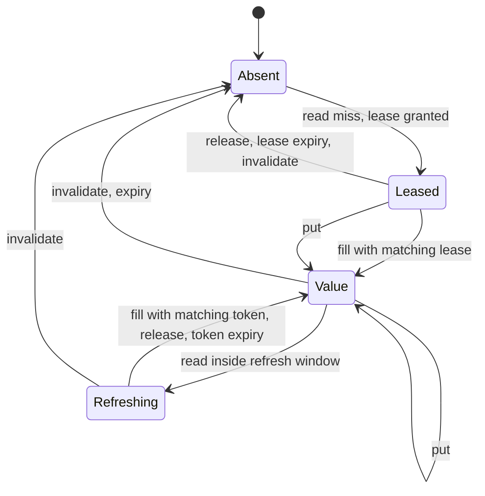
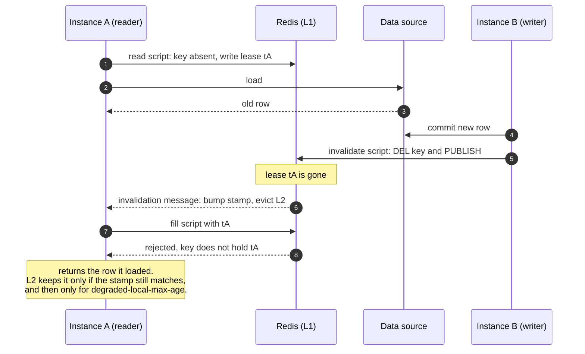
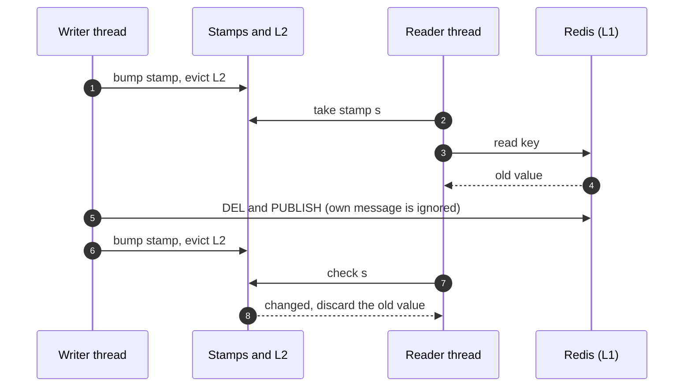
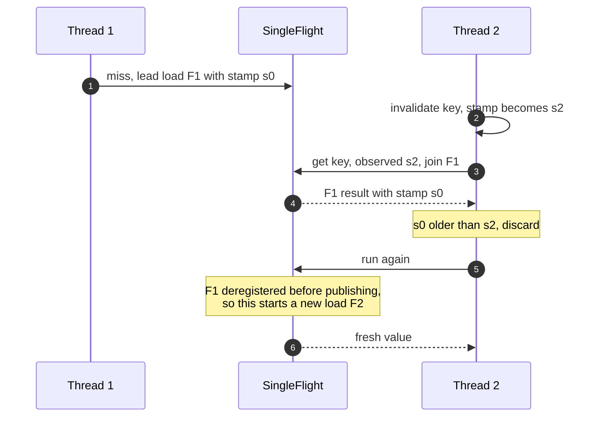
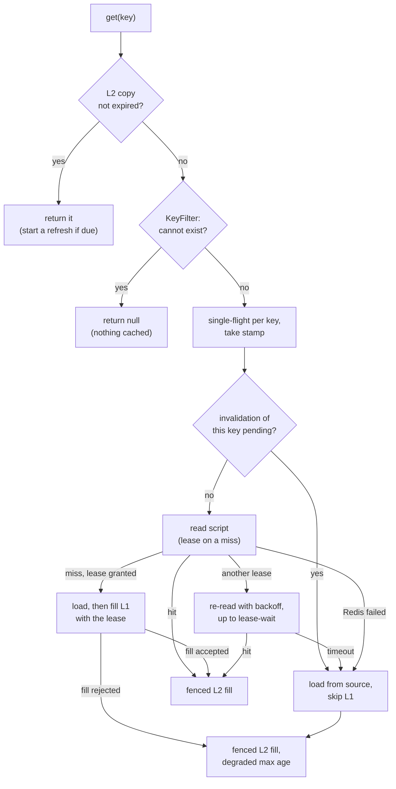

# Consistency

This page states what CoCache guarantees and why. It is rigorous enough to check against the code, and every claim maps to [`docs/architecture.md`](https://github.com/Ahoo-Wang/CoCache/blob/main/docs/architecture.md), the normative specification.

## The one interleaving {#the-problem}

Every correctness problem in a cache is the same race: **a copy that started before an invalidation lands after it.**

1. Reader A misses and starts loading. It reads the old row.
2. Writer B commits a new row and invalidates the key.
3. A finishes and writes the old row into the cache, after B's invalidation.

Nothing will remove that copy until it expires. CoCache has two copies that can go stale this way, L1 in Redis and L2 in each instance, and it closes the race at both with one rule.

## The fence rule {#fences}

> **A fill must hold a token taken before its read. An invalidation destroys the token, before and after it changes the level below.**

| Level | Token | Filler | Invalidator |
|-------|-------|--------|-------------|
| L1 (Redis) | A **lease**, taken atomically by the read script on a miss, or a **refresh token**, taken atomically when a value enters its refresh window | The fill script writes only if the key still holds that exact token | `DEL`, an overwrite, or a set update replaces the key, and with it the token |
| L2 (one per instance) | An **invalidation stamp**: a counter per key stripe (4,096 stripes) | Take the stamp, read L1, check the stamp, write L2, check again, undo on mismatch | Bump the stamp and evict L2, change L1, then bump and evict again |

Tokens are built by the client from the runtime's `NodeId` and a sequence number, so they are unique across the cluster and never reissued. A destroyed token can't match again, so there is no ABA problem. Stamp stripes can collide: two keys share a counter, and a fill is occasionally discarded for nothing. That costs a reload, never correctness.

## L1: leases {#l1-fence}

Every key in L1 moves through these states. Each transition is one Lua script, so it is atomic, and each one sets the expiry explicitly, so a lease's or a negative entry's lifetime never leaks onto a value.



"Value" includes negative entries and sets. A `put` overwrites any state and destroys any token.

The race from above, with a lease:



- If B's invalidation comes **after** A took the lease, it destroys the lease, and A's fill is rejected. The old row never reaches L1.
- If B's invalidation comes **before** A took the lease, A's load starts after B's commit and reads the new row.

Either way, **no load that started before an invalidation appears in L1 after it.** This holds on every instance, for any loader duration, and needs no clock.

Leases also coalesce loads across the cluster. A miss that finds another instance's lease re-reads with a backoff from 2 to 50 ms, for up to `lease-wait` (or the lease's remaining time, if shorter). If the value appears, it is used. If not, the instance loads itself without writing L1. Leases are always released when unused: when the loader, `ttlOf`, or the codec throws, when the load is rejected by `load-max-concurrent`, and when a cache has no loader. A crashed instance's lease expires after `lease-ttl`.

A rejected fill still returns its result to the caller and keeps it in L2 for `degraded-local-max-age` (10 s by default). Otherwise a key whose loader is slower than `lease-ttl` would miss forever.

## L2: invalidation stamps {#l2-fence}

Each instance has a stamp counter per key stripe. A fill takes the stamp **after** registering with single-flight and **before** reading L1, and keeps that one stamp for the whole call, including lease waits:

```
stamp = stamps.current(k)
value = read L1 (and maybe load and fill)
if stamps.current(k) != stamp: discard              // check before writing
L2.put(k, value)
if stamps.current(k) != stamp: L2.invalidate(k)     // re-check after writing
```

An invalidator bumps the stamp and evicts L2 both **before and after** changing L1. Here is why the second bump is needed, for a reader and a writer on the same instance:



With only the first bump, the reader takes its stamp after it, reads the old value before the script runs, and both checks pass. The instance ignores its own message, so nothing would ever remove that copy. With the second bump, the reader either fails its check, or it wrote L2 before the second bump and the eviction right after the bump removes it.

**A remote invalidation is the same step.** An instance that receives a message bumps the stamp and evicts L2, exactly like the second bump. Serving the old value before the message arrives is the allowed "event delay".

**L2 is only ever filled from a read of L1.** Writers never write L2. A stamp can tell whether an invalidation happened during a fill, but not which of two writes reached Redis first. If `put` wrote L2, two concurrent `put`s on one instance could leave the older value in L2 while Redis holds the newer one. Filling L2 only from L1 keeps L2 in L1's order. The cost is one extra Redis round trip on the first read after a `put`.

## Read-your-writes {#read-your-writes}

After `invalidate` or `put` returns, the same instance never serves the previous value. This needs one more ordering, because a read can join a load that is already in flight.

A read records the key's stamp before it joins single-flight. If the load it joined started with an older stamp, that load began before an invalidation this reader has already seen, so the reader discards the result and runs once more.



This works because **single-flight deregisters a call before it publishes the result**. A waiter that wakes up and retries can't join the same stale call again, so one retry is always enough.

Single-flight also guarantees: one load per key per instance at a time, every waiter gets the leader's result or its original exception, a loader that reads its own key on the same thread fails fast instead of deadlocking, and a batch leader finishes its own keys before waiting on keys led by others.

## Writer order {#writer-order}

| Operation | Steps | Round trips |
|-----------|-------|-------------|
| `invalidate`, `invalidateAll` | bump, evict L2 → script: `DEL` + `PUBLISH` → bump, evict L2 | 1 (per batch of 512 keys, and per slot in Cluster) |
| `put` | bump, evict L2 → script: overwrite + expiry + `PUBLISH` → bump, evict L2. L2 is not written. | 1 |
| `SetCache.add` / `remove` / `clear` / `put` | bump, evict L2 → script: member update + expiry + `PUBLISH` → bump, evict L2 | 1 |
| Message from another instance | bump, evict L2. Messages from this instance's own `NodeId` are skipped. | — |
| Reset (subscription confirmed, heartbeat failed), `clearLocal` | bump every stripe, clear L2 | — |

The second bump happens whether or not the script succeeded. With a backend that can't broadcast atomically, the engine publishes right after the script succeeds. A failed publish counts as a failed write.

**The caller's part: change the source first, then invalidate.** Invalidating before the commit is itself the race: a concurrent miss can load the uncommitted row after the invalidation. Inside transactions, `TransactionalInvalidator` defers invalidations to `afterCommit`.

## The invalidation channel {#invalidation-channel}

Each instance has one subscription connection and dispatches messages to caches by namespace, on the channel `cocache:inv:{namespace}`. Delivery is **at most once**: a message published while an instance is disconnected, or dropped by an output-buffer limit, is gone. Three mechanisms bound the damage:

1. **Reset on (re)subscription.** When Redis confirms a subscription, every cache on that channel bumps all its stamps and clears its L2. The first subscription waits for that confirmation (up to `command-timeout`), so a reset never lands after the cache starts filling. Lettuce resubscribes after a reconnect, and the confirmation resets again. Adding a cache doesn't reset the others.
2. **Heartbeat.** The subscription connection is pinged every `heartbeat` (5 s). A failed or slow ping resets every cache and forces a reconnect, so a half-open connection is detected within seconds. In `sharded` mode on Redis Cluster, the heartbeat also checks that each channel is still subscribed on the master that owns its slot, and resubscribes after a failover or slot migration. Until Redis confirms the new subscription, every heartbeat resets the caches on that channel again, as a failed ping does.
3. **`local-max-age`.** No L2 copy outlives it, whatever happens to messages. It must be finite, and it is the bound when a message is lost without the connection noticing.

| Mode | Broadcast | Consequence |
|------|-----------|-------------|
| `pubsub` (default) | `PUBLISH` inside the write script | The L1 change and the broadcast are one atomic step. No client-side window. |
| `sharded` | `SPUBLISH` right after the script | A crash between the two loses the message. Peers then serve their L2 copy for up to `local-max-age`. L1 is already correct. |

In `pubsub` mode the backend probes at startup whether a script may publish to a channel in another slot. Where it may not (some managed services, or an ACL), it publishes after the write, like `sharded`. It publishes even when the write fails, because a failed write may have partly taken effect (a `putAll` that spans several slot groups, or a write applied in Redis whose reply was lost). An extra invalidation only evicts copies. See [Deployment](../operations/index.md#channel-mode).

## Read path {#read-path}



- **L2 expiry** is `min(L1 remaining TTL, local-max-age)` for a copy filled from or into L1, and `min(TTL, degraded-local-max-age)` for a copy that bypassed L1. A hit is one map lookup and one comparison against the ticking clock.
- **An L1 miss is a miss.** An absent key, a lease, or unreadable content never means "doesn't exist". Only a stored negative entry (state `M`) does, written when the loader returns `null` (or omits a key from `loadAll`), for `absent-ttl`.
- **A cache without a loader** releases its lease on a miss, writes nothing to L1 (a negative entry would hide another instance's later `put`), and remembers "no answer" in L2 for `absent-ttl`. `get(key, loader)` ignores that and loads with the caller's loader.
- **The read path never deletes unconditionally.** Unreadable content (foreign bytes, or a value the codec can't decode) is converted to a lease only if Redis still holds exactly the bytes that were read (compared by SHA-1 in the script). Then it reloads normally. If the content changed, the read loads without writing L1. Content in a newer format is never reclaimed or overwritten.
- **Batch reads** (`getAll`) check L2 per key, then the leader takes stamps, reads every missed key from L1 in one pipelined round trip (requesting leases), calls `loadAll` once, and fills once. They join in-flight single-key loads. They don't wait for other instances' leases: those keys load without writing L1. A shared result that started before an invalidation this reader has seen goes through the single-key path.
- **The loader runs on the caller's thread**, so transactions, security context, and MDC are available. Redis futures are awaited on the caller's thread. Nothing runs on the event loop.

### Refresh ahead {#refresh-ahead}

With a `refresh-window`, an L2 copy records when its L1 value enters the window. A hit after that point returns the current value and submits one background refresh per key per instance. The refresh reads with a **refresh token** request. Redis grants the token only to a value whose remaining TTL is within the window and that has no live token, so one instance in the cluster reloads and fills with the token. The others refill L2 from L1. `invalidate`, `put`, and set updates destroy the token, so a refresh is fenced like any fill. A token older than `lease-ttl` can be taken over. A refresh that is rejected by the executor or fails only logs: the value expires normally.

An instance that doesn't get the token finds the value still inside the window, so a plain refill would leave its copy due for refresh on every hit, polling Redis at the hit rate until the holder fills (or, if the holder crashed, until its token outlives `lease-ttl`). Instead the refilled copy's refresh point is `min(b, remaining / 2)` from now, where `b` is `lease-wait` with a 100 ms floor. The next read comes after the holder has had time to fill, and always before the old value expires. The fill doesn't broadcast (a broadcast would turn every instance's next hit into a miss), so this re-read is how the other instances get the new value. If the token has outlived `lease-ttl` by then, the re-reader takes it over.

Any other copy created with no more than the window left (a fill, an L1 hit, a degraded fill) gets no refresh point. Each fill clears the token, so a value whose lifetime is within the window, from a short `ttlOf` or `put(key, value, ttl)`, would otherwise be reloaded by the token holder on every hit. Such values just expire. See [architecture.md §5.5](https://github.com/Ahoo-Wang/CoCache/blob/main/docs/architecture.md).

## Failure handling {#failures}

| Failure | What happens | Why it stays safe |
|---------|--------------|-------------------|
| Redis read fails | Default: load from the source, L2 only, `degraded-local-max-age`. Or throw (`read-failure: throw`). | No L1 write without a lease. The L2 copy is stamp-fenced and short-lived. |
| Fill or release fails, or times out | Logged and counted. The result is returned. | A fill is token-guarded: if it was applied, it was applied before any invalidation, because an invalidation would have destroyed the token. An unreleased lease expires after `lease-ttl`. |
| `invalidate` fails | Local effect first (both bumps and evictions). Default: retried in the background (8 attempts, 100 ms to 10 s backoff, 10,000 queued), not thrown. Meanwhile, misses for the key on this instance skip L1. After success, the instance bumps and evicts once more. | This instance never serves or refills the old value. Other instances are bounded by L1's remaining TTL. A give-up is counted in `invalidations.dropped` and logged as an error. |
| `put` or set write fails | Local effect first, then `CacheWriteException`. On a timeout, Redis may have applied it. | L2 was evicted on both sides of the attempt, so no stale local copy. The calls are idempotent. |
| Redis disconnected | Commands are rejected, not buffered. | A buffered `put` that already failed for the caller could otherwise replay later and overwrite a newer value. |
| Loader throws | The lease is released at once. The exception goes to the caller and every coalesced waiter. | Other instances don't wait for `lease-ttl`. |
| Instance crashes holding a lease | Others wait up to `lease-wait`, then load without writing L1. The lease expires after `lease-ttl`. | No fill without a live token. |
| Subscription lost | Heartbeat or resubscription resets every L2. | Messages lost during the outage can't leave L2 stale past the reset. |
| Script cache lost (failover, restart) | `NOSCRIPT` is retried with `EVAL`. | — |
| Redis failover loses recent writes | A deleted value can reappear in L1. | Outside the protocol: bounded by `ttl`. |

## Staleness bounds {#staleness-bounds}

These bounds are the precise form of goal G1. "Stale" means serving a value older than the source's latest committed value.

| Situation | Bound | Exact condition |
|-----------|-------|-----------------|
| Races inside the protocol, in L1 | **0** | Writers change the source first, then invalidate or `put` through CoCache |
| The same instance after `invalidate` / `put` returns | **0** | Read-your-writes |
| Other instances' L2, message delivered | Message latency | Normally milliseconds |
| Other instances' L2, message lost and the connection noticed | `min(local-max-age, heartbeat + reconnect time)` | The heartbeat fails or the subscription is re-established, which resets L2 |
| Other instances' L2, message lost silently | `local-max-age` | Default 5 minutes. Also the bound in `sharded` mode when a writer crashes between script and publish. |
| L2 copy that bypassed L1 (degraded fill) | `degraded-local-max-age` | Redis failure, lease wait timeout, rejected fill, unknown format, pending invalidation |
| Invalidation still being retried | Until the retry succeeds | The writing instance skips L1. Others may refill L2 from the old L1 value. |
| Invalidation dropped | L1's remaining TTL, on every instance | Each L2 copy expires and refills from the old L1 value. Unbounded with `ttl-forever`. Counted and logged. |
| Writes outside the protocol, lost writes in a failover, a loader reading a lagging replica | The value's remaining TTL in L1 (`ttl`, plus or minus jitter) | Unbounded with `ttl-forever`. Negative entries: `absent-ttl`. |
| `@Cacheable` without `sync = true` | `ttl` | Spring's unconditional `put` bypasses the lease |

## What is not guaranteed {#not-guaranteed}

- **Linearizable reads.** Two instances can briefly disagree, between a write and the arrival of its message.
- **Changes CoCache never sees.** A write that bypasses CoCache without the [invalidation protocol](../operations/troubleshooting.md#external-invalidation) leaves the old value until `ttl`.
- **Durability of Redis.** A failover can lose recent writes, both values and invalidations.
- **Atomic snapshots across caches.** A [JoinCache](../guide/join-cache.md) reads two caches, each with its own guarantees, not one consistent snapshot.

## Set caches {#set-cache}

`SetCache` is the deliberate exception to "Redis is a copy": Redis holds the **only** copy of the set.

- Element `add` and `remove` are atomic in Redis, so concurrent updates from any instances are all kept, in Redis's order.
- There is no loader. `invalidate` throws, because it would destroy the only copy. Use `clear(key)` to delete a set.
- Reads take no lease. A miss caches the empty answer in L2, stamp-fenced, for `local-max-age`. A failed Redis read throws, because there is no source to fall back to.
- The default `ttl` is forever, and durability is Redis's durability, so the Redis `maxmemory-policy` must not be `allkeys-*`. See [Deployment](../operations/index.md#maxmemory-policy).

If the set's data lives in your database, declare `Cache<K, Set<E>>` instead and invalidate after each change. Incremental updates can't be ordered correctly against database commits.
