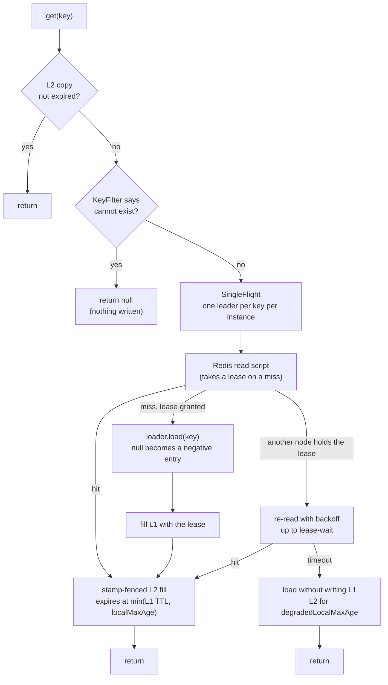

# Consistency

This page describes the read, write, and invalidation paths, and why they can't lose an invalidation. The normative version is section 4 of [RFC 0003](https://github.com/Ahoo-Wang/CoCache/blob/main/docs/rfc/0003-target-architecture.md) and [`docs/architecture.md`](https://github.com/Ahoo-Wang/CoCache/blob/main/docs/architecture.md).

## The problem: a fill that lands after an invalidation {#the-problem}

Every correctness problem in a cache is one interleaving. A copy that started early lands after an invalidation:

1. Reader A misses and starts loading. It reads the old row.
2. Writer B updates the row and invalidates the key.
3. A finishes and writes the old row into the cache, after B's invalidation.

CoCache prevents this with one rule, the **fence**: *a fill must hold a token taken before its read, and an invalidation destroys the token.* L1 and L2 each have their own token.

| Level | Token | Filler | Invalidator |
|-------|-------|--------|-------------|
| L1 (Redis) | A **lease**, taken atomically by the read script on a miss, or a **refresh token** | The fill script writes only if L1 still holds its token | `DEL` or an overwrite destroys the token |
| L2 (per instance) | An **invalidation stamp**: a striped counter per key (4,096 stripes) | Read the stamp, read L1, check the stamp, write L2, check again and undo on failure | Bump the stamp **before and after** changing L1, and evict L2 each time |

Tokens are built by the client from the `NodeId` and a sequence number, so they are globally unique and never reissued. A destroyed lease can never match again.

## Read path

- **Load coalescing.** Concurrent misses for one key on one instance share one Redis read and one load. Waiters get the leader's result or its original exception. A loader that reads its own key on the same thread fails fast instead of deadlocking.
- **Cluster-wide coalescing.** On a miss, the read script atomically writes a lease placeholder, so exactly one node in the cluster loads. Others re-read with a short backoff for up to `lease-wait` (200 ms). If the holder hasn't filled by then, they load themselves, don't write L1, and keep the result in L2 for `degradedLocalMaxAge`.
- **Leases are always released or expire.** If the loader throws, is rejected by the load limit, or the engine decides not to fill, the lease is released at once. A crashed node's lease expires after `lease-ttl` (10 s).
- **A rejected fill still returns.** If the fill fails because an invalidation destroyed the lease, or because the loader outlived `lease-ttl`, the result is returned and kept in L2 for `degradedLocalMaxAge`, so a slow key doesn't miss forever.
- **An L1 miss is never "not found".** An absent key, a lease placeholder, or an undecodable payload is a miss. Only a stored negative entry (state `M`) means "not found".
- **The read path never deletes unconditionally.** An undecodable payload is converted to a lease only if Redis still holds exactly the bytes that were read (compared by SHA-1 inside the script), then reloaded. A value in a newer format than the node knows is neither reclaimed nor written back.
- **A cache without a loader** returns `null` on a miss, releases its lease, and writes nothing to L1.

Batch reads (`getAll`) do the same per key in one batch: one Redis read that takes leases for the missed keys, one `loadAll`, one batch fill. They join in-flight single-key loads, finish the keys they lead before waiting on others, and don't wait for other nodes' leases (those keys load without writing L1).

## Write and invalidation paths

| Operation | Steps | Round trips |
|-----------|-------|-------------|
| `invalidate(key)` | stamp → evict L2 → script: `DEL` + `PUBLISH` → stamp → evict L2 | 1 |
| `put(key, value)` | stamp → evict L2 → script: overwrite + expiry + `PUBLISH` → stamp → evict L2. **L2 is not written.** | 1 |
| `SetCache.add` / `remove` | stamp → evict L2 → script: member update + expiry + `PUBLISH` → stamp → evict L2 | 1 |
| peer receives an event | stamp → evict L2 (events from its own `NodeId` are ignored) | |
| channel (re)subscribed, heartbeat failure | bump every stamp → clear L2 | |

The second bump is what makes local invalidations safe. Without it, a reader could take its stamp after the first bump, read the old L1 value before the script runs, and pass both checks. The instance's own event is filtered out, so nothing else would remove that copy.

**Why `put` doesn't write L2.** A stamp says whether an invalidation happened during a fill, not which of two writes reached Redis first. Two concurrent `put`s on one instance could otherwise leave the older value in L2. L2 is filled only from reads of L1, so it always follows L1's order. Read-your-writes still holds: when `put` returns, L2 is evicted, and the next read gets the new value from L1.

**Update the source first, then invalidate**, after the commit. Inside a transaction, use `TransactionalInvalidator` ([Spring Cache](../guide/spring-cache.md#transactions)).

## Read-your-writes

A read records the key's stamp when it starts. If the shared load it joins started before an invalidation this reader has already seen, the reader discards that result and loads once more. This holds even when the same thread invalidated the key just before reading. It relies on `SingleFlight` deregistering a call *before* publishing its result, so the retry always starts a fresh load.

## Refresh ahead

With a `refreshWindow`, an L2 copy also records when its L1 value enters the window. A hit after that point returns the current value and starts a background refresh. The read script grants a **refresh token** only if the value's remaining TTL is within the window and no unexpired token exists, so only one node in the cluster reloads from the source and fills with the token. Other nodes only refill L2 from L1. `invalidate`, `put`, and set updates destroy the token, so a refresh is fenced like any fill. A token older than `lease-ttl` can be taken over. If the refresh executor rejects the task or the load fails, the token is released and the value expires normally.

## Invalidation channel {#invalidation-channel}

Each process has one subscription connection, which dispatches messages to caches by namespace. The channel for a namespace is `cocache:inv:{namespace}`. Delivery is **at most once**: a subscriber that is disconnected, or dropped by an output-buffer limit, loses messages. Three mechanisms bound the damage:

- **Reset on (re)subscribe.** When a subscription is confirmed by the server, every cache on it bumps all stamps and clears its L2. Registering a new cache doesn't reset existing ones.
- **Heartbeat.** The subscription connection pings every `heartbeat` (5 s). A failed or slow ping resets every subscriber and forces a reconnect, so a half-open connection is caught within seconds.
- **`localMaxAge`.** No L2 copy outlives it, whatever happens to events.

| `cocache.redis.channel-mode` | Broadcast | Notes |
|------------------------------|-----------|-------|
| `pubsub` (default) | `PUBLISH` inside the write script: atomic with the L1 change | In Redis Cluster, `PUBLISH` reaches every node over the cluster bus |
| `sharded` | `SPUBLISH` right after the script: **not atomic** | Stays within the shard that owns the channel's slot (Redis 7+). When a slot migration unsubscribes a channel, CoCache resets and resubscribes. |

At startup in `pubsub` mode, the backend probes whether a script may publish to a channel in another slot. Environments that execute `PUBLISH` as `SPUBLISH`, such as ElastiCache Serverless, fail the probe, and the backend falls back to publishing after the write, with a warning. The two modes don't see each other's messages, so **every instance must use the same mode**.

## What is guaranteed

| Property | Guarantee |
|----------|-----------|
| L1 vs. races in the protocol | A fill whose load started before an invalidation never lands after it, on any node |
| L1 vs. changes outside the protocol | Bounded by `ttl` (absent entries by `absentTtl`) |
| L2 when events arrive | Stale only for the event delay, normally milliseconds |
| L2 when events are lost | At most `localMaxAge`, and cleared on reconnect or heartbeat failure |
| L2 after an L1 failure | Degraded fills live at most `degradedLocalMaxAge`. Pending invalidations make misses skip L1 until they succeed. |
| Same instance after `invalidate` / `put` returns | Never serves the previous value |
| Concurrent misses across the cluster | One load, if it finishes within `lease-wait` |

## What is not guaranteed {#what-is-not-guaranteed}

- **Linearizable reads.** Between a write and the event's arrival, other instances may serve the previous value from L2.
- **Changes CoCache never sees.** A write that bypasses the cache without the [invalidation protocol](../guide/operations.md#external-eviction), or a loader that reads a lagging replica, leaves the old value until `ttl`.
- **Redis failover.** Asynchronous replication can lose a recent `DEL` or fill, bringing an old value back into L1. `ttl` and `localMaxAge` bound it. Invalidate everything after a failover if you need more.
- **`@Cacheable` without `sync = true`.** Spring's unconditional `put` bypasses the lease.
