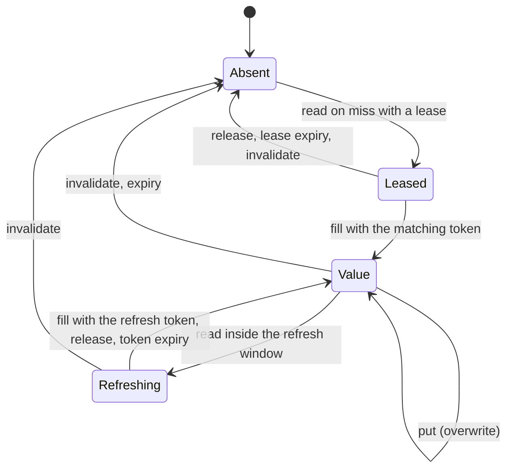

# Extending CoCache

The extension points are interfaces: `CacheLoader` and `Codec` in `me.ahoo.cocache.api`, the backend SPI in `me.ahoo.cocache.api.spi` (both `cocache-api`, no dependencies), and the spec functions `KeyEncoder`, `KeyFilter`, and `TtlFunction` in `me.ahoo.cocache.core`. L2 is always Caffeine and is not an extension point. Verify a new backend with the TCK in `cocache-test`:

```kotlin
testImplementation("me.ahoo.cocache:cocache-test")
```

| You implement | Contract | Verify with |
|---------------|----------|-------------|
| `CoherenceBackend` (its `RemoteStore` and `InvalidationChannel`) | [Backend](#backend) | `BackendProtocolSpec`, `EngineSpec`, `SetEngineSpec` |
| `Codec<V>` | [Codecs](#codecs) | your own round-trip tests |
| `CacheLoader<K, V>`, `KeyEncoder<K>`, `KeyFilter`, `TtlFunction<K, V>` | [Functions](#functions) | your own tests |

In a Spring Boot application, a `CoherenceBackend` bean replaces the Redis backend, and a `Codec<V>` bean is picked up by every cache with value type `V`.

## Backend {#backend}

```kotlin
interface CoherenceBackend : AutoCloseable {
    val atomicBroadcast: Boolean          // can a write broadcast in the same atomic step?
    val format: Int                       // wire format version this implementation writes
    val channel: InvalidationChannel
    fun store(namespace: String): RemoteStore
}
```

L1 storage and the invalidation channel are two faces of one backend, because the side that serializes a write should also announce it. The engine calls `store(namespace)` once per cache and subscribes to `channel` for that namespace.

### `RemoteStore` {#remote-store}

```kotlin
interface RemoteStore : AutoCloseable {
    fun read(key: String, lease: LeaseRequest?, refresh: RefreshRequest?): RemoteRead
    fun readAll(keys: Collection<String>, leases: Map<String, LeaseRequest>): Map<String, RemoteRead>
    fun fill(fill: Fill): Boolean
    fun fillAll(fills: List<Fill>): List<Boolean>
    fun release(key: String, token: Token)
    fun put(key: String, envelope: Envelope, ttl: Duration?, frame: ByteArray)
    fun invalidate(keys: Collection<String>, frame: ByteArray)
    fun reclaim(key: String, observed: Digest, lease: LeaseRequest): Boolean
    fun addMembers(key: String, members: Collection<ByteArray>, ttl: Duration?, frame: ByteArray)
    fun removeMembers(key: String, members: Collection<ByteArray>, ttl: Duration?, frame: ByteArray)
}
```

A store handles bytes and tokens only. It holds no policy: TTLs, refresh windows, and tokens all come from the engine as arguments. Keys already include the prefix and namespace. Each key is in one of these states:



"Value" covers a value, a negative entry (`Envelope.Absent`), and a set (`Envelope.Members`). The contract:

- **Every method is atomic per key.** Batch methods are atomic per key, not across keys.
- **`read`** on an absent key with a `lease` writes a lease placeholder and returns `Miss(leaseGranted = true)`. On a leased key it returns `Leased(remaining)`. On a scalar value whose remaining TTL is within `refresh.window` and that has no unexpired token, it writes the refresh token and returns `Hit(refreshGranted = true)`. A token older than `tokenTtl` counts as expired. `Hit.format` is the stored format version, or `0` for content this protocol didn't write.
- **`fill`** writes only if the key still holds `fill.token` (a lease or a refresh token), and returns whether it wrote. **`release`** removes a lease placeholder, or clears a refresh token, only if the token matches.
- **`put`, `invalidate`, `addMembers`, and `removeMembers` destroy any token.** `addMembers` replaces an absent key, a negative entry, or a lease with a new set. `removeMembers` affects only sets and deletes the key when it becomes empty.
- **`reclaim`** turns the key into a lease placeholder only if the `Digest` of its current content equals `observed` (scalar: the payload; negative entry: empty; set: `int32 length + member` concatenated in returned order). It must never delete content that changed.
- **Every state transition resets the expiry** (`ttl == null` means none). A lease's or a negative entry's TTL must never leak onto a new value. Use millisecond precision.
- **Never delete on read.**
- **Broadcast.** If `atomicBroadcast` is `true`, every write method must publish `frame` to the namespace's channel in the same atomic step. If it is `false`, the engine calls `channel.publish` after a successful write.
- **Throw on failure.** The engine decides whether to degrade, retry, or rethrow.

### `InvalidationChannel` {#invalidation-channel}

```kotlin
interface InvalidationChannel {
    fun subscribe(namespace: String, listener: InvalidationListener): Subscription
    fun publish(namespace: String, frame: ByteArray)   // only when atomicBroadcast == false
}
interface InvalidationListener {
    fun onInvalidated(keys: List<String>, origin: NodeId)
    fun onReset()
}
```

- **Delivery is at most once.** `frame` is an `InvalidationFrame` (`[version][nodeId][count]([length][key])*`). Decode it and call `onInvalidated` with the keys and the origin. Listeners ignore their own `NodeId`, so the channel needn't filter.
- **`onReset` is mandatory.** Call it for every listener on a connection each time the subscription is established or re-established *and confirmed by the server*, and whenever messages may have been lost (a failed heartbeat, a consumer-group rebalance). The listener clears its L2. Without resets, a lost event leaves L2 stale until `localMaxAge`.
- Subscribing a new namespace must not reset other namespaces.

## Codecs {#codecs}

```kotlin
interface Codec<V> {
    fun encode(value: V): ByteArray
    fun decode(bytes: ByteArray): V
}
```

`decode` should throw on bytes it can't read. The engine then treats the entry as corrupt: a miss, a conditional reclaim, and a reload. Changing a codec's byte format is a wire-format change for that cache: use a new namespace or `keyPrefix`, or make `decode` accept both formats.

## Functions {#functions}

- **`CacheLoader<K, V>`**: `load(key)` returns the value or `null` for "doesn't exist" (stored as a negative entry for `absentTtl`). `loadAll(keys)` loads every key that missed L2 and L1 at once, and keys missing from its result become negative entries. The default calls `load` per key, so override it with one query. The loader runs on the caller's thread and must not read its own cache for the same key, or the call fails fast.
- **`KeyEncoder<K>`**: turns a key into the string after `{keyPrefix}{namespace}:`. It must be injective. The default is `toString()`.
- **`KeyFilter.notExist(storageKey)`**: may return `true` only for keys that certainly don't exist. For a Bloom filter, that means it was built from every existing key.
- **`TtlFunction<K, V>`** (`ttlOf`): a per-entry lifetime, see [Per-entry TTL](../guide/configuration.md#per-entry-ttl).

## TCK {#tck}

| Suite | What it covers | You provide |
|-------|----------------|-------------|
| `BackendProtocolSpec` | The `RemoteStore` state machine: leases, tokens, expiry resets, broadcast, reclaim, release | `createBackend()`, `elapse(duration)` |
| `EngineSpec` | Two runtimes on one backend: every interleaving of loads, fills, invalidations, and writes, lease waits, refresh, failures and retries, resets | `createBackend()`, `clock`, `elapse(duration)`, `simulateReconnect()` |
| `SetEngineSpec` | `SetCache` element updates across two runtimes | `createBackend()`, `clock`, `elapse(duration)` |

The suites wrap your backend in `HookedBackend`, which injects hooks and faults so races are orchestrated with latches, not sleeps. An in-memory backend can advance a `ManualClock` in `elapse`. A real backend can sleep, since the suites use short TTLs (override `shortTtl` in `BackendProtocolSpec` if needed).

```kotlin
class InMemoryEngineTest : EngineSpec() {
    private val manualClock = ManualClock()
    private lateinit var memory: InMemoryBackend

    override val clock: CacheClock = manualClock
    override fun createBackend(): CoherenceBackend = InMemoryBackend(manualClock).also { memory = it }
    override fun elapse(duration: Duration) = manualClock.advance(duration)
    override fun simulateReconnect() = memory.reconnect()
}
```

`InMemoryBackend` implements the same protocol in one process. Several runtimes sharing one instance simulate several nodes, which also makes it a convenient backend for your own application tests.
