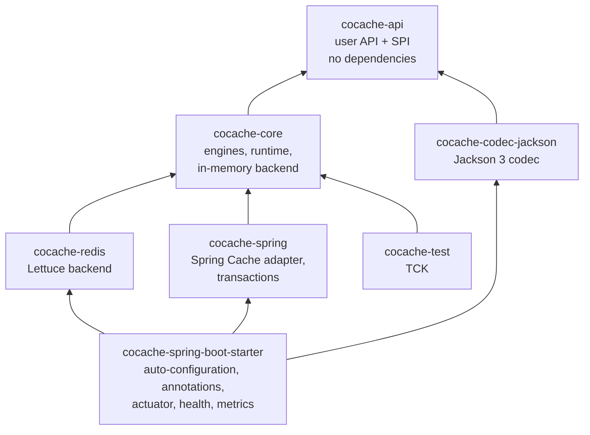
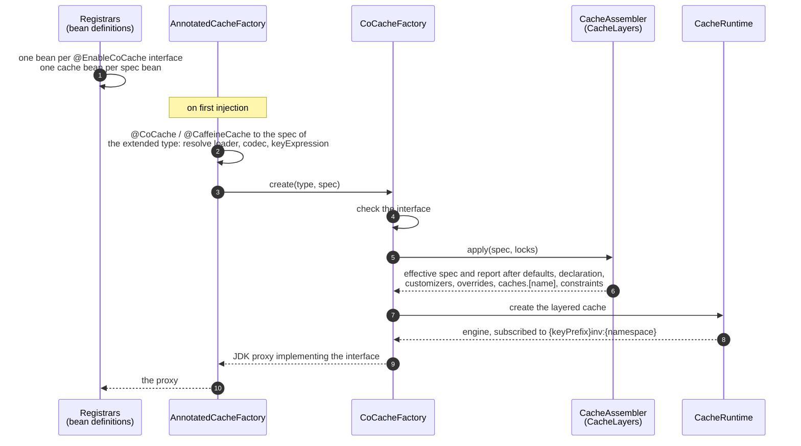

# Architecture

This section is for engineers who need to trust the protocol or extend it. It explains how CoCache is built. [Consistency](./consistency.md) proves why it doesn't lose invalidations, and [Extending](./extending.md) shows how to plug in a backend or codec. The normative specification, with every invariant a change must preserve, is [`docs/architecture.md`](https://github.com/Ahoo-Wang/CoCache/blob/main/docs/architecture.md) (in Chinese).

## Goals {#goals}

A two-level cache trades staleness for latency. It does three things: it **copies** values closer to the reader (fills), **destroys** copies when the source changes (invalidations), and **ages** copies out (TTLs). Every correctness bug in a cache is the same interleaving: a copy that started before an invalidation lands after it. CoCache's design follows from three goals:

| Goal | What it means for you |
|------|-----------------------|
| **G1 Staleness is bounded** | Every inconsistency heals on its own within a known time. Races inside the protocol leave nothing stale in Redis. Changes CoCache never hears about last at most `ttl`. A lost message leaves one instance's local copy stale for at most `local-max-age`. [Exact bounds](./consistency.md#staleness-bounds). |
| **G2 No invalidation is lost** | Once `invalidate` returns, no load that started before it can write the old value back, in Redis or in any instance that has processed the invalidation. The same instance never serves the old value again. |
| **G3 The hit path is cheap** | A local hit is one concurrent-map lookup and one time comparison, and scales with threads. A Redis hit is one round trip. A `put` or an `invalidate` is one round trip by default (atomic broadcast), two in sharded or non-atomic mode. Concurrent misses for one key load once per cluster. |

**Non-goals.** Linearizable reads: between a write and the arrival of its message, other instances may serve the previous value.

**TTL is a safety net, not the mechanism.** Races inside the protocol are closed by fences, not by waiting for expiry. That is why `ttl: forever` is safe as long as every write goes through the protocol.

## Modules {#modules}



| Module | Contains |
|--------|----------|
| `cocache-api` | The five [cache types](../guide/caches.md#types) (`Cache`, `VersionedCache`, `Store`, `VersionedStore`, `SetStore`) over `ReadableCache`, their async and suspending views, `Lookup`, `CacheLoader`, `Codec`, `CacheClock`, the exceptions, the annotations (`@CoCache`, `@CaffeineCache`, `@JoinCacheable`), `JoinView` / `JoinCache`, and the backend SPI in `me.ahoo.cocache.api.spi`. No runtime dependencies. |
| `cocache-core` | One spec per type (`CacheSpec`, `VersionedCacheSpec`, `StoreSpec`, `VersionedStoreSpec`, `SetStoreSpec`), `CachePolicy`, `CacheRuntime`, the engines, `SingleFlight`, `InvalidationStamps`, `CacheAdmin` / `CacheMetrics`, `RetryPolicy`, `ExternalInvalidator`, `CacheProxies`, `SimpleJoinView` / `SimpleJoinCache`, `SuspendingCacheLoader`, `InMemoryBackend`, `TickingClock`, `ManualClock`. Depends on Caffeine and on `kotlinx-coroutines-core` (an `api` dependency: the engines run on coroutines, and the suspending views expose them). |
| `cocache-redis` | `RedisBackend`: the Lua scripts, the wire format, the Pub/Sub and Sharded Pub/Sub channels. Depends on Lettuce, not on Spring. |
| `cocache-codec-jackson` | `JacksonCodec` (Jackson 3, `tools.jackson`) |
| `cocache-spring` | `CoCacheSpringCacheManager`, `TransactionalInvalidator`. For Spring without Boot. |
| `cocache-spring-boot-starter` | Auto-configuration, `@EnableCoCache`, annotation translation, spec-bean registration, `cocache.*` properties, the actuator endpoint, health indicator, Micrometer binding, and the Spring Cache `sync` check |
| `cocache-test` | The published TCK: `BackendProtocolSpec`, `EngineSpec`, `SetEngineSpec`, `MultiNodeSpec`, `FaultSpec`, `VersionedSpec`, `L1Capability`, `CommandCancellation`, `CacheAccess`, `HookedBackend`, `Concurrency`, `Suspending` |
| `cocache-bom` | Version alignment |

Dependencies point one way. Annotation parsing and SpEL exist only in the starter, so the core needs neither Spring nor `kotlin-reflect`. A new backend depends only on `cocache-api`, and on `cocache-test` for its tests.

## Responsibilities {#responsibilities}

| Part | Does | Never does |
|------|------|------------|
| **Loader** (`CacheLoader`, only for `Cache` and `VersionedCache`) | Returns a value, or `null` for "doesn't exist" | Decide lifetimes |
| **Policy** (`CachePolicy`) | Holds lifetimes, jitter, negative TTL, local and degraded max age, refresh window, lease, load limit, L2 size, failure modes | Act |
| **Engine** (`CoherentEngine` for `Cache`, `VersionedCache`, `Store`, `VersionedStore`; `SetEngine` for `SetStore`) | Reads through the levels, coalesces loads, holds both fences, orders writes, handles failures, refreshes ahead | Store anything remotely itself |
| **Store** (`L1Store`) | Executes the L1 protocol on bytes and tokens. TTLs, windows, and tokens arrive as arguments. | Know value types or hold policy |
| **Channel** (`InvalidationChannel`) | Delivers invalidation frames, and tells listeners when messages may have been lost | Filter or interpret keys |
| **Runtime** (`CacheRuntime`) | One per process: holds the `NodeId`, the clock, the backend, the refresh executor, and the retry queue, and creates every cache | Share a cache's state with another cache |

The store and the channel are two faces of one `CoherenceBackend`, because whoever serializes a write should also announce it, in the same atomic step when possible.

## Runtime {#runtime}

```kotlin
val backend = RedisBackend.standalone(RedisURI.create("localhost", 6379))
val runtime = CacheRuntime.builder().backend(backend).build()   // one per process

val users: Cache<String, User> = runtime.create(
    cacheSpec<String, User>("user") {
        codec = jacksonCodec<User>(mapper)
        loader = CacheLoader { id -> repository.findById(id) }
        policy { ttl = Duration.ofMinutes(10) }
    }
)
```

- A spec is immutable data: name, namespace, key prefix, key encoder, codec, the source (`Cache` and `VersionedCache` only), `ttlOf`, key filter, and policy. Each [type](../guide/caches.md#spec-bean) has its own spec, and `runtime.create(spec)` returns that type. Users supply only data and stateless functions.
- `runtime.create` builds every stateful part of a cache: its L2, invalidation stamps, single-flight table, store, and subscription. Two caches can't share one by accident. A duplicate name, or a duplicate prefix-and-namespace pair, fails. So does a type whose L1 capability the backend lacks (`Store` needs conditional writes, the versioned types versioned writes, `SetStore` sets). The start log names the type: `Cache[user] - created as Cache on namespace[user], …`.
- `NodeId` is 16 random bytes per runtime. It makes tokens globally unique and lets an instance ignore its own messages (except, for `local-max-age`, on keys whose write had an unknown outcome; see [Consistency](./consistency.md#writer-order)).
- `close()` closes subscriptions, engines, and stores in reverse creation order, then the clock and executors the runtime created. Pending invalidation retries are counted as dropped. The caller closes the backend.

**Time.** `CacheClock` returns epoch milliseconds. The default `TickingClock` refreshes a volatile field every 100 ms, which is cheaper on the hit path than `System.currentTimeMillis()` on some platforms. It is monotonic: it reads the wall clock once at startup and then advances by `System.nanoTime()`, so a wall-clock step (an NTP correction, a manual change) neither extends nor cuts short an L2 copy. Expiry crosses the wire only as relative durations (`PEXPIRE`, `PTTL`), so clock skew between instances doesn't matter. Tests inject `ManualClock`.

## From declaration to bean {#wiring}

The starter supports two declaration styles that end in the same engine.



| Style | Bean name | Bean |
|-------|-----------|------|
| Interface: `@CoCache interface UserCache : Cache<String, User>`, listed in `@EnableCoCache(caches = …)` | the cache name (`@CoCache(name)`, default the interface's simple name) | A JDK proxy. The extended type's methods dispatch to the engine by name, without reflection, so exceptions reach you unwrapped. The exception is the JDK's own proxy rule: a checked exception the interface method doesn't declare, such as an `IOException` thrown by a Kotlin loader or the `InterruptedException` of an interrupted waiter, arrives wrapped in `UndeclaredThrowableException`, with the original as its `cause`. Your `default` methods run through `InvocationHandler.invokeDefault`. |
| Spec bean: `@Bean fun userSpec(): CacheSpec<String, User>`, or any other spec type | the spec bean name minus `Spec` (`userSpec` → `user`), or plus `Cache` | The engine itself. `CacheSpecRegistrar` reads `K` and `V` from the factory method's declared return type without instantiating the spec. |
| Join cache: `@JoinCacheable interface …`, listed in `@EnableCoCache(joinCaches = …)` | the join cache name | A read-only view over two caches, resolved by name; a `JoinCache` can also invalidate. See [JoinCache](../guide/join-cache.md). |

Policy layers, merged field by field, higher wins: the type default (`DefaultPolicies`) → `cocache.defaults.cache.*` / `.store.*` (only fields the declaration didn't write) → the declaration → `CacheSpecCustomizer` beans (in order) → `cocache.overrides.cache.*` / `.store.*` (tighten only) → `cocache.caches.[name].*`. A library's locks and constraints, passed to `CoCacheFactory.create`, then apply, and the result carries a report of each field's source ([Configuration](../guide/configuration.md#precedence)). `cocache.key-prefix` sits outside the layering and wins over the declaration unless the key prefix is locked. After all singletons exist, `CacheAssembler` fails startup if `cocache.caches` names an undeclared cache (`cocache.caches-validation: warn` only warns). An entry for a cache created directly with `CacheRuntime.create`, which no configuration layer reaches, always only logs a warning ([CoCacheFactory](../guide/caches.md#factory)). Spec beans and libraries create caches through the same `CoCacheFactory` bean. Every stateful component is created per spec by `CacheRuntime` ([Runtime](#runtime)), so two caches never share one. In Spring, a join cache finds its two caches by cache name (through their bean names), never by type.

## Wire format {#wire-format}

The wire format is frozen within a major version. The normative definition is `RedisScripts` and `InvalidationFrame`.

| Part | Format |
|------|--------|
| Storage key | `{keyPrefix}{namespace}:{encodedKey}`, default `cocache:{cacheName}:{key.toString()}`. The namespace matches `[A-Za-z0-9._-]+`. Internal keys live under `{keyPrefix}!`. |
| Value, negative entry, lease, eviction marker | Redis String: a 36-byte core header, the segments its flags declare, then the codec's bytes |
| Set (`SetStore`) | Redis Hash: field `!f` holds the format version (`"2"`), each member is a field `+{member bytes}` with an empty value. Field `!m` is a must-understand bitmap (absent means 0); other `!` fields are reserved and readers ignore them. |
| Expiry | `PEXPIRE` / `PTTL` in milliseconds, reset explicitly on every state change |
| Channel | `{keyPrefix}inv:{namespace}` |
| Message | `[0x01][publisher NodeId: 16 bytes][count: varint]([length: varint][storage key: UTF-8])*`. A frame a channel can't read resets its caches instead of being dropped, and version `2` is reserved for a namespace reset ([details](./consistency.md#invalidation-channel)). |

Every value 8.x writes is format 2, leases and negative entries included. The String layout:

| Offset | Length | Field |
|--------|--------|-------|
| 0 | 1 | Magic `0xC0` |
| 1 | 1 | Format version (`2`) |
| 2 | 1 | State: `V` value, `M` negative entry, `L` lease, `E` eviction that keeps the version (a version segment, no payload) |
| 3 | 1 | Flags |
| 4 | 24 | Token: the lease token in states `L` and `E`, the refresh token in state `V`, zeros for none |
| 28 | 8 | Token issue time: server `TIME` in epoch milliseconds, big-endian IEEE 754 double |
| 36 | 8 | Version segment (flag bit 0): big-endian signed 64-bit |
| next | 32 | Digest segment (flag bit 1): the SHA-256 of the payload, computed by the writer and checked by the reader |
| next | 2 + n | Extension area (flag bit 7): a 2-byte length n of the TLVs that follow, then the TLVs |
| rest | n | Payload from `Codec<V>` (none for `M` and `L`) |

- **Flags.** Bits 0–6 must be understood. Bit 7 marks the extension area, which holds only what an older reader may ignore. A reader treats content with a must-understand bit it doesn't know (bits 2–6 in this version) as a higher format. The payload offset follows from the flags alone, and the Lua scripts and the client compute it with the same function.
- **TLVs in the extension area.** Each TLV is `[type: 1 byte][length: 1–2 bytes][value]`. A length below 128 takes 1 byte; up to 32767 takes 2 bytes, the first being `0x80 | (length >> 8)`. Readers skip unknown types. Type 1 is the **writer id**: 24 bytes shaped like a token, new on every write.
- **Which segments are written.** A `Cache` value, a lease and a negative entry carry none, so their header is 36 bytes. Every value of an authoritative type carries a writer id (28 more bytes). A `Store` value also carries the digest segment (32 more bytes, 96 in all). A [versioned](../guide/freshness.md#versioned-writes) value or tombstone carries the version segment and no digest: a `VersionedCache` value and every tombstone the version only, a `VersionedStore` value the writer id and the version. The version segment never holds `Versioned.NO_VERSION`.
- **Digest.** The digest segment holds the SHA-256 of the payload (`Digest`, which names its algorithm). The writer computes it on the client. [Conditional reads and writes](../guide/freshness.md#conditional-writes) compare only these header bytes, so Redis reads 78 bytes of header (`GETRANGE`) instead of the whole value and hashes nothing. An authoritative reader that receives the payload (a `Store` or `VersionedStore` reading from Redis, or `getIfChanged` returning a value) recomputes the SHA-256 and treats a mismatch, or a value without a version and without a digest, as corrupt. A `Cache` or `VersionedCache` that reads a value with a digest segment counts it in `cocache.type.mismatch` and reads it anyway. A value with a digest segment is never reclaimed and never gets a refresh token: it is a `Store`'s only copy.
- **State `E`.** Evicting a key of a versioned cache (the endpoint's per-key `DELETE`) keeps its version: the key becomes `E` with the version and no payload (44 bytes). A read sees a miss and takes a lease on it in place, keeping the version and the expiry; the fill is written only if its version is at least the one in `E`, so a late older version is still refused.

A token is the issuing runtime's `NodeId` (16 bytes) plus a per-process sequence number (8 bytes). Tokens are built by the client, never reused, so a destroyed token can't match again. A read grants a lease or refresh token only on format-2 content without an unknown must-understand bit, and a refresh token only on a value without a digest segment (a versioned value gets one). A fill reads only the core header and the version segment (44 bytes), and a release only the 36-byte core header. When the key holds a version, a fill with an older version (or none) is refused and its token cleared inside the script; an equal version renews the value without an invalidation message; a newer version, or a fill on `E`, writes and broadcasts.

Content in a lower format is content the cache can't read: a read with a source reclaims it if unchanged and reloads, and a read without one fails. That covers content the protocol didn't write (no magic byte, format byte `0`, segments longer than the value, a Hash without a valid `!f`, another Redis type), which reads as format `0`. It also covers any format number below 2. A higher format is never reclaimed or written back: a read with a source loads around it, an externally sourced `Cache` read without a loader treats the key as unfilled, and an authoritative type fails. That covers a format above 2, content with an unknown must-understand bit or state, and a set whose `!m` has a bit set.

New must-understand segments ship in two phases within 8.x: first a release that reads them, then, once every instance in the namespace runs it, a release that writes them. New TLVs and new `!` fields need no such rollout, because older readers skip them.

## Fixed and pluggable {#pluggable}

| Part | Pluggable? | How |
|------|-----------|-----|
| L1 storage + invalidation channel | Yes | Implement `CoherenceBackend` and pass the TCK. See [Extending](./extending.md#backend). |
| Value bytes | Yes | `Codec<V>`, per cache. See [codecs](./extending.md#codecs). |
| Data source | Yes | `CacheLoader<K, V>`, `AsyncCacheLoader`, `SuspendingCacheLoader`, or a versioned loader |
| Key encoding | Yes | `KeyEncoder<K>` or `keyExpression` |
| Impossible keys | Yes | `KeyFilter` |
| Per-entry lifetime | Yes | `TtlFunction` (`ttlOf`) |
| Clock | Yes | `CacheClock` (tests) |
| Refresh executor, retry policy | Yes | `CacheRuntime.Builder.refreshExecutor` (starter: `cocache.refresh-executor`), `retryPolicy` |
| Executor of the async and suspending views | Yes | `CacheRuntime.Builder.executor` (starter: `cocache.executor`). It must tolerate blocking tasks. See [Async API](../guide/async.md#threads). |
| **L2** | **No** | Always a bounded Caffeine cache, so the hit path stays monomorphic and its cost is known. Size it with `local-maximum-size`. |
| **Fences, write order, read path** | **No** | They are the protocol. See [Consistency](./consistency.md). |
| Wire format | Not within a major version | Two-phase upgrade only |
