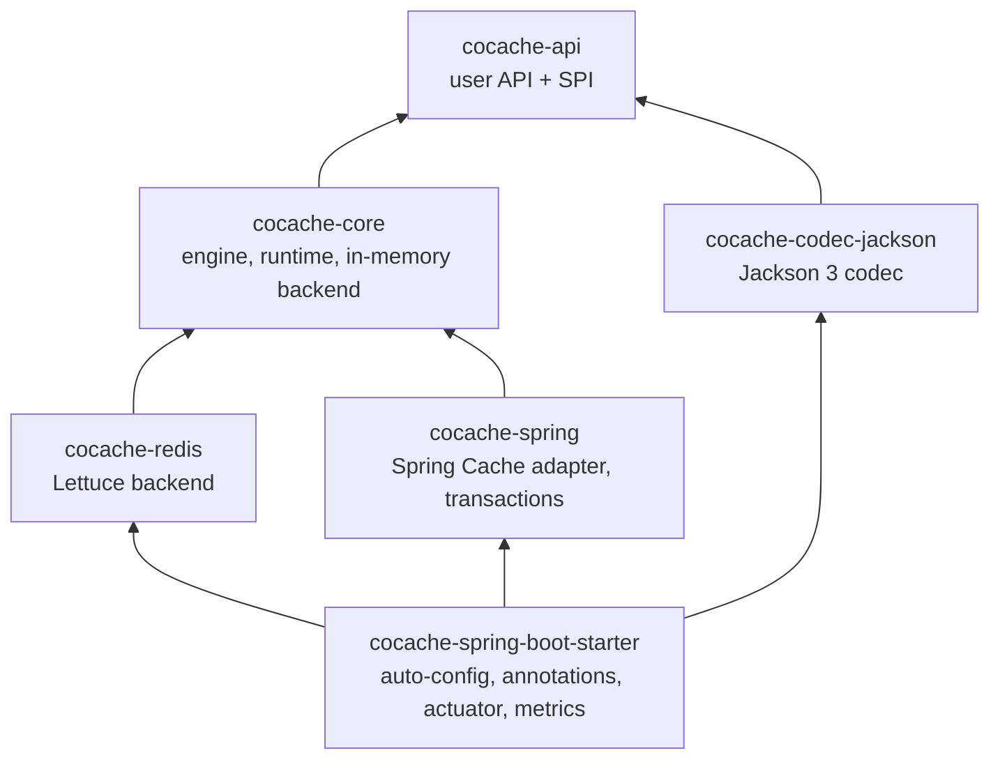
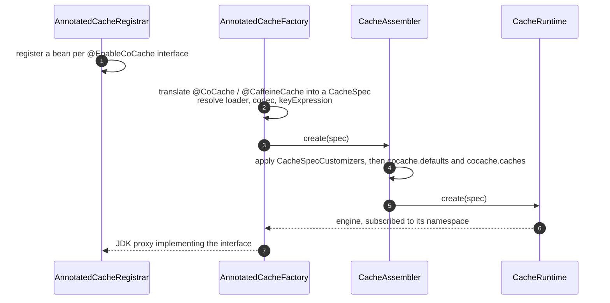

# Architecture

This page explains how CoCache is put together. The normative design, with every invariant a change must preserve, is in the repository (in Chinese): [`docs/architecture.md`](https://github.com/Ahoo-Wang/CoCache/blob/main/docs/architecture.md) and [RFC 0003](https://github.com/Ahoo-Wang/CoCache/blob/main/docs/rfc/0003-target-architecture.md). If this page and those documents disagree, they win.

## Design goals

A two-level cache trades staleness for latency. Every design decision serves three goals:

| Goal | Measurable form | Means |
|------|-----------------|-------|
| **G1 Bounded staleness** | L1: no staleness from races inside the protocol, and at most `ttl` from changes outside it. L2: the event delay when events arrive, at most `localMaxAge` when they're lost, at most `degradedLocalMaxAge` for fills that skipped L1. | Finite `localMaxAge` by default. L2 cleared on every resubscribe and heartbeat failure. |
| **G2 No lost invalidations** | A fill whose read started before an invalidation never appears after that invalidation, in L1 or in any instance's L2 that has processed it. | One primitive, the fence: L1 leases and L2 invalidation stamps. |
| **G3 A cheap hit path** | An L2 hit is one concurrent-map read and one expiry comparison. An L1 hit is one round trip. A single-key write or invalidation is one round trip. | Fixed Caffeine L2, a ticking clock, atomic Lua scripts, multiplexed Lettuce connections, no counters on the L2 hit path. |

**Non-goals:** linearizable reads, and asynchronous or coroutine APIs. The synchronous API works well with virtual threads.

## Modules



| Module | Contains |
|--------|----------|
| `cocache-api` | `Cache`, `SetCache`, `Lookup`, `CacheLoader`, `Codec`, `CacheClock`, the exceptions, the `@CoCache` / `@CaffeineCache` annotations, and the SPI in `me.ahoo.cocache.api.spi`: `CoherenceBackend`, `RemoteStore`, `InvalidationChannel`, `InvalidationFrame`. No runtime dependencies. |
| `cocache-core` | `CacheSpec`, `CachePolicy`, `CacheRuntime`, the engines, `SingleFlight`, `InvalidationStamps`, `CacheProxies`, `CacheAdmin` / `CacheMetrics`, `InMemoryBackend`, `TickingClock`, `ManualClock`, `StringCodec`. Depends on Caffeine. |
| `cocache-redis` | `RedisBackend`: the Lua protocol, the wire format, and the Pub/Sub and Sharded channels. Depends on `lettuce-core`, not on Spring. |
| `cocache-codec-jackson` | `JacksonCodec` (Jackson 3, `tools.jackson`) |
| `cocache-spring` | `CoCacheSpringCacheManager`, `TransactionalInvalidator`. For Spring applications without Boot. |
| `cocache-spring-boot-starter` | Auto-configuration, `@EnableCoCache`, spec-bean registration, `CoCacheProperties`, `CacheSpecCustomizer`, the `cocache` actuator endpoint, Micrometer binding |
| `cocache-test` | The TCK for new backends and engines |
| `cocache-bom` | Version alignment |

Annotation parsing and SpEL live only in the starter, so the core has no Spring or reflection dependencies.

## Responsibilities

- **The loader only loads.** `CacheLoader` returns a value or `null`. It never decides how long a value lives.
- **The policy decides lifetimes.** `CachePolicy` holds `ttl`, jitter, `absentTtl`, `localMaxAge`, `degradedLocalMaxAge`, the refresh window, lease, load limit, L2 size, and failure modes. `CacheSpec.ttlOf` overrides `ttl` per entry.
- **The engine** reads through the levels, coalesces loads, takes and releases leases, fences L2 fills with stamps, retries invalidations, and refreshes ahead. The loader always runs on the caller's thread.
- **The backend** is one object with two faces: a `RemoteStore` per namespace, which executes the L1 protocol on bytes and tokens, and an `InvalidationChannel`, which delivers invalidations. The side that serializes a write also broadcasts it, in the same atomic step when it can (`atomicBroadcast`).
- **L2 is not pluggable.** It is always a bounded Caffeine cache, which keeps the hit path monomorphic inside CoCache.

## Runtime and declarations

```kotlin
val runtime = CacheRuntime.builder().backend(backend).build()   // one per process
val users: Cache<String, User> = runtime.create(cacheSpec("user") { … })
```

- A `CacheSpec` (or `SetCacheSpec`) is immutable data: name, namespace, key prefix, key encoder, codec, loader, `ttlOf`, key filter, and policy.
- `CacheRuntime` holds what belongs to the process: the `NodeId` (16 random bytes), the clock, the backend, a refresh executor, and the invalidation retrier. Every stateful component of a cache (its L2, stamps, single-flight table, subscription) is created by `runtime.create`, so two caches can never share one. Duplicate names or namespaces fail.
- Closing the runtime closes caches and subscriptions in reverse order of creation.

## Wire format

The wire format is frozen within a major version.

| Part | Format |
|------|--------|
| Key | `{keyPrefix}{namespace}:{encodedKey}`, default prefix `cocache:`, default namespace the cache name |
| Scalar value, negative entry, lease | Redis String: a 36-byte header, then the codec's bytes. Header: magic `0xC0`, format version, state (`V` value, `M` negative, `L` lease), a reserved byte, a 24-byte token (lease or refresh token, zeros for none), and the token's issue time (server `TIME`, milliseconds). |
| Set (`SetCache`) | Redis Hash: field `!f` holds the format version, and each member is a field `+{member}` with an empty value |
| Expiry | `PEXPIRE` / `PTTL`, millisecond precision, reset explicitly on every state change |
| Channel | `cocache:inv:{namespace}` |
| Message | `[version:1][nodeId:16][count:varint]([length:varint][storage key])*` |

A value written in a newer format than a node knows is treated as a miss, neither reclaimed nor written back, so a two-phase format upgrade is possible.

## Time

`CacheClock` returns epoch milliseconds. The default `TickingClock` refreshes a volatile value every 100 ms, which is cheaper on the hit path than `System.currentTimeMillis()`. The runtime starts and stops it. Tests inject `ManualClock` and advance it, so TTL, refresh, and age tests are deterministic. An L2 entry stores its expiry as local time plus the `PTTL` returned by Redis, so clock skew between instances doesn't matter.

## From declaration to bean



- **Interface declarations** (`@EnableCoCache`): the bean name is the cache name and the bean type is the interface. Generic types come from the `Cache<K, V>` or `SetCache<K, E>` the interface extends and must be concrete.
- **Spec beans**: `CacheSpecRegistrar`, a `BeanFactoryPostProcessor`, reads `K` and `V` from the factory method's declared return type without instantiating the spec, and registers a `Cache<K, V>` bean named after the spec bean minus `Spec` (or plus `Cache`). That bean is the engine itself, with no proxy.
- A bean name that is already taken fails startup, and so does a cache name used twice.
- Caches are created on first injection. After all singletons exist, `CacheAssembler` fails startup if `cocache.caches` names a cache that doesn't exist.

The proxy (`CacheProxies`) dispatches `Cache` and `SetCache` methods to the engine by name, without `Method.invoke`, so exceptions reach the caller unwrapped. Default methods on your interface run through `InvocationHandler.invokeDefault`. `equals` and `hashCode` use proxy identity.

## Next

- [Consistency](./consistency.md): the read, write, and invalidation paths, and what they guarantee.
- [Extending CoCache](./extending.md): implementing a backend or a codec, and the TCK.
