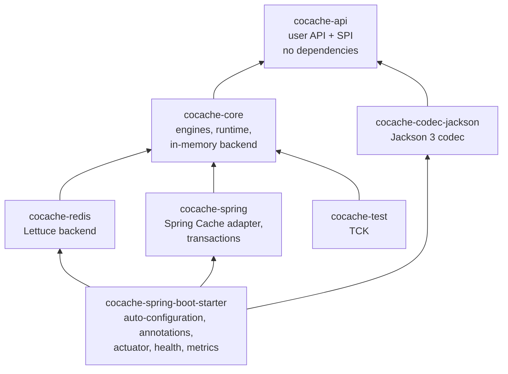
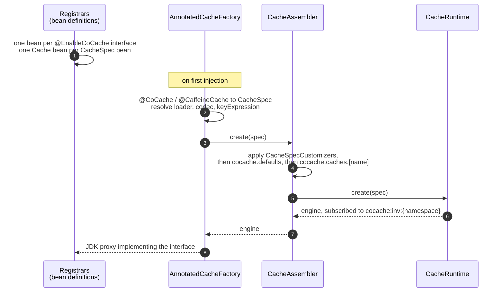

# Architecture

This section is for engineers who need to trust the protocol or extend it. It explains how CoCache is built. [Consistency](./consistency.md) proves why it doesn't lose invalidations, and [Extending](./extending.md) shows how to plug in a backend or codec. The normative specification, with every invariant a change must preserve, is [`docs/architecture.md`](https://github.com/Ahoo-Wang/CoCache/blob/main/docs/architecture.md) (in Chinese).

## Goals {#goals}

A two-level cache trades staleness for latency. It does three things: it **copies** values closer to the reader (fills), **destroys** copies when the source changes (invalidations), and **ages** copies out (TTLs). Every correctness bug in a cache is the same interleaving: a copy that started before an invalidation lands after it. CoCache's design follows from three goals:

| Goal | What it means for you |
|------|-----------------------|
| **G1 Staleness is bounded** | Every inconsistency heals on its own within a known time. Races inside the protocol leave nothing stale in Redis. Changes CoCache never hears about last at most `ttl`. A lost message leaves one instance's local copy stale for at most `local-max-age`. [Exact bounds](./consistency.md#staleness-bounds). |
| **G2 No invalidation is lost** | Once `invalidate` returns, no load that started before it can write the old value back, in Redis or in any instance that has processed the invalidation. The same instance never serves the old value again. |
| **G3 The hit path is cheap** | A local hit is one concurrent-map lookup and one time comparison, and scales with threads. A Redis hit is one round trip. A `put` or an `invalidate` is one round trip by default (atomic broadcast), two in sharded or non-atomic mode. Concurrent misses for one key load once per cluster. |

**Non-goals.** Linearizable reads: between a write and the arrival of its message, other instances may serve the previous value. Asynchronous or coroutine APIs: the API is synchronous and works well on virtual threads.

**TTL is a safety net, not the mechanism.** Races inside the protocol are closed by fences, not by waiting for expiry. That is why `ttl-forever` is safe as long as every write goes through the protocol.

## Modules {#modules}



| Module | Contains |
|--------|----------|
| `cocache-api` | `Cache`, `SetCache`, `Lookup`, `CacheLoader`, `Codec`, `CacheClock`, the exceptions, the annotations (`@CoCache`, `@CaffeineCache`, `@JoinCacheable`), `JoinCache`, and the backend SPI in `me.ahoo.cocache.api.spi`. No runtime dependencies. |
| `cocache-core` | `CacheSpec` / `SetCacheSpec`, `CachePolicy`, `CacheRuntime`, the engines, `SingleFlight`, `InvalidationStamps`, `CacheAdmin` / `CacheMetrics`, `RetryPolicy`, `ExternalInvalidator`, `CacheProxies`, `InMemoryBackend`, `TickingClock`, `ManualClock`. Depends on Caffeine. |
| `cocache-redis` | `RedisBackend`: the Lua scripts, the wire format, the Pub/Sub and Sharded Pub/Sub channels. Depends on Lettuce, not on Spring. |
| `cocache-codec-jackson` | `JacksonCodec` (Jackson 3, `tools.jackson`) |
| `cocache-spring` | `CoCacheSpringCacheManager`, `TransactionalInvalidator`. For Spring without Boot. |
| `cocache-spring-boot-starter` | Auto-configuration, `@EnableCoCache`, annotation translation, spec-bean registration, `cocache.*` properties, the actuator endpoint, health indicator, Micrometer binding, and the Spring Cache `sync` check |
| `cocache-test` | The published TCK: `BackendProtocolSpec`, `EngineSpec`, `SetEngineSpec`, `HookedBackend`, `Concurrency` |
| `cocache-bom` | Version alignment |

Dependencies point one way. Annotation parsing and SpEL exist only in the starter, so the core needs neither Spring nor `kotlin-reflect`. A new backend depends only on `cocache-api`, and on `cocache-test` for its tests.

## Responsibilities {#responsibilities}

| Part | Does | Never does |
|------|------|------------|
| **Loader** (`CacheLoader`) | Returns a value, or `null` for "doesn't exist" | Decide lifetimes |
| **Policy** (`CachePolicy`) | Holds lifetimes, jitter, negative TTL, local and degraded max age, refresh window, lease, load limit, L2 size, failure modes | Act |
| **Engine** (`CoherentEngine`, `SetEngine`) | Reads through the levels, coalesces loads, holds both fences, orders writes, handles failures, refreshes ahead | Store anything remotely itself |
| **Store** (`RemoteStore`) | Executes the L1 protocol on bytes and tokens. TTLs, windows, and tokens arrive as arguments. | Know value types or hold policy |
| **Channel** (`InvalidationChannel`) | Delivers invalidation frames, and tells listeners when messages may have been lost | Filter or interpret keys |
| **Runtime** (`CacheRuntime`) | One per process: holds the `NodeId`, the clock, the backend, the refresh executor, and the retry queue, and creates every cache | Share a cache's state with another cache |

The store and the channel are two faces of one `CoherenceBackend`, because whoever serializes a write should also announce it, in the same atomic step when possible.

## Runtime {#runtime}

```kotlin
val backend = RedisBackend.standalone(RedisURI.create("localhost", 6379))
val runtime = CacheRuntime.builder().backend(backend).build()   // one per process

val users: Cache<String, User> = runtime.create(
    cacheSpec<String, User>("user") {
        codec = jacksonCodec<User>(mapper)
        loader = CacheLoader { id -> repository.findById(id) }
        policy { ttl = Duration.ofMinutes(10) }
    }
)
```

- A spec is immutable data: name, namespace, key prefix, key encoder, codec, loader, `ttlOf`, key filter, and policy. Users supply only data and stateless functions.
- `runtime.create` builds every stateful part of a cache: its L2, invalidation stamps, single-flight table, store, and subscription. Two caches can't share one by accident. A duplicate name or namespace fails.
- `NodeId` is 16 random bytes per runtime. It makes tokens globally unique and lets an instance ignore its own messages.
- `close()` closes subscriptions, engines, and stores in reverse creation order, then the clock and executors the runtime created. Pending invalidation retries are counted as dropped. The caller closes the backend.

**Time.** `CacheClock` returns epoch milliseconds. The default `TickingClock` refreshes a volatile field every 100 ms, which is cheaper on the hit path than `System.currentTimeMillis()` on some platforms. Expiry crosses the wire only as relative durations (`PEXPIRE`, `PTTL`), so clock skew between instances doesn't matter. Tests inject `ManualClock`.

## From declaration to bean {#wiring}

The starter supports two declaration styles that end in the same engine.



| Style | Bean name | Bean |
|-------|-----------|------|
| Interface: `@CoCache interface UserCache : Cache<String, User>`, listed in `@EnableCoCache(caches = …)` | the cache name (`@CoCache(name)`, default the interface's simple name) | A JDK proxy. `Cache` / `SetCache` methods dispatch to the engine by name, without reflection, so exceptions reach you unwrapped. Your `default` methods run through `InvocationHandler.invokeDefault`. |
| Spec bean: `@Bean fun userSpec(): CacheSpec<String, User>` | the spec bean name minus `Spec` (`userSpec` → `user`), or plus `Cache` | The engine itself. `CacheSpecRegistrar` reads `K` and `V` from the factory method's declared return type without instantiating the spec. |
| Join cache: `@JoinCacheable interface …`, listed in `@EnableCoCache(joinCaches = …)` | the join cache name | A read-only view over two caches, resolved by name. See [JoinCache](../guide/join-cache.md). |

Policy layers, later wins: built-in defaults → the declaration → `CacheSpecCustomizer` beans (in order) → `cocache.defaults.*` → `cocache.caches.[name].*`. `key-prefix` follows the same layering. After all singletons exist, `CacheAssembler` fails startup if `cocache.caches` names an undeclared cache. Every stateful component is created per spec by `CacheRuntime` ([Runtime](#runtime)), so two caches never share one. In Spring, a join cache finds its two caches by cache name (through their bean names), never by type.

## Wire format {#wire-format}

The wire format is frozen within a major version. The normative definition is `RedisScripts` and `InvalidationFrame`.

| Part | Format |
|------|--------|
| Storage key | `{keyPrefix}{namespace}:{encodedKey}`, default `cocache:{cacheName}:{key.toString()}` |
| Value, negative entry, lease | Redis String: a 36-byte header, then the codec's bytes |
| Set (`SetCache`) | Redis Hash: field `!f` holds the format version (`"1"`), each member is a field `+{member bytes}` with an empty value |
| Expiry | `PEXPIRE` / `PTTL` in milliseconds, reset explicitly on every state change |
| Channel | `cocache:inv:{namespace}` (no key prefix) |
| Message | `[0x01][publisher NodeId: 16 bytes][count: varint]([length: varint][storage key: UTF-8])*` |

The String header:

| Offset | Length | Field |
|--------|--------|-------|
| 0 | 1 | Magic `0xC0` |
| 1 | 1 | Format version (`1`) |
| 2 | 1 | State: `V` value, `M` negative entry, `L` lease |
| 3 | 1 | Reserved (`0`) |
| 4 | 24 | Token: the lease token in state `L`, the refresh token in state `V`, zeros for none |
| 28 | 8 | Token issue time: server `TIME` in epoch milliseconds, big-endian IEEE 754 double |
| 36 | n | Payload from `Codec<V>` (none for `M` and `L`) |

A token is the issuing runtime's `NodeId` (16 bytes) plus a per-process sequence number (8 bytes). Tokens are built by the client, never reused, so a destroyed token can't match again.

Content the protocol didn't write (no magic byte, an unknown state, a Hash without `!f`, another Redis type) reads as format `0` and is treated as corrupt: reclaimed only if unchanged, then reloaded. A format higher than the instance knows is loaded around, never overwritten. Together these allow a two-phase format upgrade: first ship a version that reads N+1 and writes N, then one that writes N+1.

## Fixed and pluggable {#pluggable}

| Part | Pluggable? | How |
|------|-----------|-----|
| L1 storage + invalidation channel | Yes | Implement `CoherenceBackend` and pass the TCK. See [Extending](./extending.md#backend). |
| Value bytes | Yes | `Codec<V>`, per cache. See [codecs](./extending.md#codecs). |
| Data source | Yes | `CacheLoader<K, V>` |
| Key encoding | Yes | `KeyEncoder<K>` or `keyExpression` |
| Impossible keys | Yes | `KeyFilter` |
| Per-entry lifetime | Yes | `TtlFunction` (`ttlOf`) |
| Clock | Yes | `CacheClock` (tests) |
| Refresh executor, retry policy | Yes | `CacheRuntime.Builder.refreshExecutor` (starter: `cocache.refresh-executor`), `retryPolicy` |
| **L2** | **No** | Always a bounded Caffeine cache, so the hit path stays monomorphic and its cost is known. Size it with `local-maximum-size`. |
| **Fences, write order, read path** | **No** | They are the protocol. See [Consistency](./consistency.md). |
| Wire format | Not within a major version | Two-phase upgrade only |
