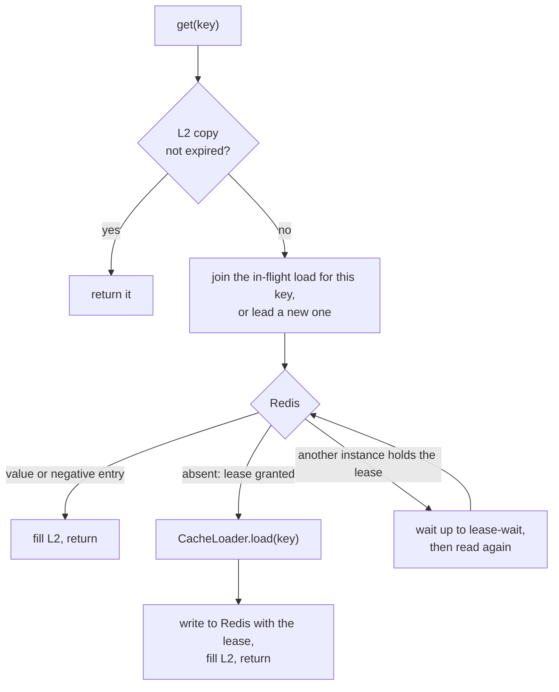
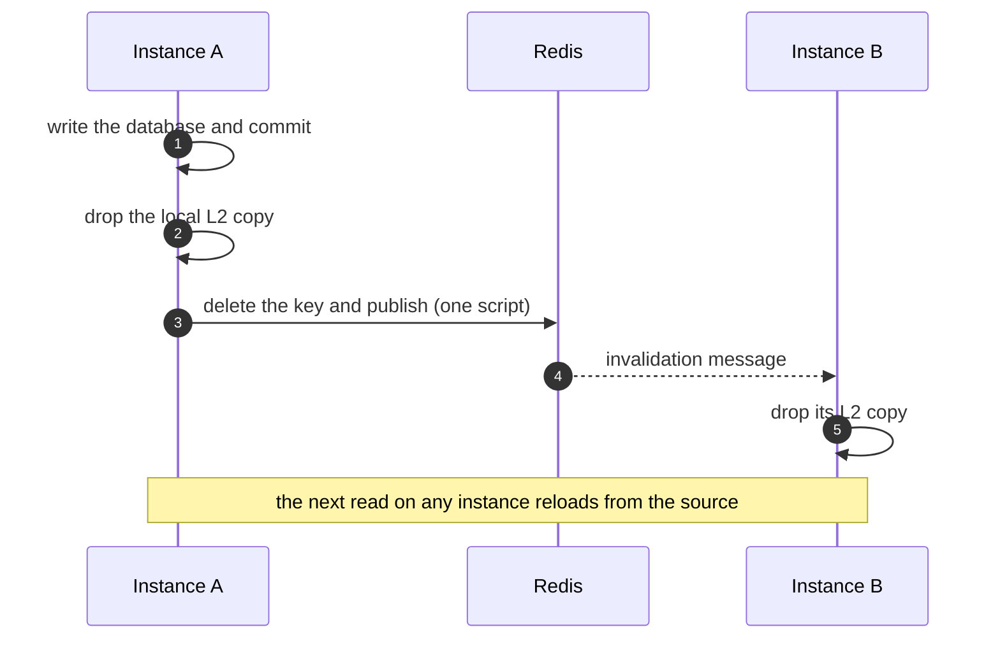

# How It Works

This page explains what CoCache does with your reads and writes, at the level you need to use it well. The protocol itself, and the argument that it is correct, are in [Architecture › Consistency](/architecture/consistency).

## Two levels {#levels}

| Level | Where | Holds | Lifetime |
|-------|-------|-------|----------|
| **L2** | Caffeine, inside each instance | A bounded copy of recently read keys (10 000 by default) | The Redis value's remaining TTL, capped at `localMaxAge` (5 min) |
| **L1** | Redis, shared by all instances | The cached value, a negative entry, or a short lease while someone loads | `ttl` ± jitter (1 h ± 1 min) for values, `absentTtl` (1 min) for negative entries |
| **Source** | Your `CacheLoader` | The truth | — |

L2 is what makes reads fast. L1 is what makes instances agree, and what keeps the database from seeing one load per instance.

## The read path {#read-path}

1. **L2 hit.** A Caffeine lookup and an expiry check. No I/O, no locks, and no counters unless you turn on the [L2 hit counter](/operations/observability#metrics-reads).
2. **L2 miss.** Concurrent callers on this instance share one load (`SingleFlight`). The leader reads Redis.
3. **L1 hit.** The value (or negative entry) goes into L2 and is returned.
4. **L1 miss.** The same Redis script that found the key absent gives this instance a **lease**. The leader calls your loader on the calling thread, so transactions, security context, and MDC are available. The result is written to Redis only if the lease is still intact.
5. **Leased elsewhere.** Another instance is loading this key. This one polls for up to `lease-wait` (200 ms) and usually picks up the value. If the wait times out, it loads by itself but doesn't write Redis, and keeps the result in L2 for only `degradedLocalMaxAge` (10 s).

The result: for each key, the database sees **one load per cluster**, as long as the load finishes within `lease-wait`.

`getAll(keys)` follows the same path in bulk: L2 for each key, then one batched Redis read, then one `loadAll` call for the keys still missing, then one batched write. It doesn't wait for leases held by other instances; those keys load directly.

### Negative caching {#negative-caching}

When the loader returns `null` (or `loadAll` leaves a key out), CoCache stores a **negative entry** in Redis for `absentTtl`. Reads for that key then return `null` without calling the loader, which protects the database from repeated lookups of keys that don't exist. Use `lookup(key)` when you need to tell a confirmed absence (`Lookup.Absent`) from a value (`Lookup.Present`). Its `expiresAt` is the expiry of the copy that answered: on an L2 hit that is the L2 copy, capped at `localMaxAge` (`degradedLocalMaxAge` for a copy that wasn't written to Redis), so it can be earlier than the Redis TTL. Precision is the cache clock's tick (100 ms by default). To see the Redis TTL of a key, use the [actuator endpoint](/operations/observability#inspect-key) or `CacheAdmin.inspect`.

A key that is merely absent from Redis is a miss, never a negative entry. A cache without a loader (filled only by `put`) therefore never writes negative entries to Redis: a miss returns `null`, and only the local instance remembers that answer, for at most `absentTtl`.

### Refresh-ahead {#refresh-ahead}

With `refreshWindow` set, a read that finds a value close to its Redis expiry returns the value immediately and schedules a background reload. Only the instance that wins a refresh token in Redis calls the loader, so the cluster reloads each key once. The others re-read the refreshed value from Redis. Expired values are never served; refresh-ahead only removes the latency spike when a hot key expires. See [tuning](./freshness.md#refresh-ahead).

## The write path {#write-path}

You change data in two steps: **write the source of truth, then invalidate**.

- **`invalidate(key)`** deletes the key from both levels everywhere. It also destroys any lease, so a load that started before the invalidation can't write its stale result back. This is the operation to use after a write.
- **`put(key, value)`** overwrites the Redis value and broadcasts the same invalidation. Use it only when the writer has the final value in hand. `put` deliberately **doesn't fill the local L2**: only reads fill L2, from Redis, which keeps L2 in the same order as Redis when two writes race. The next local read costs one Redis round trip.

Either way, the next read **on the same instance** sees the change (read-your-writes). Other instances see it as soon as the message arrives.

By default the delete and the publish run in one Lua script, so there is no window where Redis has changed and peers weren't told. With `channel-mode: sharded`, the publish follows the script as a separate command.

## How stale can data get? {#staleness}

| Situation | Staleness bound |
|-----------|-----------------|
| A load racing an invalidation (any instance) | None: the stale result is discarded |
| Another instance, message delivered | The Pub/Sub delivery delay (milliseconds) |
| Another instance, message lost | `localMaxAge` (5 min), or sooner when the heartbeat (5 s) detects the broken connection and clears L2 |
| A write that bypasses CoCache without invalidating | `ttl` (1 h). Never, with `ttl` forever |
| A new row after a lookup cached its absence, with no invalidation | `absentTtl` (1 min) |
| A load that couldn't be written to Redis (Redis down, lease-wait timeout) | `degradedLocalMaxAge` (10 s) |
| An invalidation that failed on Redis and exhausted its retries | The Redis value's remaining TTL |

`ttl` is a safety net, not the mechanism: races inside the protocol are prevented by the lease, not healed by expiry. That is why `ttl` forever is safe when every writer invalidates.

## When Redis fails {#failures}

| What fails | Default behavior | Opt-in alternative |
|------------|------------------|--------------------|
| Reading Redis | The read loads from the source and keeps the result in L2 for `degradedLocalMaxAge`, without writing Redis. Your callers keep working; the database takes the load. A read without a loader has no source, so it throws `CacheReadException` and caches nothing. | `read-failure: throw` throws `CacheReadException` |
| `invalidate` | Local effects happen first. With a loader, the Redis delete goes to a bounded background retry queue and the call **doesn't throw** (it usually runs after a commit, where throwing can't help). Until it succeeds, misses for that key on this instance skip Redis. Without a loader, the call throws `CacheWriteException`: Redis holds the only copy, and a delayed delete would remove a newer value. | `invalidate-failure: throw` or `retry` sets either behavior explicitly |
| `put` | Throws `CacheWriteException`. The outcome may be unknown (a timeout), but `put` is idempotent, so retrying is safe. | — |
| The Pub/Sub connection | The heartbeat detects it within seconds. On reconnect every instance clears its L2, and local copies are capped at `localMaxAge` regardless. The health indicator reports `DOWN` meanwhile. | — |
| Your loader | The exception reaches the caller and every caller waiting on the same load. Nothing is cached. | — |

While Redis is down, every miss reaches the database. Protect it with `load-max-concurrent`: a load beyond the limit waits up to `load-acquire-timeout` (default 1 s) for a slot, then fails with `SourceLoadRejectedException` instead of piling up. [Keeping Data Fresh](./freshness.md#redis-down) covers write failures in detail, and [Troubleshooting](/operations/troubleshooting) covers diagnosis.

## Further reading {#further-reading}

- [Architecture › Consistency](/architecture/consistency): the fences and why they are sufficient.
- [Declaring Caches](./caches.md): turning this model into code.
- [Keeping Data Fresh](./freshness.md): writes, TTL choices, and external writers.
