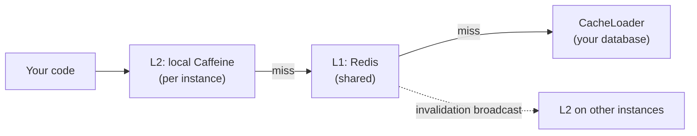

# Why CoCache

## The problem {#problem}

Your service reads the same rows over and over. You have two obvious ways to make that cheaper, and each one breaks something:

- **A shared cache such as Redis.** Every instance sees the same data, but every read still costs a network round trip, typically a few hundred microseconds to a millisecond. For hot keys read thousands of times per second, that is most of the request.
- **A local in-memory cache such as Caffeine.** A hit costs nanoseconds, but each instance has its own copy. When one instance changes a row, the others keep serving the old value until it expires. Short TTLs reduce the drift and destroy the hit rate.

The usual fix is to put both in front of the database and broadcast "drop key X" messages. Done naively, that design has holes that are hard to see in testing:

- A load that **started before** an update can **finish after** the invalidation and write the old value back. The cache is now stale until the TTL, and nothing will ever correct it.
- A broadcast message can be lost (a reconnect, a half-open TCP connection). A local copy with no maximum age then stays wrong indefinitely.
- When a hot key expires, every instance and every thread misses at once and hits the database together.

## What CoCache does {#what-it-does}

CoCache is that two-level design with the holes closed.

- **Reads** try L2, then L1, then your `CacheLoader`. Each miss fills the level above it.
- **Writes and invalidations** change L1 and broadcast an invalidation in one atomic Redis script (by default). Every other instance drops its L2 copy.
- **Loads are lease-fenced.** On an L1 miss, the reading instance atomically takes a lease on the key. Only the lease holder may write the loaded value to Redis, and any invalidation destroys the lease. A load that started before an invalidation can therefore never land after it. Locally, a stamp check does the same for L2.
- **Local copies have a maximum age** (`localMaxAge`, 5 minutes by default), so a lost message heals on its own.
- **One load per key.** Concurrent misses share one load inside an instance, and other instances wait briefly for the lease holder instead of loading too.

You declare a cache as an annotated interface (or a `CacheSpec` bean), give it a loader, and call `get`, `getAll`, and `invalidate`. [How It Works](./concepts.md) explains the model in more depth.

## Guarantees {#guarantees}

| Concern | What you get |
|---------|--------------|
| Read latency | An L2 hit is an in-process lookup with no I/O and no shared counters. An L1 hit is one Redis round trip. |
| A load racing an update | Never wins. A load that started before an invalidation can't write its result to Redis or to local memory afterwards. |
| Staleness on other instances | Normally the time it takes a Pub/Sub message to arrive. If the message is lost: at most `localMaxAge`. |
| Changes CoCache never sees | Writes that bypass CoCache without invalidating heal when the Redis value expires (`ttl`, 1 hour by default). |
| Your own writes | After `invalidate` or `put` returns, the next read on the same instance sees the new state. |
| Stampedes | Concurrent misses for one key load once per instance, and once per cluster when the load finishes within `lease-wait` (200 ms by default). |
| Missing keys | A loader returning `null` is cached as a negative entry for `absentTtl` (1 minute by default). |
| Mass expiry | TTLs are jittered (±1 minute by default) so keys loaded together don't expire together. |

The full list of bounds, including what happens when Redis fails, is in [How It Works](./concepts.md#staleness).

## What it does not do {#limits}

- **It is not linearizable.** Another instance can return the old value for the few milliseconds before the invalidation reaches it. If a read must see a write made on a different instance at the same moment, read the source of truth.
- **It doesn't see writes it isn't told about.** If something updates the database without invalidating (a batch job, another service, manual SQL), caches stay stale until `ttl`. Those writers can use [`ExternalInvalidator`](./freshness.md#external-writers).
- **A [JoinCache](./join-cache.md) is not a snapshot.** Its two reads are independent and can come from different moments.
- **A [`SetCache`](./caches.md#set-cache) keeps its only copy in Redis.** Its durability is Redis's durability.
- **The in-memory backend is single-process.** It exists for development and tests.

## When not to use it {#when-not}

- **Data that must never be stale**, such as balances or inventory you decrement. Read the database, or use the database's own locking.
- **One instance, no Redis.** A plain Caffeine cache is simpler.
- **Values that change on most reads.** The cache will mostly be invalidating, and you pay a write round trip for little benefit.
- **Very large values** (megabytes). Redis and the network become the bottleneck, and one large value delays other commands on the shared connection.
- **Reactive or coroutine code that must not block.** CoCache's API is synchronous. It runs well on virtual threads.

## Requirements {#requirements}

- JDK 17 or newer
- Redis 7.0 or newer: standalone, Sentinel, or Cluster (static master-replica is not supported)
- For the starter: Spring Boot 4

Next: [Quick Start](./quick-start.md).
