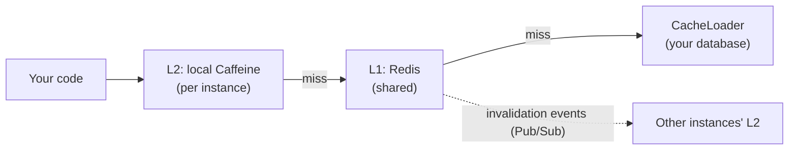

# Introduction

CoCache is a two-level coherent cache for Java and Kotlin applications. Every instance of your service keeps an in-process copy (L2, Caffeine) in front of a shared copy (L1, Redis) in front of your data source. CoCache keeps the copies in step across all instances and gives a hard upper bound on how stale any copy can get.

You declare a cache either as an annotated interface or as a `CacheSpec` bean. Spring Boot wires it up.

## The problem

A local in-memory cache is the fastest place to read from, but every instance has its own copy. When one instance changes the data, the others keep serving the old value. A shared cache like Redis fixes that but costs a network round trip on every read.

CoCache keeps both and connects them:

- A read tries L2, then L1, then your `CacheLoader`. Each miss fills the levels above it.
- `invalidate` and `put` change L1 and broadcast an invalidation, by default in one atomic Redis script. Every other instance drops its L2 copy.
- Concurrent misses for the same key share one load, within an instance and across the whole cluster, so a hot key that expires doesn't stampede your database.

## What you get

| Concern | How CoCache handles it |
|---------|------------------------|
| Read latency | An L2 hit is an in-process lookup with no I/O. An L1 hit is one Redis round trip. |
| Stale copies across instances | Writes and invalidations broadcast an event in the same Redis script that changes L1. Peers drop their L2 copy. |
| Lost events | L2 is cleared whenever the event channel reconnects, a heartbeat detects half-open connections, and every L2 copy expires after `localMaxAge` (5 minutes by default) regardless. |
| Cache stampede | Concurrent misses for a key share one load per instance (`SingleFlight`) and one load per cluster (an L1 lease). |
| Cache penetration (lookups for keys that don't exist) | A loader returning `null` stores a negative entry for `absentTtl` (1 minute by default). |
| Cache avalanche (many keys expiring at once) | Each TTL gets random jitter of up to `±ttlJitter`. |
| Hot-key expiry latency | Optional refresh-ahead: one node in the cluster reloads a key shortly before it expires. |
| Redis outages | Reads fall back to the source by default, invalidations are retried in the background, and explicit writes throw. |

## Guarantees

CoCache trades a bounded amount of staleness for latency, and it is explicit about how much.

- **Staleness is bounded.** L1 copies expire after `ttl` (1 hour by default). L2 copies expire after `localMaxAge` (5 minutes by default) even if every invalidation event is lost.
- **Invalidations are never lost to races.** A load that started before an invalidation cannot write its old value back afterwards, neither into L1 (an L1 lease guards every fill) nor into any instance's L2 (invalidation stamps guard every fill).
- **Read-your-writes on one instance.** After `invalidate(key)` or `put(key, …)` returns, the same instance doesn't serve the previous value.

CoCache does **not** give linearizable reads across instances. Peers see a change once the invalidation event reaches them, normally within milliseconds. See [Consistency](../architecture/consistency.md) for the exact model.

## When to use it

Use CoCache when:

- you run several instances of a service against shared data,
- reads far outnumber writes, and
- your writes can tolerate other instances seeing the change a few milliseconds later.

Don't use it when:

- every read must see the latest committed write (read from the database, or use a lock),
- the data changes on nearly every read, so caching would buy little, or
- the values are too large to hold copies in every instance's memory.

## Next steps

- [Quick Start](./quick-start.md): add CoCache to a Spring Boot application.
- [Configuration](./configuration.md): TTLs, L2 sizing, properties, and building caches in code.
- [Migrating from 5.x](./migration-6.md): what changed in 6.0.
- [Architecture](../architecture/index.md): how CoCache is built.
