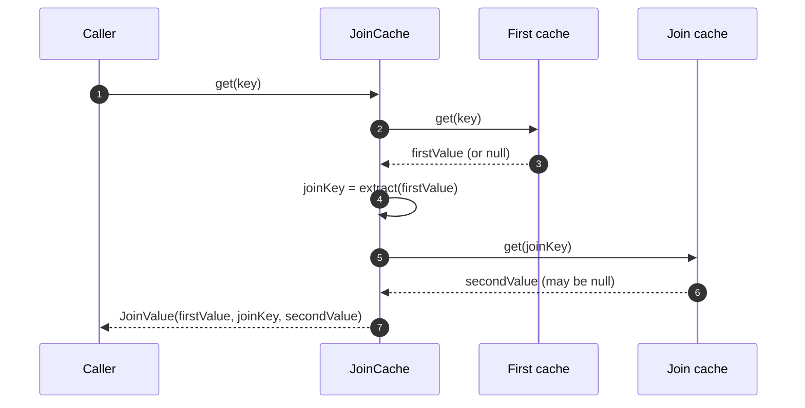

# JoinCache

A `JoinCache` reads a value from one cache (the *first* cache), derives a key from it, and reads a second cache (the *join* cache) with that key. One call returns both values. Typical uses are "order + its customer" or "profile extension + its user".

A JoinCache is a **read-only view**. It has no copy of its own, no loader, and no `put`: each component cache keeps its own loader, TTL, and invalidation, and the view only reads through them. It is not a `Cache` subtype.



## Declare it {#declare}

Both component caches are ordinary CoCache caches, declared as interfaces or as `CacheSpec` beans. Declare the view as an interface that extends `JoinCache<K1, V1, K2, V2>`, and list it in `@EnableCoCache(joinCaches = …)`:

```kotlin
data class UserExtendInfo(val id: String, val userId: String)

@CoCache(keyPrefix = "userExtendInfo:")
interface UserExtendInfoCache : Cache<String, UserExtendInfo>

@CoCache(keyPrefix = "user:")
interface UserCache : Cache<String, User>

@JoinCacheable(
    firstCacheName = "UserExtendInfoCache",
    joinCacheName = "UserCache",
    joinKeyExpression = "#{#root.userId}",   // evaluated against the first value
)
interface UserExtendInfoJoinCache : JoinCache<String, UserExtendInfo, String, User>

@EnableCoCache(
    caches = [UserExtendInfoCache::class, UserCache::class],
    joinCaches = [UserExtendInfoJoinCache::class],
)
@SpringBootApplication
class AppServer
```

The starter registers the view as a bean of the interface type. The bean name is `@JoinCacheable(name)`, which defaults to the interface's simple name (`UserExtendInfoJoinCache`).

| `@JoinCacheable` attribute | Meaning |
|----------------------------|---------|
| `name` | View name and bean name. Default: the interface's simple name. |
| `firstCacheName` | **Required.** The first cache, by name: an interface cache's name, or a spec cache's name or bean name. |
| `joinCacheName` | **Required.** The join cache, by the same rules. |
| `joinKeyExpression` | SpEL template evaluated with the first value as root, for example `#{#root.userId}` or `#{userId}`. Requires `K2 = String`. |
| `joinKeyExtractor` | Bean name of a `JoinKeyExtractor<V1, K2>`. |

Startup fails, naming the view and the attribute, when a name is blank or matches no cache, when the cache's type is not `Cache<K1, V1>` (or `Cache<K2, V2>`), or when the type arguments aren't concrete.

## The join key {#join-key}

Pick one of three ways:

1. **`joinKeyExpression`**: a SpEL template, the same syntax as `@CoCache(keyExpression)`, with the first value as root. It works only when the join key type is `String`.
2. **`joinKeyExtractor = "beanName"`**: any join key type.
3. **Neither**: the starter uses the only bean of type `JoinKeyExtractor<V1, K2>`. None, or more than one, fails startup.

Setting both `joinKeyExpression` and `joinKeyExtractor` fails startup.

```kotlin
@Bean
fun userIdExtractor() = JoinKeyExtractor<UserExtendInfo, String> { it.userId }
```

A `null` join key means "no join for this value": the result has `joinKey = null` and `secondValue = null`, and the join cache isn't read. An expression that evaluates to `null` behaves the same way.

## Semantics {#semantics}

| Operation | Behavior |
|-----------|----------|
| `get(key)` | Reads the first cache (which loads from its own source on a miss). A missing first value, including a negative entry, returns `null`. Otherwise it extracts the join key and reads the join cache. A missing second value gives `secondValue = null`. |
| `getAll(keys)` | Two batch reads: `getAll` on the first cache, then one `getAll` on the join cache over the **distinct** non-null join keys (skipped when there are none). The result contains only the keys whose first value exists. |
| `invalidate(key)` | Invalidates **only the first cache**. The second value is shared by other entries and belongs to its own writers. |
| `invalidate(firstKey, joinKey)` | Invalidates both caches. |

A JoinCache adds no coherence logic of its own: every read goes through the component caches, so their guarantees (fenced fills, invalidation, `localMaxAge`) apply unchanged. The two reads aren't atomic, so the two values may come from different moments. When a `User` changes, invalidate it in `UserCache`, and every view that reads it sees the new value on its next call.

You can add default methods to the interface; they run on the proxy:

```kotlin
interface UserExtendInfoJoinCache : JoinCache<String, UserExtendInfo, String, User> {
    fun userOf(id: String): User? = get(id)?.secondValue
}
```

Abstract methods other than those of `JoinCache` fail at startup. Declare them as default methods.

## Without Spring {#without-spring}

`SimpleJoinCache` in `cocache-core` is the implementation, and `JoinCacheProxies` wraps it in your interface:

```kotlin
val view = SimpleJoinCache("userExtendInfoJoin", userExtendInfoCache, userCache) { info -> info.userId }
val typed = JoinCacheProxies.create(UserExtendInfoJoinCache::class.java, view)
```

## Next steps

- [Quick Start](./quick-start.md#composing-caches): the example app uses this view.
- [Migrating from 5.x](./migration-6.md#joincache): what changed since 5.x.
