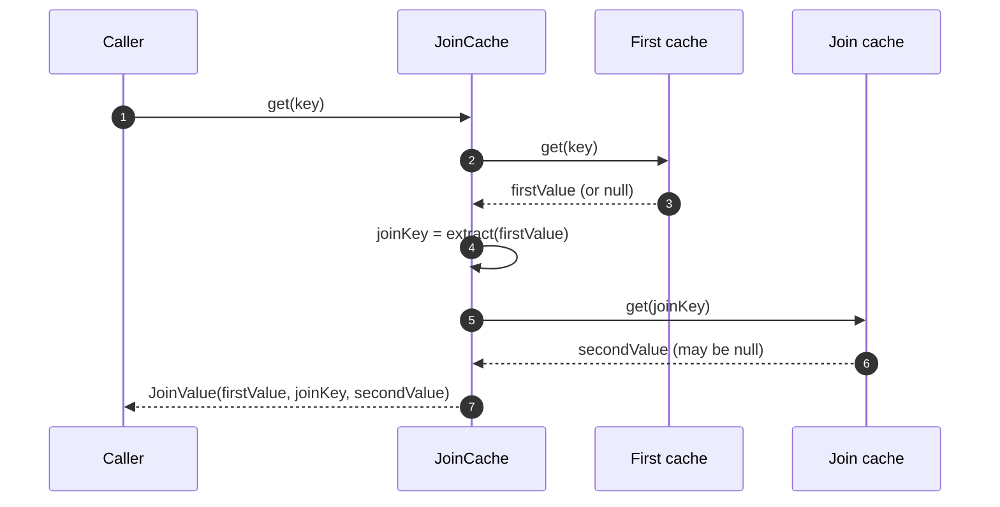

# JoinCache

Many read models are "one thing plus the thing it points to": an order and its customer, a profile extension and its user. You already cache both. A `JoinCache` reads them together: it reads a value from the **first** cache, derives a key from it, and reads the **join** cache with that key.



A JoinCache is a **read-only view**. It stores nothing, has no loader, and has no `put`. Each component cache keeps its own loader, TTL, and invalidation.

## Declare it {#declare}

The two component caches are ordinary caches, declared as interfaces or spec beans. The view is an interface that extends `JoinCache<K1, V1, K2, V2>`, listed in `@EnableCoCache(joinCaches = …)`:

```kotlin
data class UserExtendInfo(val id: String, val userId: String)

@CoCache
interface UserExtendInfoCache : Cache<String, UserExtendInfo>

@CoCache
interface UserCache : Cache<String, User>

@JoinCacheable(
    firstCacheName = "UserExtendInfoCache",
    joinCacheName = "UserCache",
    joinKeyExpression = "#{#root.userId}",   // evaluated against the first value
)
interface UserExtendInfoJoinCache : JoinCache<String, UserExtendInfo, String, User>

@EnableCoCache(
    caches = [UserExtendInfoCache::class, UserCache::class],
    joinCaches = [UserExtendInfoJoinCache::class],
)
@SpringBootApplication
class App
```

Inject `UserExtendInfoJoinCache` like any bean. Its bean name is the view name.

| `@JoinCacheable` attribute | Meaning |
|----------------------------|---------|
| `name` | View name and bean name. Default: the interface's simple name. |
| `firstCacheName` | **Required.** The first cache's name (an interface cache's name, or a spec cache's name or bean name). |
| `joinCacheName` | **Required.** The join cache, by the same rules. |
| `joinKeyExpression` | SpEL template with the first value as root, such as `#{#root.userId}` or `#{userId}`. Requires `K2 = String`. |
| `joinKeyExtractor` | Bean name of a `JoinKeyExtractor<V1, K2>`. |

## The join key {#join-key}

Choose one of three ways:

1. **`joinKeyExpression`**: a SpEL template, for `String` join keys only.
2. **`joinKeyExtractor = "beanName"`**: any join key type.
3. **Neither**: the single bean of type `JoinKeyExtractor<V1, K2>` is used.

```kotlin
@Bean
fun userIdOf() = JoinKeyExtractor<UserExtendInfo, String> { it.userId }
```

A `null` join key means "nothing to join": the result has `joinKey = null` and `secondValue = null`, and the join cache isn't read. An expression that evaluates to `null` behaves the same way.

## What each call does {#semantics}

| Call | Behavior |
|------|----------|
| `get(key)` | Reads the first cache (loading on a miss). Absent, or a negative entry: returns `null`. Otherwise extracts the join key and reads the join cache; an absent second value gives `secondValue = null`. |
| `getAll(keys)` | One `getAll` on the first cache, then one `getAll` on the join cache over the **distinct** non-null join keys (skipped if there are none). Contains only keys whose first value exists. |
| `invalidate(key)` | Invalidates **only the first cache**. The second value is shared with other entries and belongs to its own writers. |
| `invalidate(firstKey, joinKey)` | Invalidates both. |

Because `getAll` is two batch reads, listing 100 extensions that point to 20 users costs at most one batched Redis read and one `loadAll` per cache, regardless of how many entries share a user.

## Guarantees and limits {#guarantees}

- Every read goes through the component caches, so their guarantees apply unchanged: fenced loads, invalidation, `localMaxAge`.
- **No snapshot across the two caches.** The two reads are independent; the pair may combine values from different moments. If the first value changes its join key between reads, you see the old pairing until the first cache is invalidated.
- When a `User` changes, invalidate it in `UserCache`. Every view that reads it sees the change on its next call.

## Adding methods {#methods}

Default methods run on the proxy:

```kotlin
interface UserExtendInfoJoinCache : JoinCache<String, UserExtendInfo, String, User> {
    fun userOf(id: String): User? = get(id)?.secondValue
}
```

An abstract method that doesn't match a `JoinCache` method fails startup.

## Startup checks {#validation}

Startup fails, naming the view and the attribute, when:

- `firstCacheName` or `joinCacheName` is blank or matches no cache,
- a named cache isn't a `Cache<K1, V1>` (or `Cache<K2, V2>`),
- the interface's type arguments aren't concrete or `@JoinCacheable` is missing,
- both `joinKeyExpression` and `joinKeyExtractor` are set, `joinKeyExpression` is used with a non-`String` join key, or the extractor lookup by type finds zero or several beans.

## Without Spring {#without-spring}

`SimpleJoinCache` in `cocache-core` is the implementation, and `JoinCacheProxies` wraps it in your interface:

```kotlin
val view = SimpleJoinCache("UserExtendInfoJoinCache", userExtendInfoCache, userCache) { info -> info.userId }
val typed = JoinCacheProxies.create(UserExtendInfoJoinCache::class.java, view)
```
