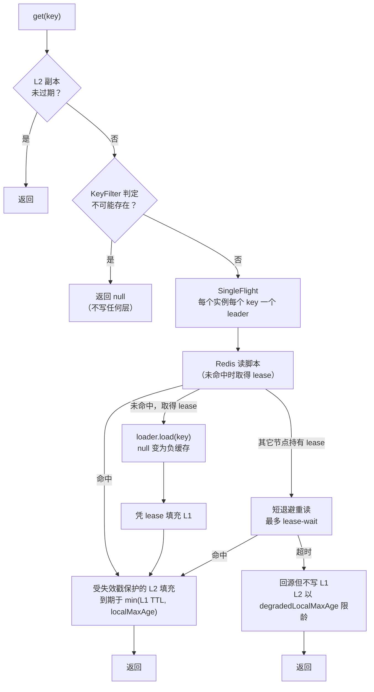

# 一致性

本页描述读、写与失效路径，以及它们为什么不会吞没失效。规范版本见 [RFC 0003](https://github.com/Ahoo-Wang/CoCache/blob/main/docs/rfc/0003-target-architecture.md) 第 4 节与 [`docs/architecture.md`](https://github.com/Ahoo-Wang/CoCache/blob/main/docs/architecture.md)。

## 问题：在失效之后才落地的填充 {#the-problem}

缓存的所有正确性问题都是同一种交错：一次开始得早的复制，在失效之后才落地。

1. 读者 A 未命中，开始加载，读到旧数据。
2. 写者 B 更新数据并失效该 key。
3. A 完成加载，在 B 的失效之后把旧数据写入缓存。

CoCache 用一条规则防止它，即**栅栏**：*填充必须持有读取之前取得的令牌，失效销毁令牌。* L1 与 L2 各有自己的令牌。

| 层 | 令牌 | 填充方 | 失效方 |
|----|------|--------|--------|
| L1（Redis） | **lease**：未命中时由读脚本原子取得；或者**刷新令牌** | 填充脚本仅当 L1 中仍是自己的令牌时写入 | `DEL` 或整体覆盖销毁令牌 |
| L2（每个实例） | **失效戳**：每个 key 一个分段计数器（4,096 段） | 取戳、读 L1、校验戳、写 L2、再次校验，失败则撤销 | 在修改 L1 **之前和之后**各递增一次戳，并各淘汰一次 L2 |

令牌由客户端用 `NodeId` 加序号构造，全局唯一、永不重复签发，被销毁的 lease 不可能再次匹配。

## 读路径 {#read-path}

- **合并加载。** 同一实例上同一 key 的并发未命中共享一次 Redis 读取和一次加载。等待者得到 leader 的结果或其原始异常。loader 在同一线程上读取自己的 key 时会快速失败，而不是死锁。
- **全集群合并。** 未命中时读脚本原子地写入 lease 占位，所以整个集群恰好一个节点回源。其它节点以短退避重读，最多等待 `lease-wait`（200 ms）。持有者届时仍未填充，它们就自行回源，不写 L1，结果在 L2 中保留 `degradedLocalMaxAge`。
- **lease 一定会被释放或过期。** loader 抛出异常、被回源并发上限拒绝，或者引擎决定不填充时，立即释放 lease。崩溃节点留下的 lease 在 `lease-ttl`（10 秒）后过期。
- **填充被拒绝时照常返回。** 如果因为失效销毁了 lease，或者 loader 慢于 `lease-ttl` 而填充失败，结果照常返回，并在 L2 中保留 `degradedLocalMaxAge`，慢 key 不会一直未命中。
- **L1 未命中从不等于“不存在”。** key 不存在、处于 lease 占位、载荷无法解码，都是未命中。只有存储的负缓存（状态 `M`）才表示“不存在”。
- **读路径从不无条件删除。** 无法解码的载荷只有当 Redis 中仍是读到的那份字节时（在脚本中按 SHA-1 比较）才转为 lease，然后重新加载。格式版本高于本节点所知的值既不回收也不写回。
- **没有 loader 的缓存**未命中时返回 `null`，释放 lease，不写 L1。

批量读取（`getAll`）对每个 key 做同样的事，但成批进行：一次为未命中的 key 申请 lease 的 Redis 读取、一次 `loadAll`、一次批量填充。它会合并在途的单 key 加载，先完成自己负责的 key 再等待别人，并且不等待其它节点的 lease（这些 key 回源但不写 L1）。

## 写入与失效路径 {#write-and-invalidation-paths}

| 操作 | 步骤 | 往返 |
|------|------|------|
| `invalidate(key)` | 戳 → 淘汰 L2 → 脚本：`DEL` + `PUBLISH` → 戳 → 淘汰 L2 | 1 |
| `put(key, value)` | 戳 → 淘汰 L2 → 脚本：覆盖 + 到期时间 + `PUBLISH` → 戳 → 淘汰 L2。**不写 L2** | 1 |
| `SetCache.add` / `remove` | 戳 → 淘汰 L2 → 脚本：成员更新 + 到期时间 + `PUBLISH` → 戳 → 淘汰 L2 | 1 |
| 收到其它实例的事件 | 戳 → 淘汰 L2（忽略自己 `NodeId` 发出的事件） | |
| 通道（重新）订阅、心跳失败 | 递增全部戳 → 清空 L2 | |

第二次递增保证了本地失效的安全。没有它，读者可能在第一次递增之后取戳、在脚本执行之前读到 L1 旧值，并通过两次校验；而本实例自己的事件会被过滤，没有别的东西能清除这份副本。

**为什么 `put` 不写 L2。** 戳只能判断填充期间有没有发生失效，判断不了两次写入谁先到达 Redis。同一实例上两个并发的 `put` 否则可能在 L2 中留下较旧的值。L2 只由读 L1 的路径填充，所以总是与 L1 的顺序一致。读己之写仍然成立：`put` 返回时 L2 已被淘汰，下一次读取从 L1 读到新值。

**先更新数据源，再在提交之后失效。** 事务内使用 `TransactionalInvalidator`（[Spring Cache](../guide/spring-cache.md#transactions)）。

## 读己之写 {#read-your-writes}

读取开始时记下该 key 的戳。如果它合并到的共享加载开始于本读者已经观察到的某次失效之前，读者放弃这个结果并重新加载一次。即使同一线程刚刚失效了该 key 再读取，也成立。这依赖于 `SingleFlight` 在发布结果*之前*注销调用，所以重试总是开始一次新的加载。

## 提前刷新 {#refresh-ahead}

设置了 `refreshWindow` 时，L2 副本还会记下其 L1 值何时进入窗口。此后的命中返回当前值，并启动一次后台刷新。只有当值的剩余 TTL 在窗口内且没有未过期的令牌时，读脚本才授予**刷新令牌**，所以整个集群只有一个节点回源并凭令牌填充，其它节点只从 L1 重新填充 L2。`invalidate`、`put` 与集合更新都会销毁令牌，所以刷新与其它填充一样受栅栏保护。签发超过 `lease-ttl` 的令牌可以被抢占。刷新执行器拒绝任务或加载失败时，释放令牌，值照常到期。

## 失效通道 {#invalidation-channel}

每个进程一条订阅连接，按命名空间把消息分发给缓存。命名空间的频道是 `cocache:inv:{namespace}`。投递**至多一次**：断线的订阅者，或被输出缓冲区限制断开的订阅者，会丢失消息。三种机制限制其影响：

- **（重新）订阅时重置。** 订阅得到服务端确认时，其上的每个缓存递增全部戳并清空 L2。注册新缓存不会重置已有缓存。
- **心跳。** 订阅连接每隔 `heartbeat`（5 秒）PING 一次。PING 失败或超时会重置所有订阅者并强制重连，所以半开连接在秒级内被发现。
- **`localMaxAge`。** 无论事件发生什么，L2 副本都不会活过它。

| `cocache.redis.channel-mode` | 广播 | 说明 |
|------------------------------|------|------|
| `pubsub`（默认） | 写脚本内 `PUBLISH`：与 L1 修改原子完成 | Redis Cluster 中 `PUBLISH` 经集群总线发往所有节点 |
| `sharded` | 脚本之后立即 `SPUBLISH`：**非原子** | 只在频道 slot 所属的分片内传播（Redis 7+）。slot 迁移导致频道被退订时，CoCache 重置并重新订阅 |

`pubsub` 模式下，后端启动时探测脚本能否向另一个 slot 的频道发布。把 `PUBLISH` 当作 `SPUBLISH` 执行的环境（例如 ElastiCache Serverless）探测失败，后端退回为写入之后再发布，并输出告警。两种模式互相收不到对方的消息，所以**所有实例必须使用同一种模式**。

## 保证什么 {#what-is-guaranteed}

| 性质 | 保证 |
|------|------|
| L1 与协议内的竞态 | 加载开始于某次失效之前的填充，在任何节点上都不会在该失效之后落地 |
| L1 与协议外的变化 | 以 `ttl` 为上界（负缓存以 `absentTtl` 为上界） |
| 事件送达时的 L2 | 只在事件延迟内陈旧，通常为毫秒级 |
| 事件丢失时的 L2 | 至多 `localMaxAge`，并在重连或心跳失败时清空 |
| L1 故障之后的 L2 | 降级填充至多存活 `degradedLocalMaxAge`；待重试的失效让未命中跳过 L1，直到重试成功 |
| `invalidate` / `put` 返回后的同一实例 | 不再返回之前的值 |
| 全集群的并发未命中 | 只加载一次，前提是在 `lease-wait` 内完成 |

## 不保证什么 {#what-is-not-guaranteed}

- **线性一致读。** 在写入与事件到达之间，其它实例可能从 L2 返回之前的值。
- **CoCache 看不到的变化。** 绕过缓存且没有使用[失效协议](../guide/operations.md#external-eviction)的写入，或者读到滞后从库的 loader，会让旧值保留到 `ttl`。
- **Redis 故障切换。** 异步复制可能丢失最近的 `DEL` 或填充，让旧值回到 L1。`ttl` 与 `localMaxAge` 为其上界。需要更强保证时，在故障切换后失效全部数据。
- **不带 `sync = true` 的 `@Cacheable`。** Spring 的无条件 `put` 绕过了 lease。
