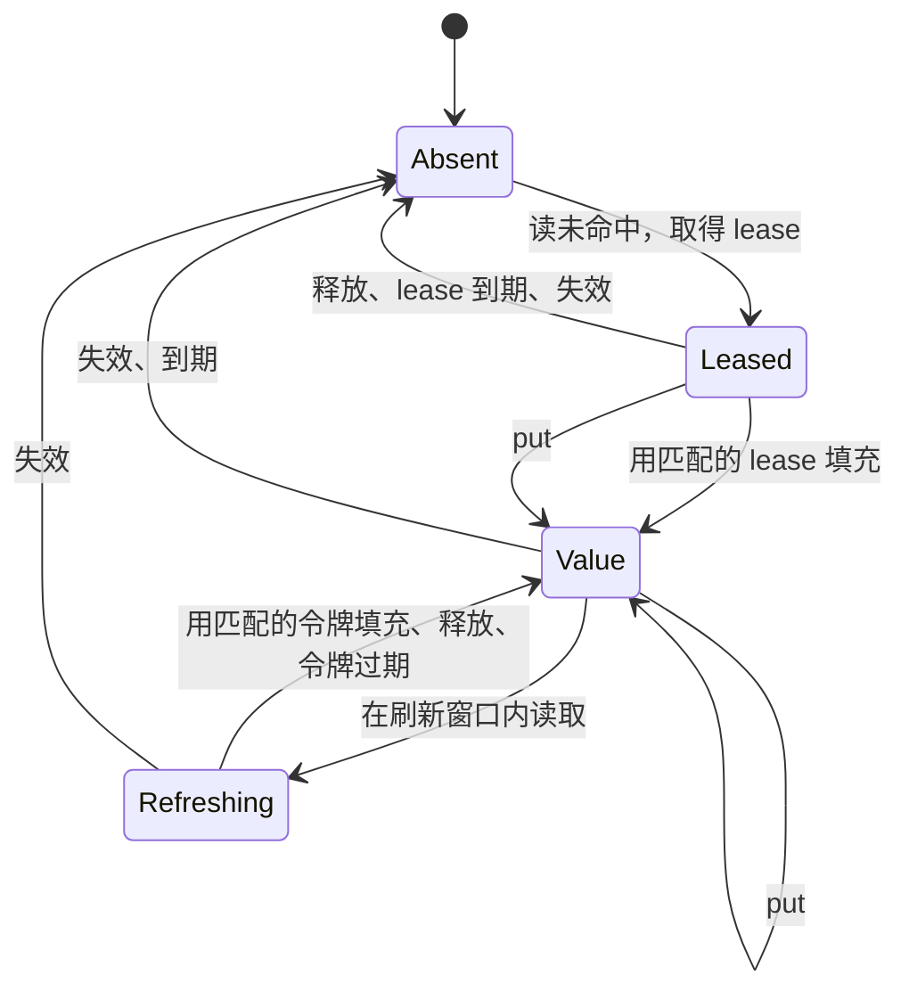
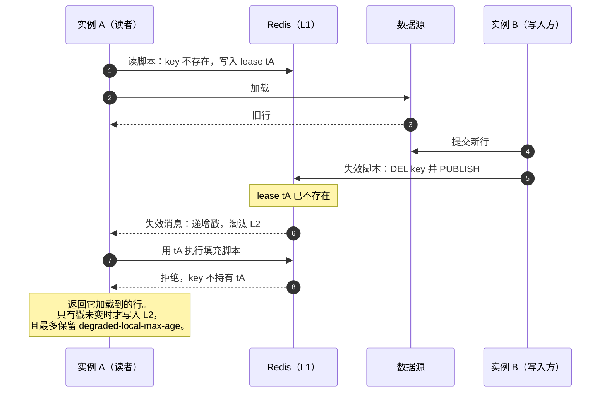
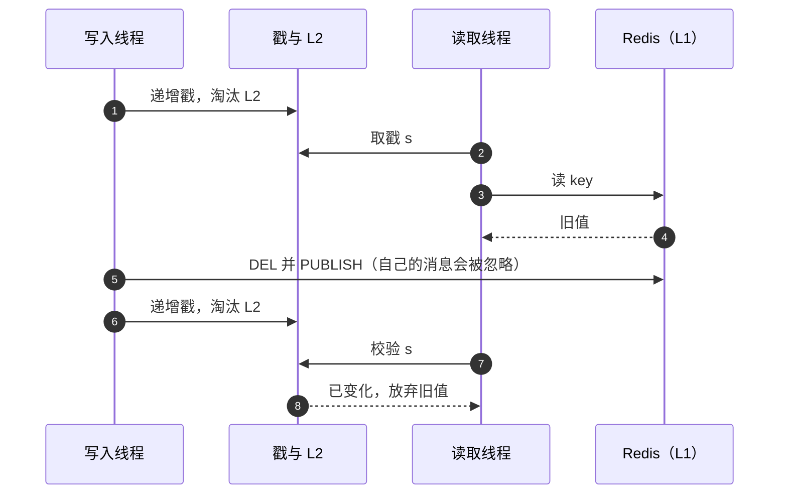
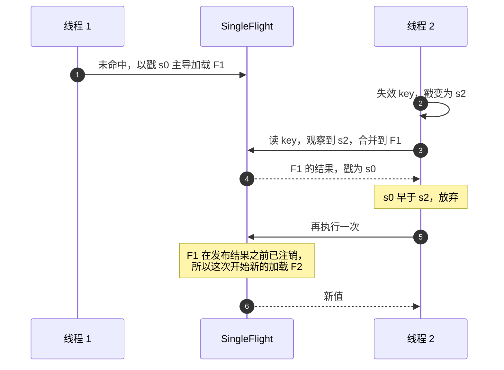
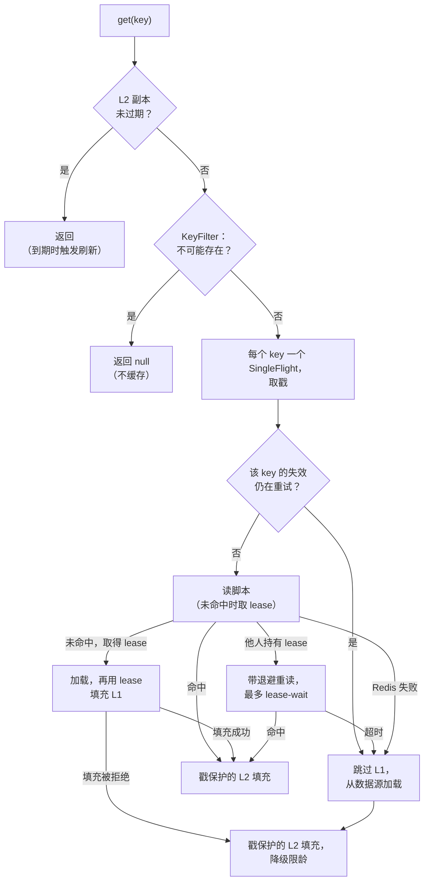

# 一致性

本页说明 CoCache 保证什么、为什么成立。它足够严谨，可以对照代码检查，每个论断都对应规范 [`docs/architecture.md`](https://github.com/Ahoo-Wang/CoCache/blob/main/docs/architecture.md)。

## 唯一的交错 {#the-problem}

缓存的所有正确性问题都是同一个竞态：**一次开始于失效之前的复制，在失效之后才落地。**

1. 读者 A 未命中，开始加载，读到旧行。
2. 写入方 B 提交新行，并失效该 key。
3. A 加载完成，在 B 的失效之后把旧行写入缓存。

在过期之前，没有任何东西会移除这个副本。CoCache 有两份可能这样陈旧的副本：Redis 中的 L1 与每个实例中的 L2。它用一条规则在两层同时消除这个竞态。

## 栅栏规则 {#fences}

> **填充必须持有在读取之前取得的令牌。失效在修改下一层之前和之后各销毁一次令牌。**

| 层 | 令牌 | 填充方 | 失效方 |
|----|------|--------|--------|
| L1（Redis） | **lease**，未命中时由读脚本原子取得；或**刷新令牌**，值进入刷新窗口时原子取得 | 填充脚本只在 key 仍持有同一个令牌时写入 | `DEL`、整体覆盖或集合更新替换 key，令牌随之消失 |
| L2（每个实例一份） | **失效戳**：按 key 分段的计数器（4,096 段） | 取戳、读 L1、校验戳、写 L2、再次校验，不一致则撤销 | 递增戳并淘汰 L2，修改 L1，再递增并淘汰一次 |

令牌由客户端用运行时的 `NodeId` 加序号构造，在全集群唯一、永不重复签发。被销毁的令牌不可能再次匹配，所以没有 ABA 问题。戳的分段可能碰撞：两个 key 共用一个计数器，偶尔会白白放弃一次填充。代价是一次重新加载，从不影响正确性。

## L1：lease {#l1-fence}

L1 中的每个 key 在以下状态之间转换。每个转换都是一个 Lua 脚本，因此是原子的；每个转换都显式设置到期时间，lease 或负缓存的寿命不会泄漏到值上。



“Value”包括负缓存与集合。`put` 覆盖任何状态，销毁任何令牌。

上面的竞态，加上 lease 之后：



- B 的失效发生在 A 取得 lease **之后**：它销毁了 lease，A 的填充被拒绝，旧行永远到不了 L1。
- B 的失效发生在 A 取得 lease **之前**：A 的加载开始于 B 提交之后，读到的是新行。

两种情况下，**开始于某次失效之前的加载都不会在该失效之后出现在 L1 中**。这在每个实例上、对任意加载耗时都成立，而且不依赖时钟。

lease 同时在全集群合并回源。发现其它实例持有 lease 的未命中会以 2 到 50 ms 的退避重读，最多等待 `lease-wait`（lease 剩余寿命更短时以它为准）。值出现了就用它，没出现就自行加载、不写 L1。用不上的 lease 总会被释放：loader、`ttlOf` 或编解码器抛出异常时，加载被 `load-max-concurrent` 拒绝时，以及缓存没有 loader 时。崩溃实例留下的 lease 在 `lease-ttl` 后到期。

被拒绝的填充仍会把结果返回给调用方，并以 `degraded-local-max-age`（默认 10 s）留在 L2 中。否则，loader 慢于 `lease-ttl` 的 key 会永远未命中。

## L2：失效戳 {#l2-fence}

每个实例为每个 key 分段维护一个戳计数器。填充在 SingleFlight 注册**之后**、读 L1 **之前**取戳，整个调用（包括等待 lease 的重读）只用这一个戳：

```
stamp = stamps.current(k)
value = 读 L1（可能还要加载并填充）
if stamps.current(k) != stamp: 放弃              // 写之前校验
L2.put(k, value)
if stamps.current(k) != stamp: L2.invalidate(k)  // 写之后复核
```

失效方在修改 L1 **之前和之后**各递增一次戳并淘汰 L2。以同一实例上的一个读者和一个写入方为例，说明为什么需要第二次递增：



只有第一次递增时，读者在它之后取戳，在脚本执行之前读到旧值，两次校验都会通过。实例会忽略自己发出的消息，于是没有任何东西会移除这个副本。有了第二次递增，读者要么校验失败，要么在第二次递增之前已经写入 L2，被紧随其后的淘汰移除。

**处理远端失效是同一个步骤**。收到消息的实例递增戳并淘汰 L2，与第二次递增完全相同。消息到达之前返回旧值，属于允许的“事件延迟”。

**L2 只由读取 L1 的路径填充**，写入方从不写 L2。戳能判断填充期间是否发生过失效，却判断不了两次写入谁先到达 Redis。如果 `put` 写 L2，同一实例上两个并发的 `put` 可能让 L2 留下较旧的值，而 Redis 中是较新的值。只从 L1 填充 L2，L2 就与 L1 的顺序一致。代价是 `put` 之后的第一次读取多一次 Redis 往返。

## 读己之写 {#read-your-writes}

`invalidate` 或 `put` 返回之后，同一个实例不会再返回之前的值。这还需要一个顺序保证，因为读取可能合并到一次已经在途的加载。

读取在加入 SingleFlight 之前记录 key 的戳。如果它合并到的加载开始时的戳更旧，说明那次加载开始于这个读者已经看到的某次失效之前，读者就放弃结果，再执行一次。



成立的前提是 **SingleFlight 先注销调用，再发布结果**。被唤醒后重试的等待者不可能再次合并到同一次陈旧的调用，所以重试一次总是足够。

SingleFlight 还保证：每个实例上每个 key 同一时刻只有一次加载；每个等待者得到 leader 的结果或其原始异常；loader 在同一线程上读取自己的 key 会快速失败而不是死锁；批量 leader 先完成自己负责的 key，再等待别人负责的 key。

## 写入方顺序 {#writer-order}

| 操作 | 步骤 | 往返 |
|------|------|------|
| `invalidate`、`invalidateAll` | 递增、淘汰 L2 → 脚本：`DEL` + `PUBLISH` → 递增、淘汰 L2 | 1（每批 512 个 key，Cluster 中每个 slot） |
| `put` | 递增、淘汰 L2 → 脚本：覆盖 + 到期时间 + `PUBLISH` → 递增、淘汰 L2。不写 L2 | 1 |
| `SetCache.add` / `remove` / `clear` / `put` | 递增、淘汰 L2 → 脚本：成员更新 + 到期时间 + `PUBLISH` → 递增、淘汰 L2 | 1 |
| 来自其它实例的消息 | 递增、淘汰 L2。跳过本实例 `NodeId` 发出的消息 | — |
| 重置（订阅得到确认、心跳失败）、`clearLocal` | 递增所有分段，清空 L2 | — |

无论脚本成功与否，第二次递增都会执行。后端不能原子广播时，引擎在脚本成功之后立即发布，发布失败按写入失败处理。

**调用方的责任：先修改数据源，再失效**。在提交之前失效本身就是那个竞态：并发的未命中可能在失效之后加载到未提交的行。事务内，`TransactionalInvalidator` 会把失效推迟到 `afterCommit`。

## 失效通道 {#invalidation-channel}

每个实例有一条订阅连接，按命名空间把频道 `cocache:inv:{namespace}` 上的消息分发给各缓存。投递是**至多一次**：实例断开期间发布的消息、被输出缓冲区限制丢弃的消息都会丢失。三种机制限制了损害：

1. **（重新）订阅时重置**。Redis 确认订阅时，该频道上的每个缓存递增所有戳并清空 L2。第一次订阅会等待这个确认（最多 `command-timeout`），所以重置不会晚于缓存开始填充。Lettuce 在重连后重新订阅，确认时再次重置。新增缓存不会重置其它缓存。
2. **心跳**。订阅连接每隔 `heartbeat`（5 s）PING 一次。PING 失败或超时会重置所有缓存并强制重连，半开连接在秒级内被发现。Redis Cluster 的 `sharded` 模式下，心跳还会检查每个频道是否仍订阅在其 slot 所属的主节点上，故障切换或 slot 迁移后重新订阅。
3. **`local-max-age`**。无论消息发生什么，L2 副本都不会活过它。它必须是有限的，它是消息在连接毫无察觉时丢失的上界。

| 模式 | 广播 | 后果 |
|------|------|------|
| `pubsub`（默认） | 在写脚本内 `PUBLISH` | L1 修改与广播是同一个原子步骤，没有客户端窗口 |
| `sharded` | 脚本之后立即 `SPUBLISH` | 两者之间的崩溃会丢失消息。其它实例最多在 `local-max-age` 内返回 L2 副本，L1 已经正确 |

`pubsub` 模式下，后端启动时探测脚本能否向另一个 slot 的频道发布。不能时（部分托管服务或 ACL），它像 `sharded` 一样在写入之后发布。写入失败时也会发布，因为失败的写入可能已部分生效（跨多个 slot 组的 `putAll`，或 Redis 已执行但应答丢失的写入）；多余的失效只淘汰副本。见[部署](../operations/index.md#channel-mode)。

## 读路径 {#read-path}



- **L2 副本的到期时间**：从 L1 填充或填充进 L1 的副本是 `min(L1 剩余寿命, local-max-age)`，绕过 L1 的副本是 `min(寿命, degraded-local-max-age)`。命中是一次 map 查找加一次与 ticking clock 的比较。
- **L1 未命中就是未命中**。key 不存在、处于 lease 状态或内容无法读取，都不代表“不存在”。只有存储的负缓存（状态 `M`）才代表不存在，它在 loader 返回 `null`（或 `loadAll` 结果中缺少该 key）时写入，存活 `absent-ttl`。
- **没有 loader 的缓存**在未命中时释放 lease，不向 L1 写入任何内容（负缓存会挡住其它实例之后的 `put`），只在 L2 中记住“没有答案”，存活 `absent-ttl`。`get(key, loader)` 不接受这个结果，会用调用方的 loader 加载。
- **读路径从不无条件删除**。无法读取的内容（外来字节，或编解码器无法解码的值）只有在 Redis 中仍是读到的那份字节时（在脚本内比较 SHA-1）才会转为 lease，然后正常回源。内容已变时，本次读取不写 L1 直接回源。更新格式的内容从不被回收或覆盖。
- **批量读取**（`getAll`）逐个 key 查 L2，然后 leader 取戳，用一次流水线往返从 L1 读取所有未命中的 key（同时申请 lease），调用一次 `loadAll`，再填充一次。它会合并在途的单 key 加载，但不等待其它实例的 lease：这些 key 直接回源，不写 L1。共享到的结果若开始于本次读取已看到的失效之前，就改走单 key 路径。
- **loader 在调用方线程上执行**，事务、安全上下文与 MDC 都可用。Redis 的 future 在调用方线程上等待，事件循环线程上不执行任何续接。

### 提前刷新 {#refresh-ahead}

设置 `refresh-window` 后，L2 副本会记录其 L1 值进入窗口的时间。此后的命中照常返回当前值，并为每个实例上的每个 key 提交一次后台刷新。刷新以申请**刷新令牌**的方式读取。Redis 只把令牌授予剩余寿命在窗口内、且没有有效令牌的值，所以全集群只有一个实例回源，并用该令牌填充，其它实例只从 L1 重新填充 L2。`invalidate`、`put` 与集合更新都会销毁令牌，所以刷新像任何填充一样受栅栏保护。签发时间早于 `lease-ttl` 的令牌可以被接管。被执行器拒绝或失败的刷新只记录日志，值正常到期。

## 失败处理 {#failures}

| 失败 | 发生什么 | 为什么仍然安全 |
|------|----------|----------------|
| Redis 读取失败 | 默认：从数据源加载，只写 L2，限龄 `degraded-local-max-age`。或者抛出（`read-failure: throw`） | 没有 lease 就不写 L1。L2 副本受戳保护且寿命很短 |
| 填充或释放失败、超时 | 记录日志并计数，结果照常返回 | 填充受令牌保护：如果它生效了，就一定生效在任何失效之前，因为失效会销毁令牌。没有释放的 lease 在 `lease-ttl` 后到期 |
| `invalidate` 失败 | 本地效果先生效（两次递增与淘汰）。默认在后台重试（8 次，退避 100 ms 到 10 s，最多排队 10,000 个），不抛出。期间本实例上该 key 的未命中跳过 L1。成功后本实例再递增并淘汰一次 | 本实例不会返回或重新填充旧值。其它实例以 L1 的剩余寿命为上界。放弃时计入 `invalidations.dropped` 并记录错误日志 |
| `put` 或集合写入失败 | 本地效果先生效，然后抛出 `CacheWriteException`。超时时 Redis 可能已经执行 | 尝试前后都淘汰了 L2，不会留下陈旧的本地副本。这些调用幂等 |
| Redis 断线 | 命令被拒绝，而不是缓冲 | 否则一个已经向调用方报错的 `put` 可能稍后重放，覆盖更新的值 |
| loader 抛出异常 | 立即释放 lease。异常抛给调用方与所有合并的等待者 | 其它实例不必等待 `lease-ttl` |
| 实例持有 lease 时崩溃 | 其它实例最多等待 `lease-wait`，然后自行加载、不写 L1。lease 在 `lease-ttl` 后到期 | 没有有效令牌就无法填充 |
| 订阅丢失 | 心跳或重新订阅会重置所有 L2 | 断开期间丢失的消息不会让 L2 陈旧到重置之后 |
| 脚本缓存丢失（故障切换、重启） | 遇到 `NOSCRIPT` 时改用 `EVAL` 重试 | — |
| Redis 故障切换丢失最近的写入 | 已删除的值可能重新出现在 L1 中 | 属于协议之外：以 `ttl` 为上界 |

## 陈旧度上界 {#staleness-bounds}

这些上界是目标 G1 的精确形式。“陈旧”指返回的值早于数据源最新提交的值。

| 情形 | 上界 | 精确条件 |
|------|------|----------|
| 协议内的竞态，L1 | **0** | 写入方先修改数据源，再经 CoCache 失效或 `put` |
| `invalidate` / `put` 返回后的同一实例 | **0** | 读己之写 |
| 其它实例的 L2，消息送达 | 消息延迟 | 通常是毫秒级 |
| 其它实例的 L2，消息丢失且连接有所察觉 | `min(local-max-age, heartbeat + 重连时长)` | 心跳失败或订阅重新建立，重置 L2 |
| 其它实例的 L2，消息悄然丢失 | `local-max-age` | 默认 5 分钟。`sharded` 模式下写入方在脚本与发布之间崩溃时也是这个上界 |
| 绕过 L1 的 L2 副本（降级填充） | `degraded-local-max-age` | Redis 失败、等待 lease 超时、填充被拒绝、未知格式、失效仍在重试 |
| 失效仍在重试 | 直到重试成功 | 写入方实例跳过 L1。其它实例可能从旧的 L1 值重新填充 L2 |
| 失效被放弃 | L1 的剩余寿命，所有实例 | 每个 L2 副本到期后从旧的 L1 值重新填充。`ttl-forever` 时没有上界。会计数并记录日志 |
| 协议之外的写入、故障切换丢失的写入、读取滞后从库的 loader | 该值在 L1 中的剩余寿命（`ttl`，加减抖动） | `ttl-forever` 时没有上界。负缓存：`absent-ttl` |
| 没有 `sync = true` 的 `@Cacheable` | `ttl` | Spring 的无条件 `put` 绕过了 lease |

## 不保证的内容 {#not-guaranteed}

- **线性一致读**。在写入与其消息到达之间，两个实例可能短暂不一致。
- **CoCache 看不到的变化**。绕过 CoCache 且没有使用[失效协议](../operations/troubleshooting.md#external-invalidation)的写入，会让旧值保留到 `ttl`。
- **Redis 的持久性**。故障切换可能丢失最近的写入，包括值与失效。
- **跨缓存的原子快照**。[JoinCache](../guide/join-cache.md) 读取两个各有保证的缓存，而不是一个一致的快照。

## 集合缓存 {#set-cache}

`SetCache` 是“Redis 只是副本”的有意例外：Redis 保存集合的**唯一**副本。

- 元素的 `add` 与 `remove` 在 Redis 中原子完成，来自任意实例的并发更新都会保留，顺序以 Redis 为准。
- 没有 loader。`invalidate` 会抛出异常，因为它会销毁唯一副本。删除集合用 `clear(key)`。
- 读取不取 lease。未命中会把空结果以戳保护的方式缓存在 L2 中，存活 `local-max-age`。Redis 读取失败直接抛出，因为没有可以降级的数据源。
- 默认 `ttl` 是永不过期，持久性就是 Redis 的持久性，所以 Redis 的 `maxmemory-policy` 不能是 `allkeys-*`。见[部署](../operations/index.md#maxmemory-policy)。

如果集合的数据在数据库中，请改用 `Cache<K, Set<E>>`，并在每次修改之后失效。增量更新无法与数据库提交正确排序。
