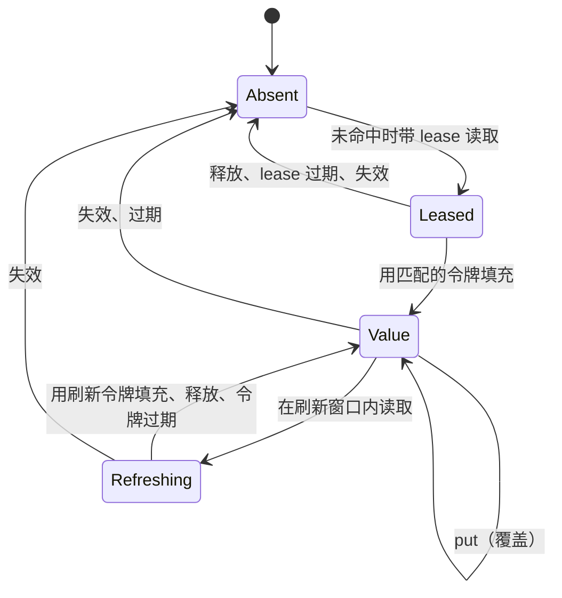

# 扩展 CoCache

扩展点都是接口：`me.ahoo.cocache.api` 中的 `CacheLoader` 与 `Codec`，`me.ahoo.cocache.api.spi` 中的后端 SPI（两者都在 `cocache-api`，没有依赖），以及 `me.ahoo.cocache.core` 中的 spec 函数 `KeyEncoder`、`KeyFilter` 与 `TtlFunction`。L2 固定为 Caffeine，不是扩展点。用 `cocache-test` 中的 TCK 验证新后端：

```kotlin
testImplementation("me.ahoo.cocache:cocache-test")
```

| 你实现的 | 约定 | 验证 |
|----------|------|------|
| `CoherenceBackend`（及其 `RemoteStore` 与 `InvalidationChannel`） | [后端](#backend) | `BackendProtocolSpec`、`EngineSpec`、`SetEngineSpec` |
| `Codec<V>` | [编解码](#codecs) | 自己的往返测试 |
| `CacheLoader<K, V>`、`KeyEncoder<K>`、`KeyFilter`、`TtlFunction<K, V>` | [函数](#functions) | 自己的测试 |

在 Spring Boot 应用中，`CoherenceBackend` bean 会取代 Redis 后端；`Codec<V>` bean 会被所有值类型为 `V` 的缓存采用。

## 后端 {#backend}

```kotlin
interface CoherenceBackend : AutoCloseable {
    val atomicBroadcast: Boolean          // 能否在写入的同一个原子步骤中广播？
    val format: Int                       // 本实现写入的线格式版本
    val channel: InvalidationChannel
    fun store(namespace: String): RemoteStore
}
```

L1 存储与失效通道是同一个后端的两个面：串行化写入的一方也应负责通知。引擎为每个缓存调用一次 `store(namespace)`，并为该命名空间订阅 `channel`。

### `RemoteStore` {#remote-store}

```kotlin
interface RemoteStore : AutoCloseable {
    fun read(key: String, lease: LeaseRequest?, refresh: RefreshRequest?): RemoteRead
    fun readAll(keys: Collection<String>, leases: Map<String, LeaseRequest>): Map<String, RemoteRead>
    fun fill(fill: Fill): Boolean
    fun fillAll(fills: List<Fill>): List<Boolean>
    fun release(key: String, token: Token)
    fun put(key: String, envelope: Envelope, ttl: Duration?, frame: ByteArray)
    fun invalidate(keys: Collection<String>, frame: ByteArray)
    fun reclaim(key: String, observed: Digest, lease: LeaseRequest): Boolean
    fun addMembers(key: String, members: Collection<ByteArray>, ttl: Duration?, frame: ByteArray)
    fun removeMembers(key: String, members: Collection<ByteArray>, ttl: Duration?, frame: ByteArray)
}
```

存储只处理字节与令牌，不持有任何策略：TTL、刷新窗口、令牌都由引擎作为参数传入。key 已经包含前缀与命名空间。每个 key 处于以下状态之一：



“Value”包括值、负缓存（`Envelope.Absent`）与集合（`Envelope.Members`）。约定：

- **每个方法对单个 key 原子执行。** 批量方法对每个 key 原子，不要求跨 key 原子。
- **`read`**：key 不存在且带 `lease` 时，写入 lease 占位并返回 `Miss(leaseGranted = true)`；处于 lease 状态时返回 `Leased(remaining)`；标量值的剩余 TTL 在 `refresh.window` 内且没有未过期的令牌时，写入刷新令牌并返回 `Hit(refreshGranted = true)`。签发超过 `tokenTtl` 的令牌视为过期。`Hit.format` 是存储的格式版本，不是本协议写入的内容为 `0`。
- **`fill`** 仅当 key 中仍是 `fill.token`（lease 或刷新令牌）时写入，返回是否写入。**`release`** 仅当令牌匹配时删除 lease 占位，或清除刷新令牌。
- **`put`、`invalidate`、`addMembers`、`removeMembers` 销毁任何令牌。** `addMembers` 把不存在的 key、负缓存或 lease 替换为新集合；`removeMembers` 只作用于集合，移空时删除 key。
- **`reclaim`** 仅当当前内容的 `Digest` 等于 `observed` 时把 key 转为 lease 占位（标量：载荷；负缓存：空；集合：按返回顺序拼接 `int32 长度 + 成员`）。它绝不能删除已经变化的内容。
- **每次状态转换都重设到期时间**（`ttl == null` 表示永不过期）。lease 或负缓存的 TTL 绝不能泄漏到新值上。使用毫秒精度。
- **读路径从不删除。**
- **广播。** `atomicBroadcast` 为 `true` 时，每个写方法都必须在同一个原子步骤中把 `frame` 发布到命名空间的频道；为 `false` 时，引擎在写入成功后调用 `channel.publish`。
- **失败时抛出异常。** 降级、重试还是重抛由引擎决定。

### `InvalidationChannel` {#invalidation-channel}

```kotlin
interface InvalidationChannel {
    fun subscribe(namespace: String, listener: InvalidationListener): Subscription
    fun publish(namespace: String, frame: ByteArray)   // 仅当 atomicBroadcast == false
}
interface InvalidationListener {
    fun onInvalidated(keys: List<String>, origin: NodeId)
    fun onReset()
}
```

- **投递至多一次。** `frame` 是 `InvalidationFrame`（`[版本][nodeId][数量]([长度][key])*`）。解码后用其中的 key 与来源调用 `onInvalidated`。订阅者会忽略自己的 `NodeId`，通道不需要过滤。
- **`onReset` 是必需的。** 每次订阅建立或重新建立*并得到服务端确认*时，以及任何可能丢失消息的时候（心跳失败、消费组再均衡），都要对该连接上的每个订阅者调用它。订阅者会清空 L2。没有重置，一个丢失的事件会让 L2 陈旧到 `localMaxAge`。
- 订阅新的命名空间不得重置其它命名空间。

## 编解码 {#codecs}

```kotlin
interface Codec<V> {
    fun encode(value: V): ByteArray
    fun decode(bytes: ByteArray): V
}
```

`decode` 遇到无法读取的字节时应抛出异常，引擎随后把该条目当作损坏：按未命中处理，条件回收，然后重新加载。修改 codec 的字节格式就是修改该缓存的线格式：使用新的命名空间或 `keyPrefix`，或者让 `decode` 同时接受两种格式。

## 函数 {#functions}

- **`CacheLoader<K, V>`**：`load(key)` 返回值，或返回 `null` 表示“不存在”（写入负缓存，存活 `absentTtl`）。`loadAll(keys)` 一次加载所有 L2 与 L1 都未命中的 key，结果中缺少的 key 写入负缓存。默认实现逐个调用 `load`，应覆盖为一次查询。loader 在调用方线程上执行，不得读取自己缓存中的同一个 key，否则调用快速失败。
- **`KeyEncoder<K>`**：把 key 转为 `{keyPrefix}{namespace}:` 之后的字符串，必须是单射。默认为 `toString()`。
- **`KeyFilter.notExist(storageKey)`**：只能对确定不存在的 key 返回 `true`。对布隆过滤器而言，意味着它必须由全部已有 key 构建。
- **`TtlFunction<K, V>`**（`ttlOf`）：按条目决定寿命，见[按条目决定寿命](../guide/configuration.md#per-entry-ttl)。

## TCK {#tck}

| 套件 | 覆盖内容 | 你需要提供 |
|------|----------|------------|
| `BackendProtocolSpec` | `RemoteStore` 状态机：lease、令牌、到期时间重设、广播、回收、释放 | `createBackend()`、`elapse(duration)` |
| `EngineSpec` | 两个运行时共享一个后端：加载、填充、失效与写入的全部交错，等待 lease、刷新、故障与重试、重置 | `createBackend()`、`clock`、`elapse(duration)`、`simulateReconnect()` |
| `SetEngineSpec` | 两个运行时之间的 `SetCache` 元素更新 | `createBackend()`、`clock`、`elapse(duration)` |

这些套件用 `HookedBackend` 包装你的后端，注入钩子与故障，用 latch 而不是 sleep 编排竞态。内存后端可以在 `elapse` 中推进 `ManualClock`；真实后端可以 sleep，因为套件使用很短的 TTL（必要时覆盖 `BackendProtocolSpec` 的 `shortTtl`）。

```kotlin
class InMemoryEngineTest : EngineSpec() {
    private val manualClock = ManualClock()
    private lateinit var memory: InMemoryBackend

    override val clock: CacheClock = manualClock
    override fun createBackend(): CoherenceBackend = InMemoryBackend(manualClock).also { memory = it }
    override fun elapse(duration: Duration) = manualClock.advance(duration)
    override fun simulateReconnect() = memory.reconnect()
}
```

`InMemoryBackend` 在单个进程内实现同一协议。多个运行时共享一个实例即可模拟多个节点，因此它也很适合用作应用自己测试中的后端。
