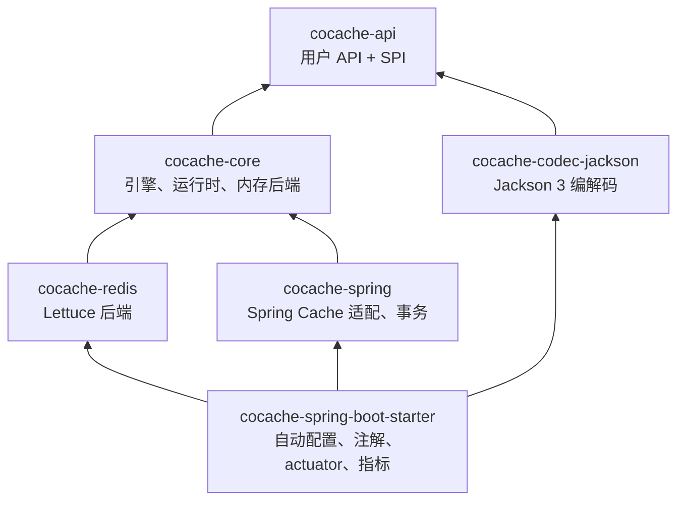
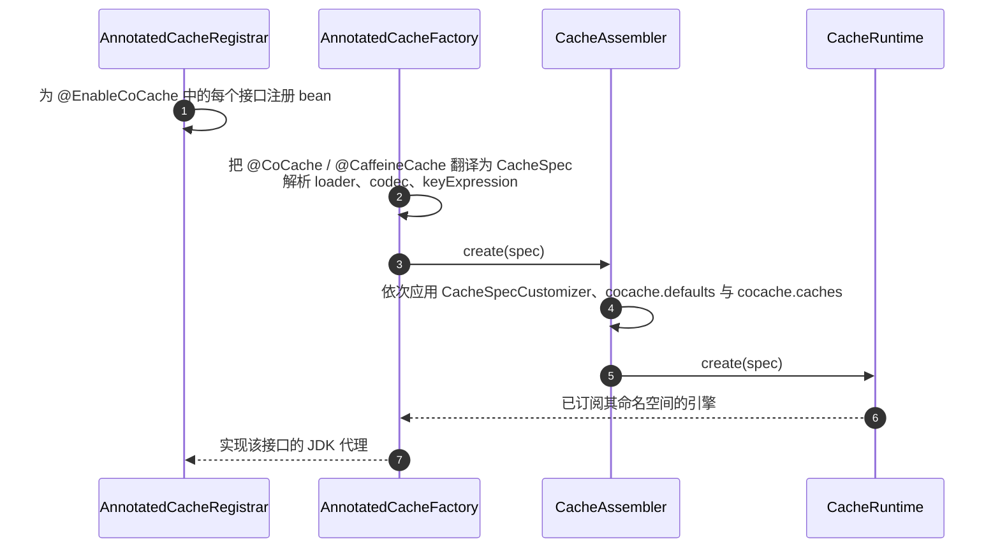

# 架构

本页说明 CoCache 的整体结构。规范性的设计以及任何改动都必须保持的不变量，见仓库中的 [`docs/architecture.md`](https://github.com/Ahoo-Wang/CoCache/blob/main/docs/architecture.md) 与 [RFC 0003](https://github.com/Ahoo-Wang/CoCache/blob/main/docs/rfc/0003-target-architecture.md)。本页与这些文档不一致时，以这些文档为准。

## 设计目标 {#design-goals}

二级缓存用陈旧换取延迟。每个设计决定都服务于三个目标：

| 目标 | 可度量的表述 | 手段 |
|------|--------------|------|
| **G1 陈旧度有界** | L1：协议内竞态造成的陈旧为 0，协议外的变化至多 `ttl`。L2：事件送达时为事件延迟，事件丢失时至多 `localMaxAge`，跳过 L1 的填充至多 `degradedLocalMaxAge` | 默认有限的 `localMaxAge`；每次重新订阅与心跳失败都清空 L2 |
| **G2 失效不被吞没** | 读取开始于某次失效之前的填充，永远不会在该失效之后出现在 L1，也不会出现在已处理该失效的任何实例的 L2 中 | 一个原语：栅栏。L1 用 lease，L2 用失效戳 |
| **G3 命中路径便宜** | L2 命中是一次并发哈希表读取加一次过期比较；L1 命中一次往返；单 key 写入或失效一次往返 | 固定的 Caffeine L2、定时刷新的时钟、原子 Lua 脚本、多路复用的 Lettuce 连接、L2 命中路径上不计数 |

**非目标：** 线性一致读；异步或协程 API。同步 API 对虚拟线程友好。

## 模块 {#modules}



| 模块 | 内容 |
|------|------|
| `cocache-api` | `Cache`、`SetCache`、`Lookup`、`CacheLoader`、`Codec`、`CacheClock`、异常、`@CoCache` / `@CaffeineCache` 注解，以及 `me.ahoo.cocache.api.spi` 中的 SPI：`CoherenceBackend`、`RemoteStore`、`InvalidationChannel`、`InvalidationFrame`。没有运行时依赖 |
| `cocache-core` | `CacheSpec`、`CachePolicy`、`CacheRuntime`、引擎、`SingleFlight`、`InvalidationStamps`、`CacheProxies`、`CacheAdmin` / `CacheMetrics`、`InMemoryBackend`、`TickingClock`、`ManualClock`、`StringCodec`。依赖 Caffeine |
| `cocache-redis` | `RedisBackend`：Lua 协议、线格式、Pub/Sub 与 Sharded 通道。依赖 `lettuce-core`，不依赖 Spring |
| `cocache-codec-jackson` | `JacksonCodec`（Jackson 3，`tools.jackson`） |
| `cocache-spring` | `CoCacheSpringCacheManager`、`TransactionalInvalidator`。供不用 Boot 的 Spring 应用使用 |
| `cocache-spring-boot-starter` | 自动配置、`@EnableCoCache`、spec bean 注册、`CoCacheProperties`、`CacheSpecCustomizer`、`cocache` Actuator 端点、Micrometer 绑定 |
| `cocache-test` | 新后端与引擎的 TCK |
| `cocache-bom` | 版本对齐 |

注解解析与 SpEL 只出现在 starter 中，所以 core 不依赖 Spring，也不依赖反射库。

## 职责 {#responsibilities}

- **loader 只负责加载。** `CacheLoader` 返回值或 `null`，从不决定值的寿命。
- **策略决定寿命。** `CachePolicy` 持有 `ttl`、抖动、`absentTtl`、`localMaxAge`、`degradedLocalMaxAge`、刷新窗口、lease、回源并发上限、L2 容量与故障模式。`CacheSpec.ttlOf` 按条目覆盖 `ttl`。
- **引擎**逐层读穿透、合并加载、取得与释放 lease、用失效戳为 L2 填充设栅栏、重试失效、提前刷新。loader 总是在调用方线程上执行。
- **后端**是一个对象的两个面：每个命名空间一个 `RemoteStore`，在字节与令牌上执行 L1 协议；一个 `InvalidationChannel`，投递失效。串行化写入的一方也负责广播，能做到时就在同一个原子步骤中完成（`atomicBroadcast`）。
- **L2 不可替换。** 它总是有界的 Caffeine 缓存，使 CoCache 内部的命中路径保持单态。

## 运行时与声明 {#runtime-and-declarations}

```kotlin
val runtime = CacheRuntime.builder().backend(backend).build()   // 每个进程一个
val users: Cache<String, User> = runtime.create(cacheSpec("user") { … })
```

- `CacheSpec`（或 `SetCacheSpec`）是不可变数据：名称、命名空间、key 前缀、key 编码、codec、loader、`ttlOf`、key 过滤器与策略。
- `CacheRuntime` 持有属于进程的东西：`NodeId`（16 个随机字节）、时钟、后端、刷新执行器与失效重试器。缓存的每个有状态组件（L2、失效戳、SingleFlight 表、订阅）都由 `runtime.create` 新建，所以两个缓存不可能共享同一个组件。名称或命名空间重复时创建失败。
- 关闭运行时会按创建的逆序关闭缓存与订阅。

## 线格式 {#wire-format}

线格式在一个大版本内冻结。

| 部分 | 格式 |
|------|------|
| key | `{keyPrefix}{namespace}:{encodedKey}`，默认前缀 `cocache:`，默认命名空间为缓存名 |
| 标量值、负缓存、lease | Redis String：36 字节头，后接 codec 的字节。头：magic `0xC0`、格式版本、状态（`V` 值、`M` 负缓存、`L` lease）、一个保留字节、24 字节令牌（lease 或刷新令牌，全零表示无）、令牌签发时间（服务端 `TIME`，毫秒） |
| 集合（`SetCache`） | Redis Hash：字段 `!f` 保存格式版本，每个成员是一个值为空串的 `+{member}` 字段 |
| 到期时间 | `PEXPIRE` / `PTTL`，毫秒精度，每次状态转换都显式重设 |
| 频道 | `cocache:inv:{namespace}` |
| 消息 | `[版本:1][nodeId:16][数量:varint]([长度:varint][存储 key])*` |

格式版本高于本节点所知的值按未命中处理，既不回收也不写回，因此可以分两阶段升级格式。

## 时间 {#time}

`CacheClock` 返回纪元毫秒。默认的 `TickingClock` 每 100 ms 刷新一个 volatile 值，在命中路径上比 `System.currentTimeMillis()` 更便宜，由运行时启动和停止。测试注入 `ManualClock` 并手动推进，所以 TTL、刷新与限龄相关的测试都是确定性的。L2 条目的到期时间是本地时间加上 Redis 返回的 `PTTL`，因此实例之间的时钟偏差没有影响。

## 从声明到 bean {#from-declaration-to-bean}



- **接口式声明**（`@EnableCoCache`）：bean 名为缓存名，bean 类型为接口本身。泛型取自接口继承的 `Cache<K, V>` 或 `SetCache<K, E>`，必须是具体类型。
- **spec bean**：`CacheSpecRegistrar`（一个 `BeanFactoryPostProcessor`）从工厂方法声明的返回类型读取 `K` 与 `V`，不实例化 spec，并注册一个 `Cache<K, V>` bean，bean 名为 spec bean 名去掉 `Spec`（没有该后缀时加 `Cache`）。这个 bean 就是引擎本身，没有代理。
- bean 名已被占用时启动失败，同一个缓存名使用两次也会启动失败。
- 缓存在首次注入时创建。所有单例创建完成后，如果 `cocache.caches` 中出现不存在的缓存名，`CacheAssembler` 让启动失败。

代理（`CacheProxies`）按方法名把 `Cache` 与 `SetCache` 的方法分派给引擎，不经 `Method.invoke`，所以调用方收到的是原始异常。接口上的 default 方法经 `InvocationHandler.invokeDefault` 执行。`equals` 与 `hashCode` 按代理对象身份。

## 下一步 {#next}

- [一致性](./consistency.md)：读、写与失效路径，以及它们的保证。
- [扩展 CoCache](./extending.md)：实现后端或编解码，以及 TCK。
