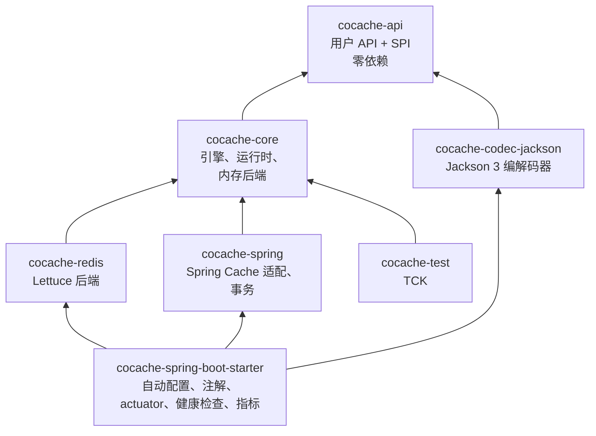
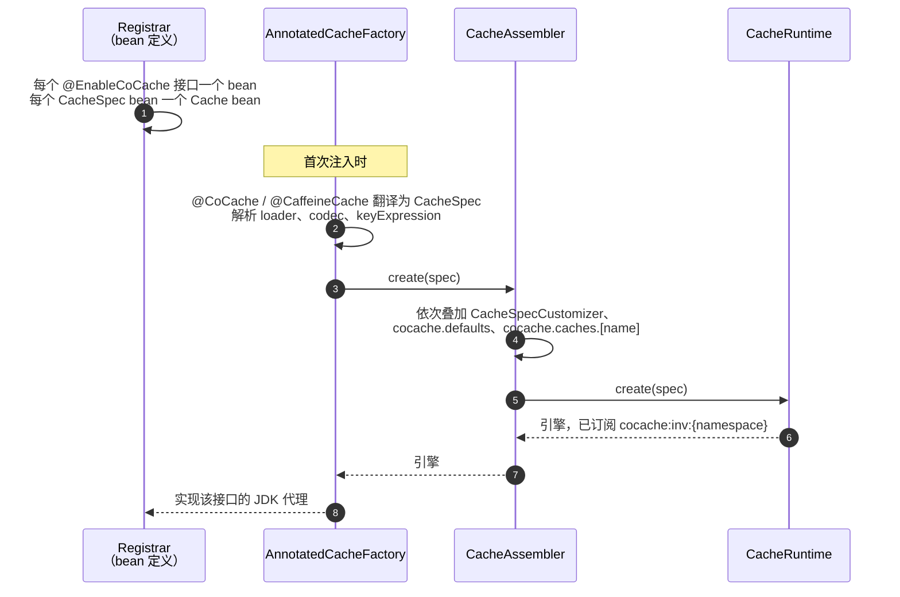

# 架构

本部分写给需要信任或扩展这套协议的工程师，讲 CoCache 是怎样构成的。[一致性](./consistency.md)论证它为什么不会丢失失效，[扩展](./extending.md)说明如何接入后端或编解码器。规范性的设计与修改时必须保持的每条不变量见 [`docs/architecture.md`](https://github.com/Ahoo-Wang/CoCache/blob/main/docs/architecture.md)。

## 目标 {#goals}

二级缓存用陈旧度换延迟。它只做三件事：把值**复制**到离读者更近的地方（填充），数据源变化时**销毁**副本（失效），让副本**老化**退出（TTL）。缓存的所有正确性问题都是同一种交错：一次开始于失效之前的复制，在失效之后才落地。CoCache 的设计来自三个目标：

| 目标 | 对你意味着什么 |
|------|----------------|
| **G1 陈旧度有上界** | 任何不一致都会在已知时间内自行愈合。协议内的竞态不会在 Redis 中留下陈旧值。CoCache 无从得知的变化最多持续 `ttl`。丢失一条消息，最多让一个实例的本地副本陈旧 `local-max-age`。[精确上界](./consistency.md#staleness-bounds) |
| **G2 失效不被吞没** | `invalidate` 返回之后，任何开始于它之前的加载都无法把旧值写回 Redis，也无法写回任何已处理该失效的实例。同一个实例不会再返回旧值 |
| **G3 命中路径便宜** | 本地命中是一次并发 map 查找加一次时间比较，随线程扩展。Redis 命中一次往返。`put`、`invalidate` 默认（原子广播）各一次往返，sharded 或非原子模式下各两次往返。同一个 key 的并发未命中在全集群只加载一次 |

**非目标**。线性一致读：在写入与其消息到达之间，其它实例可能返回之前的值。异步或协程 API：API 是同步的，在虚拟线程上工作良好。

**TTL 是安全网，不是机制**。协议内的竞态由栅栏消除，而不是靠等待过期。所以只要所有写入都走协议，`ttl-forever` 就是安全的。

## 模块 {#modules}



| 模块 | 内容 |
|------|------|
| `cocache-api` | `Cache`、`SetCache`、`Lookup`、`CacheLoader`、`Codec`、`CacheClock`、异常、注解（`@CoCache`、`@CaffeineCache`、`@JoinCacheable`）、`JoinCache`，以及 `me.ahoo.cocache.api.spi` 中的后端 SPI。没有运行时依赖 |
| `cocache-core` | `CacheSpec` / `SetCacheSpec`、`CachePolicy`、`CacheRuntime`、引擎、`SingleFlight`、`InvalidationStamps`、`CacheAdmin` / `CacheMetrics`、`RetryPolicy`、`ExternalInvalidator`、`CacheProxies`、`InMemoryBackend`、`TickingClock`、`ManualClock`。依赖 Caffeine |
| `cocache-redis` | `RedisBackend`：Lua 脚本、线格式、Pub/Sub 与 Sharded Pub/Sub 通道。依赖 Lettuce，不依赖 Spring |
| `cocache-codec-jackson` | `JacksonCodec`（Jackson 3，`tools.jackson`） |
| `cocache-spring` | `CoCacheSpringCacheManager`、`TransactionalInvalidator`。供不使用 Boot 的 Spring 应用 |
| `cocache-spring-boot-starter` | 自动配置、`@EnableCoCache`、注解翻译、spec bean 注册、`cocache.*` 配置项、actuator 端点、健康检查、Micrometer 绑定与 Spring Cache `sync` 检查 |
| `cocache-test` | 已发布的 TCK：`BackendProtocolSpec`、`EngineSpec`、`SetEngineSpec`、`HookedBackend` |
| `cocache-bom` | 版本对齐 |

依赖方向严格单向。注解解析与 SpEL 只出现在 starter 中，所以 core 既不需要 Spring 也不需要反射。新后端运行时只依赖 `cocache-api`，测试时依赖 `cocache-test`。

## 职责划分 {#responsibilities}

| 部分 | 负责 | 从不 |
|------|------|------|
| **数据源**（`CacheLoader`） | 返回值，或用 `null` 表示“不存在” | 决定寿命 |
| **策略**（`CachePolicy`） | 寿命、抖动、负缓存寿命、本地与降级限龄、刷新窗口、lease、回源并发、L2 容量、失败模式 | 执行任何动作 |
| **引擎**（`CoherentEngine`、`SetEngine`） | 逐层读穿透、合并回源、持有两层栅栏、安排写入顺序、处理失败、提前刷新 | 自己做远程存储 |
| **存储**（`RemoteStore`） | 在字节与令牌上执行 L1 协议。TTL、窗口与令牌都作为参数传入 | 了解值的类型或持有策略 |
| **通道**（`InvalidationChannel`） | 投递失效帧，并在消息可能丢失时通知订阅者 | 过滤或解释 key |
| **运行时**（`CacheRuntime`） | 每个进程一个：持有 `NodeId`、时钟、后端、刷新执行器与重试队列，并创建每个缓存 | 让两个缓存共享状态 |

存储与通道是同一个 `CoherenceBackend` 的两个面：串行化写入的一方也应该发出失效，能做到时在同一个原子步骤中完成。

## 运行时 {#runtime}

```kotlin
val backend = RedisBackend.standalone(RedisURI.create("localhost", 6379))
val runtime = CacheRuntime.builder().backend(backend).build()   // 每个进程一个

val users: Cache<String, User> = runtime.create(
    cacheSpec<String, User>("user") {
        codec = jacksonCodec<User>(mapper)
        loader = CacheLoader { id -> repository.findById(id) }
        policy { ttl = Duration.ofMinutes(10) }
    }
)
```

- spec 是不可变数据：名称、命名空间、key 前缀、key 编码器、编解码器、loader、`ttlOf`、key 过滤器与策略。用户只提供数据与无状态函数。
- `runtime.create` 构建缓存的每个有状态部分：L2、失效戳、SingleFlight 表、存储与订阅，两个缓存不可能意外共享其中任何一个。名称或命名空间重复时失败。
- `NodeId` 是每个运行时 16 个随机字节。它让令牌全局唯一，也让实例能忽略自己发出的消息。
- `close()` 按创建的逆序关闭订阅、引擎与存储，再关闭运行时自己创建的时钟与执行器。尚未执行的失效重试计入丢弃。后端由调用方关闭。

**时间**。`CacheClock` 返回纪元毫秒。默认的 `TickingClock` 每 100 ms 刷新一次 volatile 字段，在部分平台上比 `System.currentTimeMillis()` 更适合命中路径。到期时间只以相对时长跨网络传输（`PEXPIRE`、`PTTL`），所以实例之间的时钟偏差没有影响。测试注入 `ManualClock`。

## 从声明到 bean {#wiring}

starter 支持两种声明方式，最终得到同一个引擎。



| 方式 | bean 名 | bean |
|------|---------|------|
| 接口：`@CoCache interface UserCache : Cache<String, User>`，列在 `@EnableCoCache(caches = …)` 中 | 缓存名（`@CoCache(name)`，默认接口简单类名） | JDK 代理。`Cache` / `SetCache` 的方法按方法名分派给引擎，不经反射，异常原样到达调用方。接口中的 `default` 方法经 `InvocationHandler.invokeDefault` 执行 |
| spec bean：`@Bean fun userSpec(): CacheSpec<String, User>` | spec bean 名去掉 `Spec` 后缀（`userSpec` → `user`），没有该后缀时加 `Cache` | 引擎本身。`CacheSpecRegistrar` 从工厂方法声明的返回类型读取 `K` 与 `V`，不实例化 spec |
| 组合缓存：`@JoinCacheable interface …`，列在 `@EnableCoCache(joinCaches = …)` 中 | 组合缓存名 | 两个缓存之上的只读视图，按名称解析。见 [JoinCache](../guide/join-cache.md) |

策略分层，后者覆盖前者：内置默认值 → 声明 → `CacheSpecCustomizer` bean（按顺序）→ `cocache.defaults.*` → `cocache.caches.[name].*`。`key-prefix` 按同样的规则分层。所有单例创建完成后，如果 `cocache.caches` 中出现未声明的缓存，`CacheAssembler` 会让启动失败。有状态组件只按缓存名解析，从不按类型解析。

## 线格式 {#wire-format}

线格式在一个大版本内冻结。规范定义是 `RedisScripts` 与 `InvalidationFrame`。

| 部分 | 格式 |
|------|------|
| 存储 key | `{keyPrefix}{namespace}:{encodedKey}`，默认 `cocache:{cacheName}:{key.toString()}` |
| 值、负缓存、lease | Redis String：36 字节头，后接编解码器的字节 |
| 集合（`SetCache`） | Redis Hash：字段 `!f` 存格式版本（`"1"`），每个成员是一个值为空串的字段 `+{成员字节}` |
| 到期时间 | `PEXPIRE` / `PTTL`，毫秒，每次状态转换都显式重设 |
| 频道 | `cocache:inv:{namespace}`（不含 key 前缀） |
| 消息 | `[0x01][发布者 NodeId：16 字节][数量：varint]([长度：varint][存储 key：UTF-8])*` |

String 头：

| 偏移 | 长度 | 字段 |
|------|------|------|
| 0 | 1 | magic `0xC0` |
| 1 | 1 | 格式版本（`1`） |
| 2 | 1 | 状态：`V` 值、`M` 负缓存、`L` lease |
| 3 | 1 | 保留（`0`） |
| 4 | 24 | 令牌：`L` 状态下是 lease 令牌，`V` 状态下是刷新令牌，全零表示没有 |
| 28 | 8 | 令牌签发时间：服务端 `TIME` 的纪元毫秒，大端 IEEE 754 double |
| 36 | n | `Codec<V>` 的输出（`M` 与 `L` 没有载荷） |

令牌由签发它的运行时的 `NodeId`（16 字节）加进程内序号（8 字节）组成。令牌由客户端构造、永不重复，所以被销毁的令牌不可能再次匹配。

不是本协议写入的内容（没有 magic 字节、未知状态、没有 `!f` 的 Hash、其它 Redis 类型）以格式 `0` 读出，按损坏处理：仅在未变时回收，然后回源。高于实例所知的格式只会被绕开，从不被覆盖。两者结合使两阶段格式升级成为可能：先发布能读 N+1、仍写 N 的版本，再发布写 N+1 的版本。

## 固定与可插拔 {#pluggable}

| 部分 | 可插拔？ | 方式 |
|------|----------|------|
| L1 存储 + 失效通道 | 是 | 实现 `CoherenceBackend` 并通过 TCK。见[扩展](./extending.md#backend) |
| 值的字节 | 是 | `Codec<V>`，每个缓存一个。见[编解码器](./extending.md#codecs) |
| 数据源 | 是 | `CacheLoader<K, V>` |
| key 编码 | 是 | `KeyEncoder<K>` 或 `keyExpression` |
| 不可能存在的 key | 是 | `KeyFilter` |
| 按条目决定寿命 | 是 | `TtlFunction`（`ttlOf`） |
| 时钟 | 是 | `CacheClock`（测试） |
| 刷新执行器、重试策略 | 是 | `CacheRuntime.Builder.refreshExecutor`、`retryPolicy` |
| **L2** | **否** | 始终是有界的 Caffeine 缓存，让命中路径保持单态、成本可知。用 `local-maximum-size` 调整容量 |
| **栅栏、写入顺序、读路径** | **否** | 它们就是协议本身。见[一致性](./consistency.md) |
| 线格式 | 大版本内不可变 | 只能两阶段升级 |
