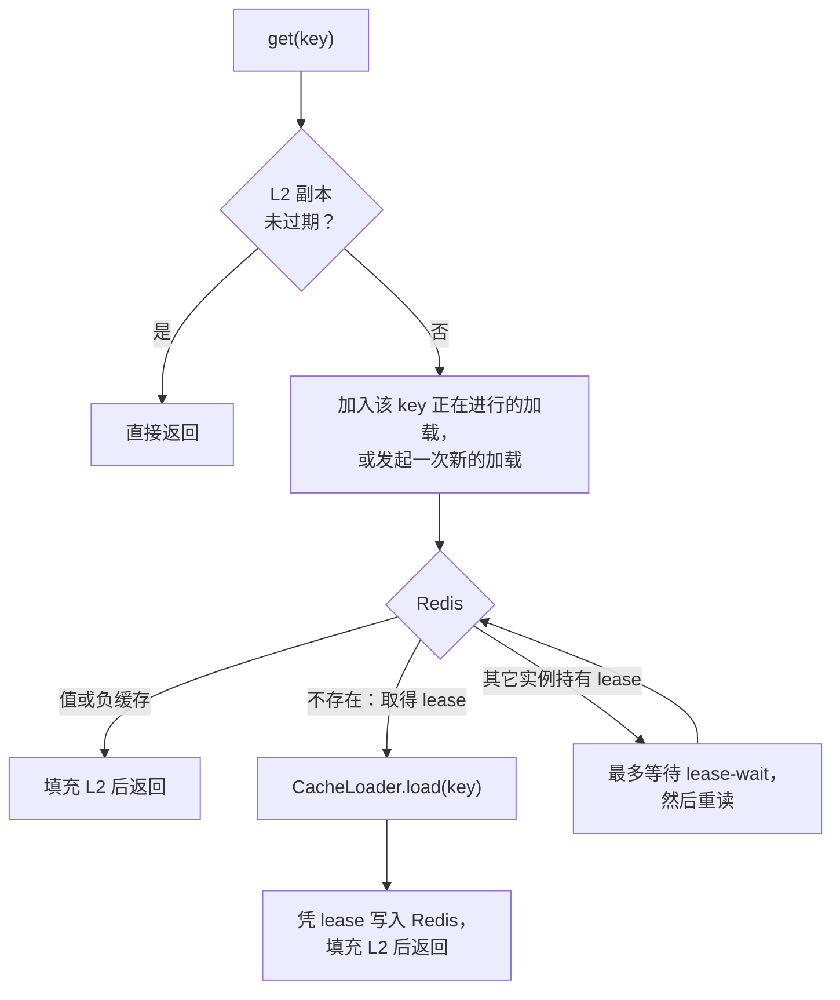
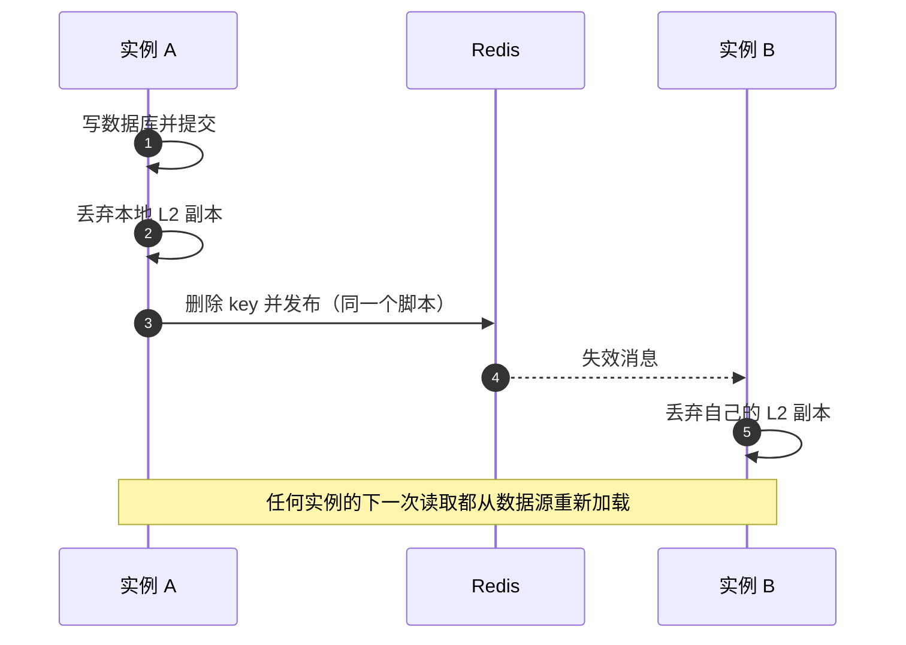

# 工作原理

本页讲清楚 CoCache 如何处理你的读取与写入，深度以用好它为准。协议本身以及它为什么正确，见[架构 › 一致性](../architecture/consistency.md)。

## 两级 {#levels}

| 层级 | 位置 | 存放 | 寿命 |
|------|------|------|------|
| **L2** | 每个实例内的 Caffeine | 最近读过的 key 的有界副本（默认 10 000 条） | Redis 中的剩余寿命，且不超过 `localMaxAge`（5 分钟） |
| **L1** | 所有实例共享的 Redis | 缓存值、负缓存，或加载期间的短暂 lease | 值为 `ttl` ± 抖动（1 小时 ± 1 分钟），负缓存为 `absentTtl`（1 分钟） |
| **数据源** | 你的 `CacheLoader` | 真实数据 | — |

L2 让读取变快。L1 让实例之间保持一致，也让数据库不至于每个实例都被加载一遍。

## 读路径 {#read-path}

1. **L2 命中。** 一次 Caffeine 查找加一次过期判断。没有 I/O，没有锁，也不计数。
2. **L2 未命中。** 本实例上的并发调用共享一次加载（`SingleFlight`），由领头的调用读取 Redis。
3. **L1 命中。** 值（或负缓存）进入 L2 并返回。
4. **L1 未命中。** 发现 key 不存在的那个 Redis 脚本同时把 **lease** 交给本实例。领头的调用在调用方线程上执行你的 loader，因此事务、安全上下文与 MDC 都可用。只有 lease 仍然完好时，结果才会写入 Redis。
5. **其它实例持有 lease。** 别的实例正在加载这个 key。本实例最多轮询 `lease-wait`（200 毫秒），通常就能拿到结果。等待超时则自行加载，但不写 Redis，结果在 L2 中只保留 `degradedLocalMaxAge`（10 秒）。

结果是：只要加载在 `lease-wait` 内完成，每个 key 在**整个集群只加载一次**。

`getAll(keys)` 批量地走同一条路径：逐个查 L2，剩余的 key 一次批量读 Redis，仍缺的 key 一次 `loadAll`，再一次批量写回。它不等待其它实例持有的 lease，这些 key 直接加载。

### 负缓存 {#negative-caching}

loader 返回 `null`（或 `loadAll` 的结果中缺少某个 key）时，CoCache 在 Redis 中写入一条**负缓存**，存活 `absentTtl`。此后对该 key 的读取直接返回 `null`，不再调用 loader，数据库不会被不存在的 key 反复查询。需要区分“确认不存在”（`Lookup.Absent`）与“有值”（`Lookup.Present`）时，用 `lookup(key)`。它的 `expiresAt` 是给出结果的那份副本的到期时间：命中 L2 时是 L2 副本的到期时间，受 `localMaxAge` 限制（未写入 Redis 的副本受 `degradedLocalMaxAge` 限制），因此可能早于 Redis 中的 TTL。精度为缓存时钟的刻度（默认 100 ms）。要查看某个 key 在 Redis 中的 TTL，用 [actuator 端点](../operations/observability.md#inspect-key)或 `CacheAdmin.inspect`。

Redis 中单纯没有这个 key 只是未命中，永远不等于负缓存。因此没有 loader 的缓存（只靠 `put` 填充）从不向 Redis 写负缓存：未命中返回 `null`，这个答案只在本实例记住，最多 `absentTtl`。

### 提前刷新 {#refresh-ahead}

设置了 `refreshWindow` 后，如果读到的值离 Redis 过期已经很近，读取会立即返回该值，并安排一次后台重新加载。只有在 Redis 中抢到刷新令牌的实例才调用 loader，所以集群对每个 key 只重新加载一次，其它实例从 Redis 读回刷新后的值。过期的值永远不会被返回；提前刷新只是消除热点 key 过期时的延迟尖刺。调优见[这里](./freshness.md#refresh-ahead)。

## 写路径 {#write-path}

修改数据分两步：**先写数据源，再失效**。

- **`invalidate(key)`** 在所有地方删除两级中的 key，同时销毁 lease，所以开始于失效之前的加载无法把旧结果写回。写入之后应该用的就是它。
- **`put(key, value)`** 覆盖 Redis 中的值，并广播同样的失效。只在写入方手里已有最终值时使用。`put` 有意**不填充本地 L2**：L2 只由读取从 Redis 填充，这样两次写入赛跑时，L2 与 Redis 的顺序始终一致。代价是本地下一次读取多一次 Redis 往返。

无论哪种，**同一实例**上的下一次读取都能看到变化（读己之写）。其它实例在消息到达时看到。

默认情况下删除与发布在同一个 Lua 脚本中执行，不存在“Redis 已改、其它实例却没收到通知”的窗口。`channel-mode: sharded` 时，发布作为单独的命令紧跟在脚本之后。

## 数据最多会陈旧多久？ {#staleness}

| 情形 | 陈旧度上界 |
|------|------------|
| 加载与失效赛跑（任何实例） | 无：旧结果被丢弃 |
| 其它实例，消息已送达 | Pub/Sub 送达延迟（毫秒级） |
| 其它实例，消息丢失 | `localMaxAge`（5 分钟）；心跳（5 秒）发现连接断开并清空 L2 时更早 |
| 绕过 CoCache 且不失效的写入 | `ttl`（1 小时）；`ttl` 永不过期时没有上界 |
| 查询缓存了“不存在”之后新建的行，且没有失效 | `absentTtl`（1 分钟） |
| 无法写入 Redis 的加载（Redis 故障、等待 lease 超时） | `degradedLocalMaxAge`（10 秒） |
| 在 Redis 上失败且重试耗尽的失效 | Redis 中该值的剩余寿命 |

`ttl` 是安全网，不是机制：协议之内的竞态由 lease 阻止，而不是靠过期来愈合。因此只要所有写入方都失效，`ttl` 永不过期也是安全的。

## Redis 故障时 {#failures}

| 故障点 | 默认行为 | 可选行为 |
|--------|----------|----------|
| 读取 Redis | 直接从数据源加载，结果只在 L2 中保留 `degradedLocalMaxAge`，不写 Redis。调用方照常工作，压力落到数据库上。 | `read-failure: throw` 抛出 `CacheReadException` |
| `invalidate` | 本地效果先生效。Redis 删除交给有界的后台重试队列，调用**不抛出**（它通常在提交之后执行，抛出也于事无补）。重试成功之前，该 key 的未命中跳过 Redis。 | `invalidate-failure: throw` 抛出 `CacheWriteException` |
| `put` | 抛出 `CacheWriteException`。结果可能未知（超时），但 `put` 是幂等的，可以安全重试。 | — |
| Pub/Sub 连接 | 心跳在数秒内发现。重连时每个实例清空 L2，而本地副本无论如何都受 `localMaxAge` 限制。期间健康检查报告 `DOWN`。 | — |
| 你的 loader | 异常抛给调用方以及所有等待同一次加载的调用方，不缓存任何东西。 | — |

Redis 故障期间，每次未命中都会打到数据库。用 `load-max-concurrent` 保护它：超出上限的加载最多等待 `load-acquire-timeout`（默认 1 s）获取名额，之后抛出 `SourceLoadRejectedException` 失败，而不是层层堆积。写入失败的细节见[保持数据新鲜](./freshness.md#redis-down)，排查见[故障排查](../operations/troubleshooting.md)。

## 延伸阅读 {#further-reading}

- [架构 › 一致性](../architecture/consistency.md)：栅栏机制，以及它为什么足够。
- [声明缓存](./caches.md)：把这套模型落到代码。
- [保持数据新鲜](./freshness.md)：写入、TTL 的选择与外部写入方。
