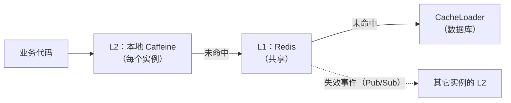

# 介绍

CoCache 是面向 Java 与 Kotlin 应用的二级一致性缓存。服务的每个实例都在数据源之前保留一份进程内副本（L2，Caffeine）和一份共享副本（L1，Redis）。CoCache 让所有实例的副本保持同步，并给出任何副本陈旧程度的硬上限。

缓存可以声明为带注解的接口，也可以声明为 `CacheSpec` bean，由 Spring Boot 完成装配。

## 要解决的问题

本地内存缓存读取最快，但每个实例各有一份副本：一个实例修改了数据，其它实例仍在返回旧值。Redis 这样的共享缓存解决了这个问题，但每次读取都要一次网络往返。

CoCache 两者都保留，并把它们连接起来：

- 读取依次尝试 L2、L1、`CacheLoader`，每一层未命中都会填充上面的层。
- `invalidate` 与 `put` 修改 L1 并广播失效，默认在同一个原子 Redis 脚本中完成。其它实例丢弃各自的 L2 副本。
- 同一 key 的并发未命中只加载一次，在实例内如此，在整个集群也如此，所以热点 key 过期不会击穿数据库。

## 能得到什么

| 关注点 | CoCache 的处理方式 |
|--------|--------------------|
| 读取延迟 | L2 命中是进程内查找，没有 I/O；L1 命中是一次 Redis 往返 |
| 跨实例的陈旧副本 | 写入与失效在修改 L1 的同一个 Redis 脚本中广播事件，其它实例丢弃 L2 副本 |
| 事件丢失 | 事件通道重连时清空 L2；心跳发现半开连接；无论如何，每个 L2 副本都在 `localMaxAge`（默认 5 分钟）后过期 |
| 缓存击穿 | 同一 key 的并发未命中在每个实例内只加载一次（`SingleFlight`），在整个集群只加载一次（L1 lease） |
| 缓存穿透（查询不存在的 key） | loader 返回 `null` 时写入负缓存，存活 `absentTtl`（默认 1 分钟） |
| 缓存雪崩（大量 key 同时过期） | 每个 TTL 加上不超过 `±ttlJitter` 的随机抖动 |
| 热点 key 过期时的延迟 | 可选的提前刷新：集群中只有一个节点在 key 过期前不久重新加载 |
| Redis 故障 | 默认读取降级为直接回源，失效在后台重试，显式写入抛出异常 |

## 保证

CoCache 用有界的陈旧换取延迟，并明确说明界限是多少。

- **陈旧度有界。** L1 副本在 `ttl`（默认 1 小时）后过期；即使所有失效事件都丢失，L2 副本也会在 `localMaxAge`（默认 5 分钟）后过期。
- **失效不会因竞态而丢失。** 开始于某次失效之前的加载，不能在失效之后把旧值写回：写回 L1 要持有 L1 lease，写回任何实例的 L2 要通过失效戳校验。
- **同一实例读己之写。** `invalidate(key)` 或 `put(key, …)` 返回后，同一实例不会再返回之前的值。

CoCache **不**提供跨实例的线性一致读。其它实例在收到失效事件后才看到变化，通常在毫秒级。精确的模型见[一致性](../architecture/consistency.md)。

## 什么时候用

适合使用 CoCache 的场景：

- 同一服务的多个实例访问共享数据；
- 读远多于写；
- 写入可以容忍其它实例晚几毫秒才看到变化。

不适合的场景：

- 每次读取都必须看到最新提交的写入（直接读数据库，或者加锁）；
- 数据几乎每次读取都在变化，缓存收益很小；
- 值太大，无法在每个实例的内存中各保留一份。

## 下一步

- [快速上手](./quick-start.md)：在 Spring Boot 应用中接入 CoCache。
- [配置](./configuration.md)：TTL、L2 容量、配置项，以及用代码构建缓存。
- [从 5.x 迁移](./migration-6.md)：6.0 的变化。
- [架构](../architecture/index.md)：CoCache 的内部结构。
