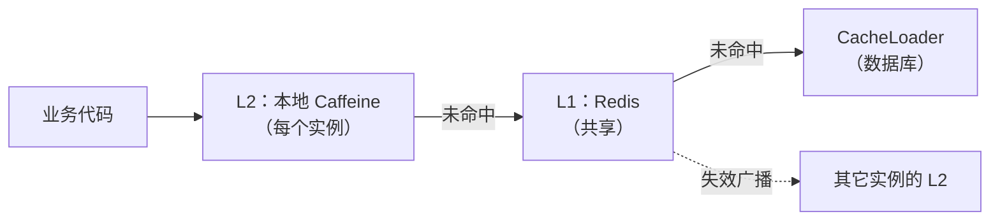

# 为什么选择 CoCache

## 问题 {#problem}

服务一遍又一遍地读同样的数据。让读取变便宜有两条显而易见的路，但各有代价：

- **Redis 这样的共享缓存。** 所有实例看到同一份数据，但每次读取仍是一次网络往返，通常几百微秒到一毫秒。对每秒被读几千次的热点 key，这往往就是请求耗时的大头。
- **Caffeine 这样的本地内存缓存。** 命中只要纳秒级，但每个实例各有一份副本。一个实例改了数据，其它实例继续返回旧值，直到过期。缩短 TTL 能减少偏差，命中率也随之崩塌。

常见的做法是把两者都放在数据库前面，再广播“删除 key X”的消息。朴素地实现，这个设计存在测试中很难发现的漏洞：

- 一次**开始于**更新之前的加载，可能在失效之后才**完成**，并把旧值写回去。缓存从此陈旧到 TTL 为止，没有任何机制会纠正它。
- 广播消息可能丢失（重连、半开的 TCP 连接）。本地副本如果没有最长寿命，就会一直错下去。
- 热点 key 过期时，所有实例的所有线程同时未命中，一起打到数据库上。

## CoCache 怎么做 {#what-it-does}

CoCache 就是这个二级设计，只是把漏洞都堵上了。

- **读取**依次尝试 L2、L1、你的 `CacheLoader`，每层未命中都会填充上一层。
- **写入与失效**修改 L1 并广播失效，默认在同一个原子 Redis 脚本中完成。其它实例丢弃各自的 L2 副本。
- **加载受 lease 保护。** L1 未命中时，读取方原子地取得该 key 的 lease。只有持有 lease 的一方才能把加载结果写入 Redis，而任何失效都会销毁 lease。所以开始于失效之前的加载，永远不可能在失效之后落地。本地则由失效戳对 L2 做同样的检查。
- **本地副本有最长寿命**（`localMaxAge`，默认 5 分钟），丢失的消息会自行愈合。
- **每个 key 只加载一次。** 实例内的并发未命中共享一次加载；其它实例短暂等待持有 lease 的一方，而不是各自加载。

你只需把缓存声明为带注解的接口（或 `CacheSpec` bean），提供一个 loader，然后调用 `get`、`getAll` 与 `invalidate`。[工作原理](./concepts.md)更深入地解释了这套模型。

## 保证 {#guarantees}

| 关注点 | 你得到什么 |
|--------|------------|
| 读取延迟 | L2 命中是进程内查找，没有 I/O，也没有共享计数器。L1 命中是一次 Redis 往返。 |
| 加载与更新赛跑 | 加载永远赢不了。开始于失效之前的加载，之后既写不进 Redis，也写不进本地内存。 |
| 其它实例上的陈旧 | 通常是一条 Pub/Sub 消息的送达时间。消息丢失时：最多 `localMaxAge`。 |
| CoCache 不知道的变更 | 绕过 CoCache 又不失效的写入，在 Redis 中的值过期时愈合（`ttl`，默认 1 小时）。 |
| 自己的写入 | `invalidate` 或 `put` 返回之后，同一实例上的下一次读取看到新状态。 |
| 缓存击穿 | 同一 key 的并发未命中，每个实例只加载一次；加载在 `lease-wait`（默认 200 毫秒）内完成时，全集群只加载一次。 |
| 不存在的 key | loader 返回 `null` 时写入负缓存，存活 `absentTtl`（默认 1 分钟）。 |
| 集中过期 | TTL 带随机抖动（默认 ±1 分钟），一起加载的 key 不会一起过期。 |

完整的陈旧度上界，包括 Redis 故障时的行为，见[工作原理](./concepts.md#staleness)。

## 它不做什么 {#limits}

- **不是线性一致的。** 失效到达之前的几毫秒里，其它实例可能还返回旧值。如果某次读取必须看到另一个实例同一时刻的写入，请直接读数据源。
- **看不到没人告诉它的写入。** 有东西改了数据库却不失效（批处理、其它服务、手写 SQL）时，缓存会陈旧到 `ttl`。这些写入方可以使用 [`ExternalInvalidator`](./freshness.md#external-writers)。
- **[JoinCache](./join-cache.md) 不是快照。** 它的两次读取相互独立，可能来自不同时刻。
- **[`SetCache`](./caches.md#set-cache) 的唯一副本在 Redis 中。** 它的持久性就是 Redis 的持久性。
- **内存后端只适用于单进程。** 它为开发与测试而存在。

## 什么时候不该用 {#when-not}

- **绝不能陈旧的数据**，比如余额、需要扣减的库存。直接读数据库，或使用数据库自身的锁。
- **单实例、没有 Redis。** 一个普通的 Caffeine 缓存更简单。
- **大多数读取之间都会变化的值。** 缓存会忙于失效，每次写入付出一次往返，收益甚微。
- **非常大的值**（MB 级）。Redis 与网络会成为瓶颈，而且一个大值会拖慢共享连接上的其它命令。
- **不允许阻塞的响应式或协程代码。** CoCache 的 API 是同步的；它在虚拟线程上运行良好。

## 环境要求 {#requirements}

- JDK 17 及以上
- Redis 7.0 及以上：单机、Sentinel 或 Cluster（不支持静态主从）
- 使用 starter 时：Spring Boot 4

下一步：[快速上手](./quick-start.md)。
