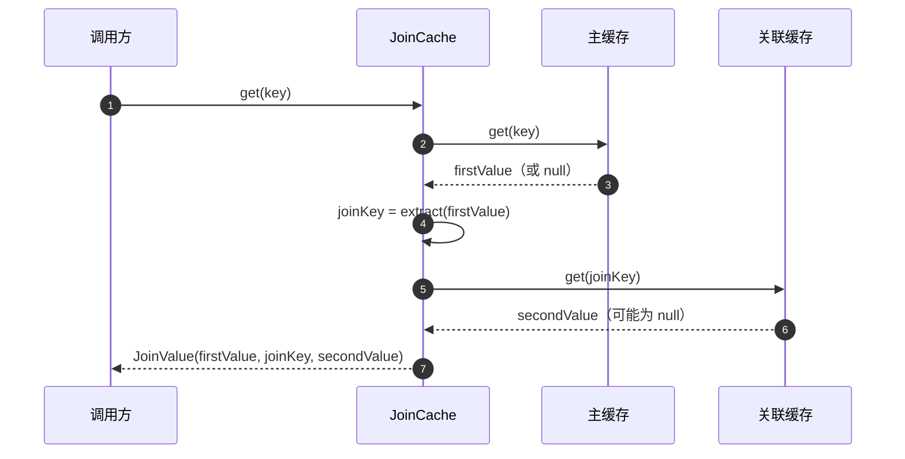

# JoinCache

很多读模型都是“一样东西加上它指向的东西”：订单与它的客户、资料扩展与它的用户。这两样你本来就都缓存了。`JoinCache` 把它们一起读出来：先从**主缓存**读一个值，从中推导出一个 key，再用这个 key 读**关联缓存**。



JoinCache 是一个**只读视图**。它不存储任何东西，没有 loader，也没有 `put`。两个组件缓存各自保有自己的 loader、TTL 与失效。

## 声明 {#declare}

两个组件缓存都是普通缓存，可以是接口式声明，也可以是 spec bean。视图是一个继承 `JoinCache<K1, V1, K2, V2>` 的接口，列在 `@EnableCoCache(joinCaches = …)` 中：

```kotlin
data class UserExtendInfo(val id: String, val userId: String)

@CoCache
interface UserExtendInfoCache : Cache<String, UserExtendInfo>

@CoCache
interface UserCache : Cache<String, User>

@JoinCacheable(
    firstCacheName = "UserExtendInfoCache",
    joinCacheName = "UserCache",
    joinKeyExpression = "#{#root.userId}",   // 以主值为根对象求值
)
interface UserExtendInfoJoinCache : JoinCache<String, UserExtendInfo, String, User>

@EnableCoCache(
    caches = [UserExtendInfoCache::class, UserCache::class],
    joinCaches = [UserExtendInfoJoinCache::class],
)
@SpringBootApplication
class App
```

像注入其它 bean 一样注入 `UserExtendInfoJoinCache`。它的 bean 名就是视图名。

| `@JoinCacheable` 属性 | 含义 |
|-----------------------|------|
| `name` | 视图名，也是 bean 名。默认取接口简单类名。 |
| `firstCacheName` | **必填。** 主缓存的名字（接口式缓存的缓存名，或 spec 缓存的缓存名 / bean 名）。 |
| `joinCacheName` | **必填。** 关联缓存，规则相同。 |
| `joinKeyExpression` | 以主值为根对象的 SpEL 模板，如 `#{#root.userId}` 或 `#{userId}`。要求 `K2 = String`。 |
| `joinKeyExtractor` | 一个 `JoinKeyExtractor<V1, K2>` 的 bean 名。 |

## 关联 key {#join-key}

三种方式选一种：

1. **`joinKeyExpression`**：SpEL 模板，只适用于 `String` 类型的关联 key。
2. **`joinKeyExtractor = "beanName"`**：任意关联 key 类型。
3. **都不设置**：使用唯一的 `JoinKeyExtractor<V1, K2>` 类型 bean。

```kotlin
@Bean
fun userIdOf() = JoinKeyExtractor<UserExtendInfo, String> { it.userId }
```

关联 key 为 `null` 表示“没有可关联的”：结果中 `joinKey = null`、`secondValue = null`，并且不读取关联缓存。表达式求值为 `null` 时同样如此。

## 每个调用做什么 {#semantics}

| 调用 | 行为 |
|------|------|
| `get(key)` | 读主缓存（未命中时加载）。不存在或是负缓存：返回 `null`。否则提取关联 key 并读关联缓存；关联值不存在时 `secondValue = null`。 |
| `getAll(keys)` | 对主缓存一次 `getAll`，再对**去重后**的非空关联 key 做一次关联缓存的 `getAll`（没有关联 key 时跳过）。结果只包含主值存在的 key。 |
| `invalidate(key)` | **只失效主缓存。** 关联值被其它条目共享，由它自己的写入方负责。 |
| `invalidate(firstKey, joinKey)` | 两者都失效。一方抛出时另一方照常执行，异常合并后抛出。作为组成部分的 `SetCache` 不支持 `invalidate`（直接对集合使用 `clear`）。 |

因为 `getAll` 就是两次批量读取，列出指向 20 个用户的 100 条扩展信息，每个缓存最多只需一次批量 Redis 读取和一次 `loadAll`，与有多少条目共享同一个用户无关。

## 保证与限制 {#guarantees}

- 每次读取都经过组件缓存，它们的保证原样适用：受栅栏保护的加载、失效、`localMaxAge`。
- **两个缓存之间没有快照。** 两次读取相互独立，组合出的一对值可能来自不同时刻。如果主值在两次读取之间换了关联 key，在主缓存被失效之前你会看到旧的配对。
- `User` 变化时，在 `UserCache` 上失效它。所有读取它的视图在下一次调用时都会看到变化。

## 添加方法 {#methods}

default 方法在代理上执行：

```kotlin
interface UserExtendInfoJoinCache : JoinCache<String, UserExtendInfo, String, User> {
    fun userOf(id: String): User? = get(id)?.secondValue
}
```

对应不上任何 `JoinCache` 方法的抽象方法会让启动失败。

## 启动检查 {#validation}

以下情形启动失败，错误信息指出视图与属性：

- `firstCacheName` 或 `joinCacheName` 为空，或对应不上任何缓存，
- 指定的缓存不是 `Cache<K1, V1>`（或 `Cache<K2, V2>`），
- 接口的类型参数不是具体类型，或缺少 `@JoinCacheable`，
- `joinKeyExpression` 中没有 `#{…}`（会成为常量，所有值都关联到同一个 key），或 `joinKeyExtractor` 指定的 bean 不是 `JoinKeyExtractor<V1, K2>`，
- 同时设置了 `joinKeyExpression` 与 `joinKeyExtractor`、对非 `String` 的关联 key 使用 `joinKeyExpression`，或按类型查找提取器时找到零个或多个 bean。

## 不用 Spring {#without-spring}

`cocache-core` 中的 `SimpleJoinCache` 是实现，`JoinCacheProxies` 把它包装成你的接口：

```kotlin
val view = SimpleJoinCache("UserExtendInfoJoinCache", userExtendInfoCache, userCache) { info -> info.userId }
val typed = JoinCacheProxies.create(UserExtendInfoJoinCache::class.java, view)
```
