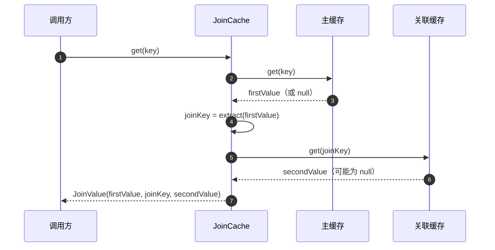

# JoinCache

`JoinCache` 先从一个缓存（*主缓存*）读取值，从中提取一个 key，再用这个 key 读取第二个缓存（*关联缓存*）。一次调用返回两个值。典型场景是“订单 + 下单客户”或“扩展信息 + 所属用户”。

JoinCache 是**只读视图**：它没有自己的副本、没有数据源，也没有 `put`。两个组件缓存各自保持自己的数据源、TTL 与失效，视图只是经由它们读取。它不是 `Cache` 的子类型。



## 声明 {#declare}

两个组件缓存都是普通的 CoCache 缓存，可以是接口式声明，也可以是 `CacheSpec` bean。把视图声明为继承 `JoinCache<K1, V1, K2, V2>` 的接口，并列在 `@EnableCoCache(joinCaches = …)` 中：

```kotlin
data class UserExtendInfo(val id: String, val userId: String)

@CoCache(keyPrefix = "userExtendInfo:")
interface UserExtendInfoCache : Cache<String, UserExtendInfo>

@CoCache(keyPrefix = "user:")
interface UserCache : Cache<String, User>

@JoinCacheable(
    firstCacheName = "UserExtendInfoCache",
    joinCacheName = "UserCache",
    joinKeyExpression = "#{#root.userId}",   // 以主值为根对象求值
)
interface UserExtendInfoJoinCache : JoinCache<String, UserExtendInfo, String, User>

@EnableCoCache(
    caches = [UserExtendInfoCache::class, UserCache::class],
    joinCaches = [UserExtendInfoJoinCache::class],
)
@SpringBootApplication
class AppServer
```

starter 把视图注册为接口类型的 bean，bean 名为 `@JoinCacheable(name)`，默认是接口简单类名（`UserExtendInfoJoinCache`）。

| `@JoinCacheable` 属性 | 含义 |
|-----------------------|------|
| `name` | 视图名，也是 bean 名。默认接口简单类名 |
| `firstCacheName` | **必填。** 按名称引用主缓存：接口式缓存的缓存名，或 spec 缓存的缓存名 / bean 名 |
| `joinCacheName` | **必填。** 按同样的规则引用关联缓存 |
| `joinKeyExpression` | 以主值为根对象的 SpEL 模板，如 `#{#root.userId}` 或 `#{userId}`。要求 `K2 = String` |
| `joinKeyExtractor` | `JoinKeyExtractor<V1, K2>` 的 bean 名 |

以下情况启动失败，错误信息给出视图名与属性：名称为空或找不到对应的缓存、缓存类型不是 `Cache<K1, V1>`（或 `Cache<K2, V2>`）、泛型参数不是具体类型。

## 关联 key {#join-key}

三选一：

1. **`joinKeyExpression`**：SpEL 模板，语法与 `@CoCache(keyExpression)` 相同，以主值为根对象。只适用于关联 key 类型为 `String` 的情况。
2. **`joinKeyExtractor = "beanName"`**：适用于任意关联 key 类型。
3. **两者都不设置**：使用唯一的 `JoinKeyExtractor<V1, K2>` 类型的 bean。没有或有多个候选时启动失败。

同时设置 `joinKeyExpression` 与 `joinKeyExtractor` 会导致启动失败。

```kotlin
@Bean
fun userIdExtractor() = JoinKeyExtractor<UserExtendInfo, String> { it.userId }
```

关联 key 为 `null` 表示“该值没有关联”：结果的 `joinKey` 与 `secondValue` 都为 `null`，不读关联缓存。表达式求值为 `null` 时同样如此。

## 语义 {#semantics}

| 操作 | 行为 |
|------|------|
| `get(key)` | 读取主缓存（未命中时由主缓存自己的数据源回源）。主值不存在（含负缓存）时返回 `null`；否则提取关联 key 并读取关联缓存。关联值不存在时 `secondValue = null` |
| `getAll(keys)` | 两次批量读取：主缓存一次 `getAll`，关联缓存按**去重后**的非空关联 key 一次 `getAll`（没有关联 key 时不读）。结果只包含主值存在的 key |
| `invalidate(key)` | **只失效主缓存**。关联值被其它条目共享，由它自己的写入方负责失效 |
| `invalidate(firstKey, joinKey)` | 同时失效两个缓存 |

JoinCache 本身不增加任何一致性逻辑：每次读取都经由组件缓存，所以它们的保证（受栅栏保护的填充、失效、`localMaxAge`）原样适用。两次读取之间没有原子性，两个值可能来自不同时刻。`User` 变更时，在 `UserCache` 中失效它，所有读取它的视图在下一次调用时都会看到新值。

接口中可以添加 default 方法，由代理执行：

```kotlin
interface UserExtendInfoJoinCache : JoinCache<String, UserExtendInfo, String, User> {
    fun userOf(id: String): User? = get(id)?.secondValue
}
```

`JoinCache` 以外的抽象方法会导致启动失败，请声明为 default 方法。

## 不使用 Spring {#without-spring}

实现是 `cocache-core` 中的 `SimpleJoinCache`，`JoinCacheProxies` 把它包装为你的接口：

```kotlin
val view = SimpleJoinCache("userExtendInfoJoin", userExtendInfoCache, userCache) { info -> info.userId }
val typed = JoinCacheProxies.create(UserExtendInfoJoinCache::class.java, view)
```

## 下一步

- [快速上手](./quick-start.md#composing-caches)：示例应用使用了这个视图。
- [从 5.x 迁移](./migration-6.md#joincache)：与 5.x 相比的变化。
